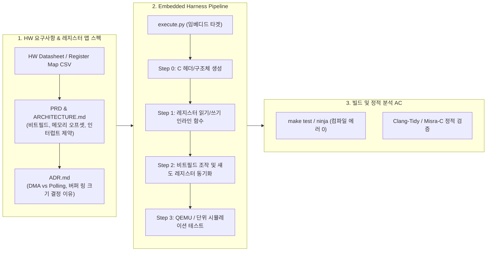

# AI 시대의 새로운 패러다임 | Spec-Driven Development (스펙 주도 개발과 하네스 프레임워크)

> **강의 출처**: [실밸개발자 YouTube (2026. 09. 24 공개)](https://www.youtube.com/watch?v=v6UAPUnOSxA)  
> **강사/화자**: 실밸개발자 (하재상 / 실리콘밸리 빅테크 시니어 소프트웨어 엔지니어)  
> **공식 GitHub**: [jha0313/harness_framework](https://github.com/jha0313/harness_framework)  
> **영상 러닝타임**: 1시간 1분 07초 (3,667초 / 25개 전 챕터 분석)  
> **실전 프로젝트**: GPT-Image-2 기반 YouTube 썸네일 생성기 웹 애플리케이션 (Next.js / TypeScript / Python 오케스트레이터)

---

## 🌟 1. Executive Summary & AI 실전 활용 5대 멘탈 모델


### 💡 핵심 결론 (Core Takeaways)
1. **TDD의 한계와 SDD의 필연성**:
   - TDD(Test-Driven Development)는 "어떻게 동작해야 하는가"가 이미 명확한 영역(버그 수정, 단일 함수, 레거시 인터페이스)에는 강력하지만, **"무엇을 만들지부터 모호한 자리"**(신규 SaaS, 모듈 아키텍처 설계, 신규 프로토콜 스택)에서는 테스트를 먼저 쓰기가 불가능함.
   - **SDD(Spec-Driven Development)**는 자연어 스펙(자연어 명세서)을 먼저 작성하고, 그 스펙으로 AI 에이전트가 **계획 ➡️ 구현 ➡️ 자가 검증**까지 자율 루프로 완수하게 만드는 차세대 엔지니어링 패러다임임.
2. **개발자의 역할 전이 (Author ➡️ Reviewer / Architect)**:
   - 엔지니어는 더 이상 타이핑하는 코더(Author)가 아니라, **판단을 내리고 경계를 긋는 설계자(Reviewer & Decision Maker)**로 진화함.
   - 코딩의 비용과 속도는 AI로 인해 사실상 0에 수렴하므로, 엔지니어링의 병목은 오직 **"스펙 정의(Design)"**와 **"결과물 검토(Review)"**로 이동함.
3. **메인 세션 컨텍스트 오염(Context Bloat) 원천 차폐**:
   - 대화형 CLI(Claude Code, ChatGPT)에서 단일 세션을 길게 유지하며 5~7개 스텝을 연속 수행하면, 컨텍스트 윈도우 사용량이 120k~150k를 초과하면서 **환각, 지시사항 망각, 코드 품질 급락**이 발생함.
   - 하네스 프레임워크(`execute.py`)는 `claude -p`(헤드리스 모드)를 통해 **각 Step마다 완전히 격리된 1회용 독립 서브프로세스를 기동**하고, 이전 Step의 산출물 요약(`summary`)과 핵심 가드레일(`CLAUDE.md`, `docs/*.md`)만 주입함으로써 컨텍스트 오염을 100% 차단함.
4. **회고(Reflection)를 통한 복리 성장 시스템**:
   - 에이전트가 실패하거나 실수를 저질렀을 때 단순히 코드를 수동 수정하고 넘어가면 다음 세션에서 똑같이 실패함.
   - 실수의 근본 원인을 `CLAUDE.md`의 CRITICAL 규칙, ADR(Architecture Decision Record), 또는 스킬로 외부화하여 시스템 자체를 개량해야 함. **"50번째 세션은 첫 번째 세션보다 압도적으로 생산적이어야 한다."**

---

### 🧠 SDD를 위한 5대 사고방식 전환 (5 Mindset Shifts)

| 번호 | 사고방식 전환 | 기존 전통적 방식 | SDD / AI-Native 방식 |
| :---: | :--- | :--- | :--- |
| **01** | **Spec First, Code Second** | 일단 IDE를 켜고 코드나 테스트부터 작성 | 코드를 건드리기 전에 자연어 스펙부터 작성. 모호한 스펙은 끝없는 재작업 유발 |
| **02** | **Reviewer, Not Author** | 개발자가 직접 코드 구문 하나하나 타이핑 | AI에게 코딩을 전권 위임하고, 인간은 아키텍처·엣지케이스·도메인 맥락 판단에 집중 |
| **03** | **Externalize Mental Context** | 코딩 컨벤션, 의도, 패턴을 개발자 머릿속에만 보관 | 머릿속 지식을 `CLAUDE.md`, `PRD.md`, `ADR.md`로 100% 문서화하여 에이전트에 공급 |
| **04** | **Attention on the Front-end (Design)** | 구현, 디버깅, 코드 작성에 80% 이상의 시간 투입 | 스펙 설계와 기획 단계에 주의력의 80%를 집중. 설계가 가장 가치 있는 병목 |
| **05** | **Closed Learning Loop** | 문제 발생 시 일회성 핫픽스 적용 후 종료 | 에이전트 실패를 시스템 개선 기회로 전환. 반성문을 규칙으로 영구 승격시켜 복리 개선 |

---

## 📖 2. 강의 전수 상세 요약 (All 25 Chapters Zero-Loss Breakdown)

### Chapter 01: 추석 인사 & 무료 공개 안내 (00:00 - 01:12)
- 패스트캠퍼스 실밸 바이브코딩 유료 강의 중 가장 핵심적이고 파괴적인 챕터(Spec-Driven Development)를 추석 연휴를 맞아 무료 공개함.
- 매일 AI를 사용하는 파워 유저 및 현업 개발자가 반드시 장착해야 할 패러다임 시프트 소개.

### Chapter 02: TDD의 한계, 그리고 Spec-Driven Development (01:12 - 03:04)
- 직전 챕터에서 다룬 TDD(Test-Driven Development)는 "테스트 없이는 구현을 작성하지 못하게 막는 훅(Test-First Guard)"을 두어 버그 수정이나 소규모 함수 작성에는 매우 탁월했음.
- 그러나 **새로운 도메인 모듈, 신규 SaaS, 아키텍처를 맨 처음 기획하는 단계**에서는 "무엇을 만들어야 할지" 자체가 모호하여 테스트 케이스 자체를 정의할 수 없는 치명적 한계가 존재함.
- 해결책으로 **자연어 스펙(Natural Language Spec)**을 선행 작성하고, 그 스펙으로 코드 생성과 검증을 자율 주도하는 **SDD(Spec-Driven Development)**를 제시함.
- 스펙 작성 자체는 Claude, Codex 등 현대 LLM이 뛰어나므로, 엔지니어가 갖춰야 할 진짜 역량은 **"좋은 스펙의 기준을 판별하고, 에이전트가 이를 자율 실행하도록 오케스트레이션하는 하네스(Harness)"**를 구축하는 것임.

### Chapter 03: SDD가 작동하려면 먼저 바꿔야 할 5가지 사고 (03:04 - 06:31)
- 도구 도입 전에 5가지 사고방식 전환이 선행되어야 함:
  1. **Spec First, Code Second**: 명확한 스펙은 단번에 프로덕션 코드로 직행하지만, 모호한 프롬프트는 무한 수정 핑퐁으로 이어짐.
  2. **Reviewer, Not Author**: 인간은 코더가 아닌 판사(Judge). 쉬운 코딩은 AI에 넘기고, 어려운 판단(아키텍처, 엣지케이스, 제약)을 인간이 맡음.
  3. **지식의 외부화(Externalization)**: 머릿속 암묵지(패턴, 컨벤션, 의도)를 문서로 꺼내지 않으면 AI는 절대 알 수 없음.
  4. **설계가 유일한 병목**: 코딩 인력을 늘려 병목을 해결하던 시대는 끝남. AI 1개가 100명의 코딩 생산성을 내므로 설계에 집중해야 함.
  5. **학습 루프 구축**: AI의 실패는 시스템 개량의 기회. 50번째 세션이 첫 번째 세션보다 똑똑해야 함.

### Chapter 04: SDD 5단계 루프: 설계 → 계획 → 구현 → 교정 → 회고 (06:31 - 08:46)
- **1단계: 설계 (Design - 인간 주도, AI 보조)**: 무엇을 왜 만드는지, 아키텍처와 기술 결정(ADR), 조직 제약을 문서화함.
- **2단계: 계획 (Plan - AI 주도, 인간 승인)**: 문서를 바탕으로 AI가 작업을 작은 단위의 Step으로 분할하고 계획을 수립함. 인간은 이를 리뷰하고 승인함.
- **3단계: 구현 (Execute - AI 자율 실행)**: 승인된 Step을 순차 실행하며 컴파일 및 단위 테스트를 통과할 때까지 자율 코딩함.
- **4단계: 교정 (Correct - 인간 주도 피드백)**: 출력물을 인간이 검토하고, 시스템 설계와 프롬프트를 교정함.
- **5단계: 회고 (Reflect - 지식 자산화)**: 학습한 교훈을 `CLAUDE.md`나 스킬, 메모리에 반영하여 루프를 완성함.

### Chapter 05: 좋은 스펙의 5가지 요소 (08:46 - 10:51)
- 스펙은 길 필요가 없으나 아래 5가지는 반드시 포함되어야 함:
  1. **입출력 및 관측 가능한 동작 (Inputs & Outputs)**: 명확한 입력과 기대 출력.
  2. **성공 기준 (Success Criteria & Value)**: 왜 만드는지, 어떻게 측정이 가능한 성공인지(AC).
  3. **제약 사항 (Constraints)**: 응답 속도, 라이브러리 제한, 프레임워크 관례 등 넘지 말아야 할 경계.
  4. **범위와 경계 (Scope & Out-of-Scope)**: 이번 MVP에서 절대 하지 않을 것들을 명시(AI의 오버엔지니어링 억제).
  5. **엣지 케이스 (Edge Cases)**: 비정상 입력, 네트워크 장애, 권한 에러 시의 동작.
- 처음에 혼자 완벽히 쓸 수 없으므로, 5~10줄의 초안을 던지고 AI와 3~4회 티키타카(확장 ➡️ 비판적 검토 ➡️ 교정)를 거쳐 완성함.

### Chapter 06: 스펙 체크리스트 (10:51 - 12:23)
- 스펙 검증 체크리스트 항목:
  - 수용 조건(AC)이 측정 가능한가? (예: 지연시간 < 100ms, 캐시 히트율 > 70%, `npm test` 통과)
  - 엣지 케이스가 정의되어 있는가?
  - 제약과 비기능적 요구사항이 있는가?
  - Out-of-scope(제외 범위)가 명확한가?
  - 인터페이스 시그니처가 명시되었는가? (레고 블록처럼 큰 모듈 인터페이스만 정의하고 내부 구현은 에이전트에 위임)

### Chapter 07: 프로젝트가 커질 때: 계층형 스펙 (12:23 - 13:40)
- 단일 대형 스펙 파일은 컨텍스트 압축 과정에서 유실됨.
- **마스터 스펙(Master Spec)** 아래에 **컴포넌트 스펙(Component Specs)**을 계층형으로 분리.
- 각 컴포넌트 스펙은 단일 AI 세션 컨텍스트 안에 온전히 들어가는 크기로 설계하여 세션 독립성을 유지함.

### Chapter 08: 실습 시작 — 하네스 프레임워크 가져오기 (13:40 - 15:19)
- 공식 저장소 `https://github.com/jha0313/harness_framework`를 Claude Code 세션에 제공하고 프로젝트에 이식 요청.
- 기존 TDD 가드 훅과 병합하여 기본 뼈대 준비.

### Chapter 09: PRD · Architecture · ADR · CLAUDE.md 구조 (15:19 - 16:24)
- 에이전트가 읽고 실행할 4대 핵심 스펙 문서의 역할:
  - `PRD.md`: 제품 목표, 사용자 페르소나, 핵심 기능, MVP 제외 사항.
  - `ARCHITECTURE.md`: 디렉토리 구조, 디자인 패턴, 데이터 흐름, 상태 관리.
  - `ADR.md`: 아키텍처 결정 레코드 (기술 선택, 이유, 트레이드오프).
  - `CLAUDE.md`: 절대 어기면 안 되는 CRITICAL 규칙 및 빌드/테스트 커맨드.

### Chapter 10: ADR이 중요한 이유: 결정에는 반드시 이유가 있다 (16:24 - 18:46)
- **ADR(Architecture Decision Records)의 절대적 가치**:
  - 엔지니어가 내린 모든 기술 선택(예: Next.js App Router, 외부 API 전용 라우트 분리)에는 고유한 배경과 포기한 것(트레이드오프)이 존재함.
  - 이 이유를 코드 주석이나 문서에 남기지 않으면, 다음 에이전트 세션이 임의로 구조를 뒤엎거나 안티패턴을 도입하게 됨.
  - 에이전트에게 "무엇을 선택했는가, 왜 선택했는가, 무엇을 포기했는가"를 알려주어 일관된 의사결정을 유지시킴.

### Chapter 11: AI와 티키타카로 스펙 다듬기 (썸네일 생성기) (18:46 - 23:46)
- 실습 주제: `GPT-Image-2` API 기반 YouTube 썸네일 생성 웹 서비스.
- 사용자가 구두로 5줄 초안 프롬프트(인풋, 아웃풋, 타겟 유저, 목적)를 입력하고, Claude Code의 Sub-agent(Explore)가 저장소를 분석하며 기획을 구체화함.
- 지식 컷오프 한계를 극복하기 위해 API 스펙을 탐색하고 프랜을 수립함.

### Chapter 12: Fast Mode는 정확히 무엇이 빨라지는가 (23:46 - 26:02)
- Claude Code의 `Fast Mode` 설명: 모델을 다운그레이드하지 않고 추론 품질을 유지한 채 출력 토큰 생성 속도를 대폭 가속하는 모드.
- 실습 진행 속도를 높이기 위해 활성화.

### Chapter 13: "플랜이 아주 빈약해" — 다시 돌리기 (26:02 - 27:38)
- AI가 1차로 생성한 계획이 너무 단순하고 빈약함을 지적: "플랜이 아주 빈약해. 특히 유저 저니와 에러 핸들링이 부족해."
- 비판적 검토(Critique)를 통해 사용자 유저 플로우, 폼 유효성 검증, API 실패 시 재시도 전략을 포함하도록 프롬프트를 재주입.

### Chapter 14: harness 워크플로우와 스텝 설계 원칙 (27:38 - 29:16)
- `/harness` 슬래시 커맨드의 동작 구조와 7대 스텝 설계 원칙:
  1. Scope 최소화 (한 step에 하나의 모듈만)
  2. 자기완결성 (독립 세션이므로 외부 참조 금지)
  3. 사전 준비 강제 (읽을 파일 경로 명시)
  4. 시그니처 수준 지시 (인터페이스만 제시, 내부 구현은 에이전트 재량)
  5. AC는 실행 가능한 커맨드 (`npm test`)
  6. 주의사항은 "X 하지 마라. 이유: Y" 형식
  7. Kebab-case 네이밍

### Chapter 15: 유저 저니 · 에러 핸들링 매트릭스 · 와이어프레임 (29:16 - 36:02)
- 2차 피드백 후 AI가 보강한 산출물 검토:
  - 폼 작성 ➡️ 유효성 검증 ➡️ 실패 시 인라인 피드백 ➡️ 성공 시 16:9 썸네일 2종 동시 생성 다이어그램.
  - 에러 처리 매트릭스 (API Rate Limit, 네트워크 에러, 권한 에러 대응).
  - 텍스트 와이어프레임 기반 UI 레이아웃 확정.
- 오버엔지니어링 금지 및 MVP 목적 부합성 최종 확인 후 승인.

### Chapter 16: claude -p 헤드리스 모드란 (36:02 - 38:31)
- 대화형 인터페이스 없이 터미널에서 1회성 명령을 실행하는 `claude -p` (Print/Headless) 모드 분석.
- "방 청소하고 와"라는 쪽지를 전달하면, 대화형 UI 없이 서버에서 백그라운드로 작업을 수행하고 결과 JSON만 표준 출력으로 반환함.

### Chapter 17: 메인 컨텍스트가 커지는 걸 두려워해야 하는 이유 (38:31 - 40:44)
- **컨텍스트 블로트(Context Bloat)의 치명성**:
  - 메인 세션에서 Step 1부터 Step 7까지 모든 코드를 작성하게 시키면, 컨텍스트가 120k~150k로 급증하면서 모델 성능이 30~40% 수준으로 붕괴함.
  - Step 6, 7 단계의 코드는 사실상 버려야 할 정도로 질이 떨어짐.
  - **해결책**: 메인 세션은 오케스트레이션(계획·스펙)만 맡고, 실제 구현은 각 Step마다 `claude -p`를 통해 **깨끗한 1회용 독립 세션**을 열어 수행함.

### Chapter 18: claude -p 과금 전환과 Codex 대안 (40:44 - 44:45)
- 최근 Anthropic 정책 변경으로 `claude -p`가 일반 구독 한도가 아닌 API 토큰 종량제 과금으로 전환된 이슈 언급.
- 대안으로 OpenAI Codex CLI 또는 Gemini API 기반 스크립트로 오케스트레이터의 백엔드를 교체하여 비용을 절감하는 전략 설명.

### Chapter 19: API 키는 절대 터미널에 붙여넣지 마세요 (44:45 - 45:22)
- **보안 가드레일**: API 키를 대화창이나 터미널 명령행에 직접 붙여넣지 말 것.
- 세션 로그, 쉘 히스토리, 원격 터미널 탈취 공격을 방지하기 위해 반드시 `.env` 파일 또는 환경 변수 파일에만 기입할 것을 강조.

### Chapter 20: Step 0~4 자동 실행 지켜보기 (45:22 - 48:55)
- `python3 scripts/execute.py 0-mvp` 실행:
  - Step 0 (project-setup): Next.js 스캐폴딩, 의존성 설치, 빌드 통과 ➡️ 자동 커밋.
  - Step 1 (domain-types): 프롬프트 빌더, 도메인 타입 정의 ➡️ 자동 커밋.
  - Step 2 (openai-service): OpenAI 이미지 생성 서비스 래퍼 ➡️ 자동 커밋.
  - Step 3 (api-routes): Next.js API Route 핸들러 ➡️ 자동 커밋.
  - Step 4 (ui-components): 반응형 프론트엔드 UI 및 생성 갤러리 ➡️ 자동 커밋.
- 인간 개입 없이 터미널 스피너와 함께 전자동으로 통과하는 과정 실시간 시연.

### Chapter 21: 리모트 컨트롤 + caffeinate 팁 (48:55 - 53:43)
- 실무 엔지니어링 꿀팁:
  - 장시간 실행되는 에이전트 작업을 모바일(스마트폰) Claude Code 원격 세션으로 모니터링 및 승인.
  - 맥OS/리눅스에서 화면이 절전 모드로 꺼져도 백그라운드 프로세스가 중단되지 않도록 `caffeinate` 명령어 활용 (`caffeinate python3 scripts/execute.py 0-mvp`).

### Chapter 22: 회고로 끝내지 말고 시스템을 고치세요 (53:43 - 54:26)
- AI가 자가 반성문(Retrospective summary)을 남기는 것에서 만족하지 말 것.
- 반성문에서 도출된 근본 원인을 `CLAUDE.md` 규칙이나 `ADR`에 즉시 반영하여 다음 실행 시 동일한 실수가 원천 배제되도록 시스템을 개선해야 함.

### Chapter 23: 사용량 리포트 읽는 법 (54:26 - 57:44)
- 실행 종료 후 토큰 사용량 리포트 분석:
  - 48% of usage: 긴 세션(150k 토큰 이상)이 비용의 절반을 차지함 ➡️ 세션을 짧게 쪼개는 것이 비용 절감의 핵심.
  - 44% of usage: 서브 에이전트(Explore 등) 과다 호출 ➡️ 필요한 경우에만 서브에이전트 제한적 활용 권장.

### Chapter 24: 완성된 썸네일 생성기 실행 (57:44 - 59:41)
- `npm run build && npm run dev` 실행 후 로컬호스트(localhost:3000)에서 완성된 웹 서비스 테스트.
- 프롬프트 입력 및 실시간 GPT-Image-2 API 호출을 통해 고품질 유튜브 16:9 썸네일 2종이 완벽히 렌더링됨을 검증.

### Chapter 25: 정리 (59:41 - 61:07)
- 30분 만에 스펙만 작성하여 완전한 프로덕션 앱 구축 완료.
- 하네스는 복잡하게 만들 필요 없이 최소한의 규칙과 독립 실행 오케스트레이터만으로 최상의 효율을 발휘함.
- 다음 편 예고: 팀 단위 토큰 효율화 대시보드 및 AI 코드 리뷰 에이전트 구축.

---

## 🛠️ 3. Harness Framework 소스코드 & 아키텍처 심층 해부

`jha0313/harness_framework` 저장소의 핵심 파일과 설계 원칙입니다.

```
harness_framework/
├── .claude/
│   ├── commands/
│   │   ├── harness.md       # /harness 워크플로우 및 스텝 설계 지침
│   │   └── review.md        # /review 5대 체크리스트 기반 코드 리뷰 지침
│   └── settings.json        # 허용 도구, 훅(Hook) 및 권한 설정
├── docs/
│   ├── PRD.md               # 제품 요구사항 정의서 (목표, 사용자, 기능, Out-of-scope)
│   ├── ARCHITECTURE.md      # 디렉토리 구조, 패턴, 데이터 흐름, 상태 관리
│   ├── ADR.md               # 아키텍처 결정 레코드 (결정, 이유, 트레이드오프)
│   └── UI_GUIDE.md          # 디자인 원칙 및 AI 슬롭(AI Slop) 7대 안티패턴 금지
├── phases/                  # [실행 시 생성] 태스크 및 스텝 관리 폴더
│   ├── index.json           # 전체 Phase 상태 인덱스
│   └── 0-mvp/
│       ├── index.json       # Step별 status, summary, error_message
│       ├── step0.md         # 프로젝트 셋업 및 스캐폴딩 프롬프트
│       └── step1.md ~ ...   # 단위별 독립 실행 프롬프트
├── scripts/
│   ├── execute.py           # 핵심 오케스트레이터 (claude -p 독립 세션 기동)
│   └── test_execute.py      # 오케스트레이터 단위 테스트 (20KB+)
└── CLAUDE.md                # 기술 스택, CRITICAL 규칙, 빌드/테스트 명령어
```

### 1) `.claude/commands/harness.md` — 7대 Step 설계 원칙
각 Step 파일(`step{N}.md`)을 생성할 때 에이전트가 반드시 준수해야 하는 가이드라인:
1. **Scope 최소화**: 하나의 Step에서 단 하나의 레이어/모듈만 다룸.
2. **자기완결성 (Self-containment)**: 각 Step은 독립 세션에서 실행되므로 "이전 대화에서 논의한 바와 같이" 같은 외부 참조 절대 금지.
3. **사전 준비 강제**: 읽어야 할 문서 및 이전 Step 생성 파일 경로를 맨 위에 강제 명시.
4. **시그니처 수준 지시**: 클래스/함수의 인터페이스만 제시하고 내부 구현은 에이전트 재량에 위임 (핵심 멱등성/보안 규칙만 고정).
5. **실행 가능한 AC (Acceptance Criteria)**: `npm run build && npm test` 등 쉘에서 즉시 검증 가능한 명령 명시.
6. **구체적 주의사항**: "X를 하지 마라. 이유: Y" 형식 준수.
7. **Kebab-case 네이밍**: `project-setup`, `domain-types`, `api-routes` 등.

### 2) `docs/UI_GUIDE.md` — AI 슬롭(AI Slop) 7대 안티패턴 금지 규정
시니어 엔지니어의 품격을 유지하기 위해 AI 템플릿의 흔한 클리셰를 원천 차단:
- `backdrop-filter: blur()` (글래스모피즘 남발 금지)
- `gradient-text` (배경 그라데이션 텍스트 금지)
- `"Powered by AI"` 배지 (무가치한 장식 금지)
- `box-shadow` 네온 글로우 애니메이션 금지
- 보라/인디고 "AI = 보라색" 브랜드 색상 클리셰 금지
- 모든 카드에 균일한 `rounded-2xl` 적용 금지
- 배경 `gradient orb` (blur-3xl 원형 배경) 금지

### 3) `scripts/execute.py` — 서브프로세스 격리 오케스트레이터 메커니즘
```python
# scripts/execute.py 핵심 실행 로직
def _invoke_claude(self, step: dict, preamble: str) -> dict:
    step_num, step_name = step["step"], step["name"]
    step_file = self._phase_dir / f"step{step_num}.md"
    prompt = preamble + step_file.read_text()
    
    # claude -p 헤드리스 서브프로세스 1회성 기동 (메인 컨텍스트 오염 방지)
    result = subprocess.run(
        ["claude", "-p", "--dangerously-skip-permissions", "--output-format", "json", prompt],
        cwd=self._root, capture_output=True, text=True, timeout=1800,
    )
    return output
```
- **가드레일 주입**: `CLAUDE.md` + `docs/*.md`를 Preamble에 자동 병합.
- **컨텍스트 누적(Context Accumulation)**: 이전 완료된 Step들의 `summary` 한 줄 요약만 추출하여 다음 Step 프롬프트에 주입.
- **자가 교정(Self-Correction)**: 실패 시 최대 3회 재시도하며 직전 `error_message`를 프롬프트에 피드백.
- **원자적 2단계 커밋**: 기능 구현 코드(`feat({phase}): step {num} — {name}`)와 오케스트레이션 메타데이터(`chore({phase}): step {num} output`)를 분리 커밋.

---

## 🎯 4. 무결점 프롬프트 추출본 & 엔지니어링 분석

강의 및 하네스 프레임워크에서 추출된 5개 공식 프롬프트입니다 (`prompts/` 폴더에 원문 저장 완료):

### [Prompt 1] 썸네일 생성기 의도 제시 및 스펙 수립 요청
- **파일**: [prompt_01_thumbnail_generator_brief.txt](file:///c:/Users/kihok/내%20드라이브/MyWiki/_sources/Study/AI-Lectures/실밸개발자/20261029_Spec_Driven_Development/prompts/prompt_01_thumbnail_generator_brief.txt)
- **분석**: 입력(필수/선택), 출력(16:9 썸네일 2개), 타겟 사용자, 비즈니스 목적을 명확히 제시하여 모호성을 제거함.

### [Prompt 2] 스펙 고도화 (유저 저니 & 에러 매트릭스 비판적 피드백)
- **파일**: [prompt_02_spec_refinement_tikitaka.txt](file:///c:/Users/kihok/내%20드라이브/MyWiki/_sources/Study/AI-Lectures/실밸개발자/20261029_Spec_Driven_Development/prompts/prompt_02_spec_refinement_tikitaka.txt)
- **분석**: AI의 첫 번째 빈약한 기획안을 비판하고, 다이어그램과 표 기반의 구체적 검증 흐름을 요구하여 프로덕션 품질로 끌어올림.

### [Prompt 3] `/harness` 슬래시 커맨드 실행
- **파일**: [prompt_03_harness_workflow_command.txt](file:///c:/Users/kihok/내%20드라이브/MyWiki/_sources/Study/AI-Lectures/실밸개발자/20261029_Spec_Driven_Development/prompts/prompt_03_harness_workflow_command.txt)
- **분석**: 정의된 4대 문서를 바탕으로 Step별 자기완결적 프롬프트 및 `phases/index.json` 생성을 일괄 지시함.

### [Prompt 4] `execute.py` Preamble 가드레일 주입 프롬프트
- **파일**: [prompt_04_execute_preamble_guardrail.txt](file:///c:/Users/kihok/내%20드라이브/MyWiki/_sources/Study/AI-Lectures/실밸개발자/20261029_Spec_Driven_Development/prompts/prompt_04_execute_preamble_guardrail.txt)
- **분석**: 매 독립 세션 시작 시 `CLAUDE.md`, `ARCHITECTURE.md`, `ADR.md`, 이전 단계 `summary`, 직전 에러를 단일 프롬프트로 병합하여 에이전트의 탈선(Drift)을 방지함.

### [Prompt 5] `/review` 코드 리뷰 5대 체크리스트 커맨드
- **파일**: [prompt_05_code_review_command.txt](file:///c:/Users/kihok/내%20드라이브/MyWiki/_sources/Study/AI-Lectures/실밸개발자/20261029_Spec_Driven_Development/prompts/prompt_05_code_review_command.txt)
- **분석**: 아키텍처 준수, 기술 스택 준수, 테스트 존재, CRITICAL 규칙, 빌드 가능 여부를 마크다운 테이블로 자동 판정.

---

## 🏢 5. 사용자 도메인 최적화 실무 적용 방안 (Group Leader Actionable Insights)

> **사용자 프로필**: 모바일 통신 프로토콜 설계, Physical Layer(PHY) 임베디드 SW 개발 그룹장.  
> **핵심 당면 과제**: 레거시 C/C++ 통신 SW 유지보수 및 AI-Native 워크플로우 효율화.



### 1) HW 레지스터 맵 기반 임베디드 C/C++ 하네스 구축
- **적용 방안**: 모바일 모뎀/PHY 계층에서 신규 통신 모뎀 칩이나 RFIC/Baseband 레지스터 맵이 변경될 때, 이를 `docs/PRD.md` 및 `docs/ARCHITECTURE.md`에 비트 필드, 주소 오프셋, R/W 권한으로 명세화.
- **효과**: `execute.py`를 실행하면 에이전트가 레지스터 매핑 헤더 정의 ➡️ 비트 조작 매크로/인라인 함수 구현 ➡️ 단위 시뮬레이션(QEMU or Host C-Mock) 작성까지 독립 세션으로 무환각 구현.

### 2) 계층형 스펙(Hierarchical Specs)을 통한 L1/L2/L3 통신 프로토콜 스택 분할
- **적용 방안**: 수만 줄에 달하는 3GPP 규격 및 시그널링 메시지 파서를 단일 프롬프트에 넣지 않고,
  - `Master Spec`: 3GPP Release 규격 및 채널 구조 정의.
  - `Component Spec 1`: PUSCH/PDSCH 물리 계층 인코딩/디코딩 파라미터.
  - `Component Spec 2`: MAC PDU 디먹싱 및 HARQ 피드백 핸들러.
  - `Component Spec 3`: RRC 상태 머신 및 재전송 제어.
- **효과**: 컨텍스트 윈도우 폭증 없이 각 계층별 엄격한 AC(`ninja test`) 기반 순차 자동 검증.

### 3) JIRA / Git Diff 연동 자동 이슈 분석 & 회고 루프
- **적용 방안**: 통신 필드 이슈(Drop call, CRC Error, Throughput 저하) 발생 시, 로그 분석 결과를 `_raw/`에 적재하고 `docs/ADR.md`의 기존 의사결정과 대조.
- **효과**: 일회성 패치로 끝내지 않고, 회고를 통해 `CLAUDE.md`에 PHY 타이밍 제약이나 동기화 가드레일을 영구 주입하여 동일 버그 재발 차단.

---

## 🔗 6. 관련 위키 지식 연결 & Next Actions

### 내부 위키 연관 문서
- [[concepts/clang-codegraph|Clang 코드그래프 (Clang CodeGraph)]]: AST 기반 C/C++ 코드베이스 이해 및 레지스터 맵 추적
- [[concepts/semantic-codegraph-indexer|시맨틱 코드그래프 인덱서]]: 임베디드 SW 무환각 심볼 그래프 빌더
- [[_sources/Study/AI-Lectures/실밸개발자/20260913/Fable_5.1_vs_GPT-6_Astra_실전_비교|메타 시니어 엔지니어의 Fable 5.1 vs GPT-6 Astra 실전 비교]]: 이전 챕터 하네스 엔지니어링 분석
- [[concepts/vibe-coding|바이브 코딩]]: 감(Intuition) 중심 코딩에서 스펙 중심 시스템 엔지니어링으로의 전환

### 후속 실행 과제 (Next Actions)
1. [ ] **사내 통신 PHY 모듈용 `embedded-harness` 프로토타입 작성**:
   - `scripts/execute.py`의 `claude -p` 호출부를 로컬 LLM 또는 사내 보안 허용 API로 매핑.
   - AC 검증 커맨드를 `make test` 및 Misra-C 정적 분석 린터로 교체.
2. [ ] **`docs/UI_GUIDE.md`를 `docs/EMBEDDED_GUIDE.md`로 변환**:
   - AI 슬롭 방지 규칙 대신 "동적 할당(`malloc`) 금지", "인터럽트 서비스 루틴(ISR) 내 블로킹 호출 금지" 등 임베디드 필수 가드레일 정의.
3. [ ] **`_sources/_index.md` 및 `hot.md` 갱신 (`wiki-organize` 실행)**.
