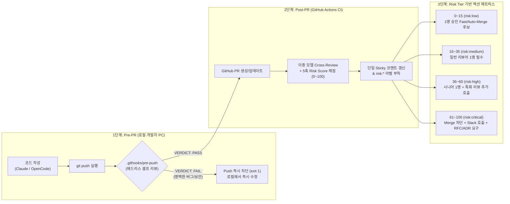

# 코드 리뷰가 병목이 되는 이유 | 메타 시니어 엔지니어가 AI 코드 리뷰 하는법

> **강의 메타데이터**
> - **강연자:** 실밸개발자 (Meta Senior Software Engineer)
> - **원본 URL:** [https://www.youtube.com/watch?v=Be5b6D1IoLI](https://www.youtube.com/watch?v=Be5b6D1IoLI)
> - **재생 시간:** `38분 23초` (총 19개 챕터, 슬라이드 Deck `116p ~ 125p` + 실시간 터미널 실습)
> - **연계 노트:** [[AI_시대_새로운_패러다임_Spec_Driven_Development_실밸개발자]], [[multi-agent-code-review]], [[clang-codegraph]], [[github-repository-archive]]
> - **PHY SW 심층 연구 연계:** [[00_PHY_SW_Code_Review_Master_Blueprint]], [[01_OpenSource_Code_Review_Benchmark]], [[02_PHY_5Layer_Review_Invariants_Catalog]]

---

## 1. Executive Summary (핵심 요약 및 테제)

AI 코딩 에이전트(Claude Code, OpenCode, Codex 등)의 도입으로 **코드 생성 속도는 폭발적으로 증가했으나, 사람이 읽고 승인하는 '코드 리뷰(Code Review)'가 엔지니어링 파이프라인의 최대 병목(Bottleneck)**이 되었다.

본 강의에서 실밸개발자는 단순히 터미널에서 *"코드 리뷰해 줘"*라고 수동 호출하는 수준을 넘어, **리포지토리 자체에 내장되어 자동으로 작동하는 2단계 코드 리뷰 하네스(Harness)**를 구축한다:

1. **Pre-PR 단계 (로컬 `pre-push` Git 훅):** 개발자가 원격 브랜치로 `git push`하기 직전, 헤드리스 에이전트(`claude -p` / `opencode run`)가 자동으로 diff를 심사하여 **명백한 버그·보안 결함·디버그 코드 누출 시 `VERDICT: FAIL`과 함께 푸시 자체를 차단(`exit 1`)**한다.
2. **Post-PR 단계 (GitHub Actions CI + 이종 모델 크로스 리뷰 + 5축 Risk Score):** PR이 생성되거나 갱신될 때, **코딩에 사용한 모델과 다른 계열의 모델**(확증 편향 방지)이 **5축 리스크 루브릭(0~100점)**으로 PR 위험도를 정량 채점하고, 단일 마커 코멘트(`<!-- ai-pr-review -->`)를 업데이트하며 `risk:low` ~ `risk:critical` 라벨을 자동 부착한다.
3. **인간 리뷰어의 재배치(Re-allocation):** 기계가 24/7 일관된 기준으로 규칙·패턴·누락을 1차 필터링함으로써, 시니어 엔지니어는 컨벤션 지적에서 해방되어 **아키텍처 결정, 도메인 정합성, 하드웨어/비즈니스 트레이드오프**가 걸린 핵심 PR에만 집중한다.

---

## 2. 전 챕터(19 Chapters) 타임라인 및 슬라이드 무손실 해부

### [Ch 01~02] 강의 배경 및 목표: 수동 프롬프트가 아닌 '자동화된 리포지토리 자산' (00:00 ~ 01:45)
- **이전 섹션(Ch 08 토큰 효율성 & Cost Gate)과의 연결 (`[00:53]`):**
  - 직전 강의에서 에이전트 비용을 통제하는 Cost Gate를 플러그인으로 추가했다면, 이번에는 **품질과 속도를 동시에 지키는 Code Review Agent Gate**를 리포지토리에 심는 단계다.
- **슬라이드 116 (`이번 섹션에서 만들 것: 코드 리뷰 에이전트`):**
  - *"그냥 'Claude야 리뷰해줘'라고 부르는 게 아니라, 모든 PR에 자동으로 코멘트가 달리고 일정 조건이 맞으면 사람을 거치지 않고도 merge까지 가는 워크플로우"*를 구축한다.
  - **3가지 핵심 포인트:**
    1. 자기 코드베이스에 즉시 적용해 볼 것 (자동화 감각 체득).
    2. Ch08의 Cost Gate에서 자연스럽게 이어지는 파이프라인 게이트.
    3. **반드시 안전 가드(Safety Guards)까지 끝까지 듣고** 도입 수준을 결정할 것.

---

### [Ch 03] 2024 vs 2026 — 코드 리뷰 풍경의 패러다임 전환 (01:45 ~ 02:48)
- **슬라이드 117 (`Code review in 2026 — 2년 전과 지금, 무엇이 달라졌는가`):**

| 구분 | 2024년: 전부 사람의 손으로 | 2026년: 기계가 1차, 사람은 고차원 |
| :--- | :--- | :--- |
| **아침 출근 풍경** | 시니어 엔지니어가 노트북을 열면 **PR 큐에 14개 적체** (그중 1개는 700줄 대형 PR) | **새벽 사이 에이전트가 14개 전부에 1차 리뷰 코멘트 완료** |
| **리뷰어의 작업** | `null check` 빠짐, 컨벤션 어긋남, 테스트 추가 요청을 일일이 손으로 코멘트 작성 | 시니어는 **사람의 판단이 필요한 핵심 PR 3개만 깊게 검토** |
| **오후 일과 및 병목** | 점심 전까지 **3개만 처리**, 나머지 **11개는 내일로 이월** ➡️ PR 올린 동료들은 전부 대기 | 오후에는 본인의 설계·구현 업무에 몰입 (리뷰 큐 병목 해소) |

> **핵심 통찰 (`[02:37]`):** *"사람을 빼는 게 아닙니다. 사람을 컨벤션 체크에서 빼내서 아키텍처, 보안 모델, 비즈니스 트레이드오프라는 더 중요한 일에 재배치(Re-allocation)하는 것입니다."*

---

### [Ch 04] AI 코드 리뷰 에이전트의 4가지 본질적 강점 (02:48 ~ 04:10)
- **슬라이드 118 (`AI 코드 리뷰의 가치 명제 — 사람 리뷰 대비 4가지 강점`):**
  1. **`01. 24/7 즉시성`:** 새벽 2시에 PR이 올라와도 다음 날 아침까지 기다리지 않고 올리는 순간 즉시 1차 리뷰가 시작된다.
  2. **`02. 일관성 (Consistency)`:** 사람은 그날의 컨디션, 마감 일정 압박, 심지어 **PR 작성자가 시니어인지 주니어인지에 따라** 리뷰 깊이가 흔들린다. 에이전트는 매번 동일한 루브릭과 규칙으로 심사한다.
  3. **`03. 누락 없음 (Zero Fatigue)`:** 700줄짜리 PR에서 사람은 후반부 1/3 지점부터 집중력이 급격히 저하되어 대충 넘기게 되지만, 에이전트는 **첫 줄과 마지막 줄을 동일한 정밀도**로 스캔한다.
  4. **`04. 사람을 고차원 결정에 재배치 ★ (핵심 가치)`:** 네이밍·포맷팅·단순 누락 지적에 쓰던 시니어의 인지 예산을 아키텍처·보안·도메인 설계로 전환한다.

---

### [Ch 05] 두 갈래 리뷰 시점: Pre-PR (사전 예방) vs Post-PR (사후 검증) (04:10 ~ 06:34)
- **슬라이드 119 (`리뷰가 돌아야 할 두 시점 — Pre-PR과 Post-PR은 누적된다`):**
  - AI 시대에 로컬에서 셀프 리뷰를 돌리지 않고 날것의 PR을 올리는 것은 동료의 시간을 빼앗는 행위다(`[04:25]`).
  - 개인의 습관에 맡기면 잊어버리므로 **Git Hook으로 강제화**해야 한다(`[05:04]`).

| 비교 항목 | `PRE-PR REVIEW` (로컬 셀프 리뷰) | `POST-PR REVIEW` (GitHub Actions 자동 코멘트) |
| :--- | :--- | :--- |
| **실행 시점** | `commit` / `push` 직전 (`pre-push` Git 훅) | GitHub PR 생성 또는 새 커밋 `push` 시 (CI 워크플로우) |
| **실행 주체** | 내 로컬 터미널의 에이전트 (`claude -p` / `opencode run`) | GitHub Actions Runner 상의 독립 리뷰 에이전트 |
| **검토 목적** | **내 선에서 1차 정제:** 명백한 버그, 빠뜨린 테스트, 디버그 코드/시크릿 유출, 컨벤션 위반을 먼저 차단 | **팀 전체가 보는 정제된 1차 리뷰:** PR에 직접 구조화된 리스크 점수와 코멘트를 기록 |
| **상호 관계** | **누적 방어선(Cumulative Defense):** 앞단(Pre-PR)에서 자잘한 실수를 다 잡아야 뒷단(Post-PR)이 무거운 아키텍처·보안·리스크 분석에 집중할 수 있다 (`[06:19]`, `[20:16]`). |

---

### [Ch 06] 6대 코드 리뷰 기법과 라벨/경로 기반 자동 라우팅 (06:34 ~ 08:32)
- **슬라이드 120 (`Agent 시대의 코드 리뷰 기법들 — 무엇을 보게 할 것인가`):**
  모든 PR을 똑같은 단일 프롬프트로 돌리는 대신, **PR의 크기·라벨·변경 파일 경로(Path)에 따라 특화된 리뷰 기법을 라우팅**한다:

| # | 리뷰 기법 | 적합 대상 조건 | 핵심 동작 방식 |
| :---: | :--- | :--- | :--- |
| **1** | **Full diff review** | 작은 PR · **100줄 이하** | diff 전체를 한 번에 컨텍스트에 넣고 빠르고 단순하게 검토 |
| **2** | **File-by-file review** | 큰 PR · **500줄 이상** | 파일 단위로 쪼개어 **각각 별도 서브에이전트 컨텍스트**로 검토 (모델 혼란 및 중간 누락 방지) |
| **3** | **Security-focused** | 결제·로그인·외부 API 변경 | 인증·인가·시크릿 노출·인젝션·메모리 오염 등 보안 취약점만 집중 감사 |
| **4** | **Performance-focused** | DB 쿼리·**Hot path (ISR/DSP)** 변경 | 레이턴시 회귀, N+1 쿼리, 불필요 재연산, 메모리 누수, 사이클 오버헤드 집중 분석 |
| **5** | **Test-coverage-focused** | 소스 ↔ 테스트 불일치 | 프로덕션 소스만 바뀌고 대응 테스트가 없으면 경고 (반대로 테스트만 삭제/변경된 경우 의도 확인) |
| **6** | **Architecture-focused** | 신규 모듈·의존성 변화 | 새 디렉토리 생성, 모듈 간 의존성 그래프(Dependency Graph) 변경, 공용 인터페이스 변경 시 호출 |

- **라우팅 자동화 원칙 (`[07:49]`):**
  - 예: `auth/` 경로가 변경되면 자동으로 `Security-focused` 에이전트 트리거, `db/migrations/`(또는 PHY의 `ipc/`, `hal/`)가 변경되면 `Architecture-focused` 에이전트 트리거.

---

### [Ch 07] 5축 리스크 점수 루브릭 설계 (0~100점) (08:32 ~ 11:25)
- **슬라이드 121 (`리스크 점수 루브릭 — PR마다 0~100 사이 위험 점수를 매긴다`):**
  *"AI가 만들어내는 PR의 개수가 폭발하기 때문에, 리뷰가 병목이 되지 않으려면 반드시 리스크 스코어 기반으로 분류하고 저위험 PR은 빠르게 통과시켜야 한다"* (`[11:07]`).

| 리스크 축 (Axis) | 배점 | 세부 채점 기준 (슬라이드 121 원문) |
| :--- | :---: | :--- |
| **1. 보안 (Security)** | **30점** | `auth`·`permissions`·`secrets`·암호화 변경, 새 외부 입력 경로, dependency CVE. **한 번 뚫리면 끝이라 가중치 최대.** |
| **2. 스코프 (Scope)** | **20점** | 변경 파일 수·라인 수·영향 모듈 수. **5파일 100줄은 낮게, 30파일 2000줄은 만점에 가깝게.** (작은 PR을 선호하도록 유도) |
| **3. Breaking Change** | **20점** | Public API 시그니처, DB 스키마, 환경 변수 추가·제거, deprecated 마킹. **Backward compatibility를 깨면 높게.** |
| **4. 테스트 커버리지 (Test)** | **15점** | 새 코드에 대응 테스트가 있는가, **기존 테스트가 사라졌는가**, 커버리지가 하락했는가. |
| **5. 마이그레이션 (Migration)** | **15점** | DB 마이그레이션·데이터 백필·환경 설정 변경 동반. **롤백(Rollback)이 어렵기 때문에 별도 축으로 분리.** |
| **합계 (Total Risk Score)** | **100점** | **점수가 높을수록 위험(High Risk)** ➡️ 반드시 사람이 깊게 봐야 하는 PR. |

- **루브릭 진화 피드백 루프 (`[10:17]`, `[10:52]`):**
  - 만약 Risk Score가 30점 이하로 낮게 나왔는데 실제 배포 후 장애나 브레이킹 체인지가 발생했다면? ➡️ **장애 사후 분석(Post-mortem) 즉시 해당 장애 패턴을 리스크 루브릭과 시스템 하네스에 추가**하여 다음번에는 높은 점수가 매겨지도록 루브릭을 지속 진화시킨다.

---

### [Ch 08] 리스크 점수별 액션 매트릭스와 Auto-Merge 기준 (11:25 ~ 12:38)
- **슬라이드 122 (`점수 → 액션 매트릭스 — 점수 구간별로 다른 게이트를 건다`):**

| 점수 구간 | GitHub 라벨 | 자동화된 게이트 및 리뷰 액션 |
| :---: | :---: | :--- |
| **`0 ~ 15점`** | `risk:low` | AI 코멘트만 달림. **1명 승인으로 auto-merge 후보** |
| **`16 ~ 35점`** | `risk:medium` | AI 코멘트 + **사람 리뷰어 1명 필수 지정. Auto-merge 비활성** |
| **`36 ~ 60점`** | `risk:high` | AI 코멘트 + **시니어 1명 지정 + Security/Architecture 리뷰 추가 호출** |
| **`61 ~ 100점`** | `risk:critical` | **즉시 사람 호출(Slack). RFC/ADR 설계 문서 링크 요구. Merge 차단** |

> [!IMPORTANT]
> **두 가지 핵심 운영 원칙 (슬라이드 122 하단 경고):**
> 1. **`"auto-merge 후보" ≠ 무인 자동 머지`:** 사람 리뷰어 1명이 보고 `LGTM(Approve)`만 누르면 추가 대기 없이 즉시 머지된다는 뜻이다 (단, 개인 프로젝트나 완전 검증된 문서 PR에 한해 완전 자동 머지 실험 가능).
> 2. **`처음엔 무조건 보수적으로 시작`:** 도입 초기에는 임계치를 보수적으로 잡아 **모든 PR을 `risk:medium` 이상으로 취급**해 사람이 반드시 보게 하다가, 데이터가 쌓여 AI 채점의 정확도(Accuracy)가 검증되면 임계치를 단계적으로 완화한다.

---

### [Ch 09] 사람이 봐야 할 것 vs AI에게 맡길 것 (12:38 ~ 13:21)
- **슬라이드 123 (`사람 vs AI 리뷰 매트릭스 — 경계를 명확히 그어야 둘 다 잘한다`):**

| 👤 사람이 봐야 할 것 (고차원 판단 · 도메인 · 미래 비용) | 🤖 AI에게 맡길 것 (규칙 · 패턴 · 일관성 · 누락 탐지) |
| :--- | :--- |
| **1. 아키텍처 결정:** 이 추상화가 6개월 뒤에도 맞는가, 모듈 경계가 자연스러운가 | **1. 코드 스타일 · 네이밍:** 린터가 못 잡는 팀 컨벤션, 일관성 깨진 변수/함수명 |
| **2. 보안 모델 트레이드오프:** 편의성 vs 격리 수준, 권한 경계 설계의 타당성 | **2. 명백한 버그:** `null`/`undefined` 역참조, `off-by-one` 인덱스 오류, 빈 `catch` 블록 |
| **3. 비즈니스 로직 정합성:** 요구사항이 의도대로 구현됐는가, 도메인 엣지 케이스 | **3. 테스트 누락 · 컨벤션 위반:** 새 분기(Branch)에 대응 테스트 없음, `CLAUDE.md`/`AGENTS.md` 규칙 자동 대조 |
| **4. API 설계의 우아함:** 호출자 입장에서 자연스러운가, 오용(Misuse)하기 어렵게 설계됐는가 | **4. 보안 Hygiene · 성능 의심:** N+1 쿼리, 하드코딩된 시크릿 노출, 입력 미검증 |

---

### [Ch 10] 도구 레퍼런스 투어 & 이종 모델 크로스 리뷰(Cross-Review) (13:21 ~ 14:30)
- **슬라이드 124 (`레퍼런스 투어: Claude의 두 리뷰 도구 — 기본 /code-review와 ultrareview`):**

| 구분 | `/code-review` (기본 단일 리뷰) | `ultrareview` (멀티 에이전트 심층 리뷰) |
| :--- | :--- | :--- |
| **아키텍처** | **단일 에이전트 패스:** 현재 브랜치 diff를 한 번에 검토 | **멀티 에이전트 병렬 리뷰 + 메타 통합:** 여러 서브에이전트가 **보안·성능·테스트·아키텍처** 관점으로 동시 분석 후, **메타 에이전트가 중복 제거(De-dup) 및 우선순위화** |
| **주요 옵션** | `/code-review` (터미널 출력) `/code-review --comment` (GitHub PR에 인라인 코멘트) `/code-review --fix` (지적 사항 즉시 수정) | 고위험/대형 PR에서 깊은 다각도 검증 수행 (시간 및 토큰 비용 높음) |
| **권장 라우팅** | **Risk Score `36점 미만`의 작은 PR** | **Risk Score `36점 이상`의 큰 PR 또는 Critical 영역** |

- **이종 모델 크로스 리뷰(Cross-Model Review)의 핵심 원리 (`[13:47 ~ 14:22]`):**
  - **문제점 (Self-Bias / 확증 편향):** 동일한 모델(예: Claude Opus)로 코드를 작성한 뒤, 새로운 세션을 열더라도 **같은 계열의 모델에게 코드 리뷰를 시키면 모델 고유의 맹점과 확증 편향 때문에 버그를 놓친다.**
  - **해결책:** **코드를 작성한 모델과 다른 패밀리의 모델로 교차 리뷰**를 수행한다.
    - 강연자 워크플로우: `Codex (GPT-5.4)`로 코딩 ➡️ `Claude Opus`로 리뷰 ➡️ 다시 `Codex`로 수정 (또는 `Claude Code`로 코딩 ➡️ GitHub Actions에서는 `GPT API`로 리뷰).
    - **우리 PHY SW 그룹 적용:** 로컬 `OpenCode`에서 **`Qwen3-Coder` / `GLM-4.5`**로 구현했다면, Pre-push 및 CI 리뷰는 **`DeepSeek-R1` / `DeepSeek-V3`** (또는 역방향)로 교차 배정하여 모델 간 맹점을 상쇄한다!

---

### [Ch 11] 도입 전 6대 안전 가드 — "이 섹션에서 가장 중요한 슬라이드" (14:30 ~ 16:09)
- **슬라이드 125 (`안전 가드: 메인 repo에 바로 켜지 마세요 — 단계적 도입을 위한 6가지 원칙`):**
  *"내일 출근하자마자 바로 Auto-merge를 켜면 회사 프로덕션이 다운됩니다. 게이트를 여러 겹 두어야 합니다."* (`[14:49]`)

1. **`01. 팀 동의 먼저`:** 자동 리뷰·자동 머지는 개인 설정이 아니라 팀의 엔지니어링 프로세스다. RFC나 팀 미팅에서 명시적 합의를 먼저 거친다.
2. **`02. 저위험 PR부터`:** 처음엔 문서(`.md`) 변경, 주석 수정, 마이너 버전 범프 같은 프로덕션 무영향 PR에만 적용한다.
3. **`03. 보수적 임계치`:** `0~15점` 구간도 처음엔 사람이 보게 두고, 라벨만 붙여서 *"이 PR들은 자동 머지할 수도 있었던 후보군"* 데이터를 모은 뒤 정확도가 검증되면 임계치를 올린다.
4. **`04. 라벨 · 작성자 화이트리스트`:** `auto-merge-ok` 라벨이 붙어 있고, AI 리뷰 워크플로우를 숙지한 특정 작성자(Whitelist)의 PR에만 한정한다.
5. **`05. 야간 · 주말 금지`:** 자동 머지가 켜져 있어도 **평일 10시~17시(근무 시간)**에만 작동하게 제한한다. 금요일 밤 자동 머지 후 주말 장애가 터지는 것을 원천 차단한다.
6. **`06. 첫 1~2주 Dry-Run`:** 코멘트와 리스크 점수표만 달고 실제 머지/차단 게이트는 걸지 않는 Dry-Run 기간을 거쳐 팀의 신뢰를 먼저 확보한다.

---

### [Ch 12~19] 실전 라이브 구현: `.githooks/pre-push` & GitHub Actions PR Review (16:09 ~ 38:23)

#### 실습 ①: 로컬 Pre-commit에서 Pre-push 훅으로의 아키텍처 피벗 (`Ch 12 ~ Ch 15`)
- **초기 시도 (`[16:22]`):** 처음에는 `git commit` 시점마다 도는 `pre-commit` 훅을 요청했으나, 에이전트와의 설계 논의 끝에 **`pre-push` 훅으로 전환(`"커밋 전이 아니라 PR 생성 전으로 가자"`, `[20:56]`)**.
- **피벗 이유 (`[21:00 ~ 21:28]`):**
  1. 로컬에서 작은 단위로 자주 `git commit`할 때마다 LLM 리뷰가 1~2분씩 돌면 **토큰 낭비가 심하고 개발 흐름이 끊긴다**.
  2. PR은 `git push`를 통해 원격 브랜치에 올라갈 때 생성되므로, **푸시 직전(`pre-push`)에 원격 브랜치 대비 누적된 커밋 diff 전체를 한 번에 검사**하는 것이 가장 합리적이다.
- **구현된 `.githooks/pre-push` 핵심 메커니즘 (프레임 `13_pre_push_hook.jpg`):**
  - `git config core.hooksPath .githooks`로 팀 전체가 버전 관리되는 훅 디렉토리를 공유.
  - 푸시할 커밋 범위(`$remote_sha..$local_sha`, 새 브랜치면 `origin/HEAD..$local_sha`)의 diff를 추출(최대 60,000자 제한으로 컨텍스트 초과 방지).
  - `claude -p`(헤드리스 모드)로 프롬프트를 전달하여 **마지막 줄에 반드시 `VERDICT: PASS` 또는 `VERDICT: FAIL`을 출력**하도록 강제.
  - **의도적 버그 주입 테스트 (`Ch 15`, `[26:20 ~ 30:01]`):** 일부러 2개의 명백한 버그를 심어 `git push`를 실행한 결과, `pre-push` 훅이 두 버그를 정확히 탐지하고 `VERDICT: FAIL`을 반환하여 **원격 리포지토리로 불량 코드가 푸시되는 것을 완벽히 차단**함. 버그 수정 후 재푸시 시 `VERDICT: PASS`로 통과 확인.

#### 실습 ②: GitHub Actions + 이종 모델(GPT API) + 5축 Risk Score 자동 코멘트 (`Ch 16 ~ Ch 19`)
- **구현 파일 구조 (프레임 `14_github_actions_pr.jpg`, `15_pr_risk_low_result.jpg`):**
  1. `.github/workflows/ai-pr-review.yml`: `pull_request` (`opened`, `synchronize`, `reopened`) 이벤트 트리거, `contents: read`, `pull-requests: write`, `issues: write` 권한 부여.
  2. `.github/scripts/ai_pr_review.mjs`:
     - `gh pr diff`로 변경분을 가져오고, 모델 API(`OPENAI_MODEL` 환경변수로 모델 ID 분리)를 호출하여 **5축 루브릭(Security 30 / Scope 20 / Breaking 20 / Test 15 / Migration 15)** 채점 JSON/Markdown 생성.
     - `<!-- ai-pr-review -->` HTML 주석 마커를 사용하여, 새 커밋이 푸시될 때마다 코멘트가 수십 개씩 쌓이지 않고 **기존 요약 코멘트 1개를 찾아 제자리 업데이트(Upsert)** 함.
     - 점수 구간에 따라 `risk:low`, `risk:medium`, `risk:high`, `risk:critical` 라벨을 자동 생성 및 교체.
- **보안 주의사항 (`Ch 17`, `[31:06 ~ 31:45]`):** 터미널 실습 도중 API 키가 화면/로그에 노출되면 지체 없이 해당 키를 즉시 폐기(Revoke)하고 재발급하여 `gh secret set`으로 등록해야 한다.
- **실제 PR 검증 결과 (`Ch 18`, 프레임 `15_pr_risk_low_result.jpg`):**
  - `README.md` 26줄 추가 PR 생성 시, GitHub Actions가 약 20초 만에 실행되어 **`Risk Score: 0 / 100 (risk:low)`** 판정 표와 항목별 근거를 PR 코멘트로 자동 게시함.

---

## 3. 추출 프롬프트 원문 및 재사용 템플릿

강의 중 강연자가 입력한 프롬프트 원문과 이를 우리 **PHY SW 그룹 환경(`GitHub + OpenCode + DeepSeek/GLM/Qwen + ARM Clang + CMake`)**에 맞게 변환한 프롬프트 전문은 아래 로컬 파일에 별도 저장되어 즉시 복사해 사용할 수 있습니다:

- 📄 [prompt_01_pre_push_hook.txt](file:///c:/Users/kihok/내 드라이브/MyWiki/_sources/Study/AI-Lectures/실밸개발자/20261031_AI_Code_Review/prompts/prompt_01_pre_push_hook.txt) — 로컬 `pre-push` 셀프 리뷰 훅 생성 프롬프트 및 판정 규격
- 📄 [prompt_02_github_actions_pr_review.txt](file:///c:/Users/kihok/내 드라이브/MyWiki/_sources/Study/AI-Lectures/실밸개발자/20261031_AI_Code_Review/prompts/prompt_02_github_actions_pr_review.txt) — GitHub Actions 이종 모델 크로스 리뷰 & 5축 Risk Score 루브릭 프롬프트
- 📄 [prompt_03_phy_opencode_review_adaptation.txt](file:///c:/Users/kihok/내 드라이브/MyWiki/_sources/Study/AI-Lectures/실밸개발자/20261031_AI_Code_Review/prompts/prompt_03_phy_opencode_review_adaptation.txt) — **PHY SW 그룹 전용 OpenCode + DeepSeek/GLM/Qwen 5-Layer 채점 프롬프트**

---

## 4. 에이전트 엔지니어링 분석: 웹/앱 도메인 vs PHY 임베디드 SW 도메인 매핑

실밸개발자의 강의는 일반적인 웹/백엔드 환경(Auth, DB Schema, API, N+1 Query)을 기준으로 설명되어 있다. 이를 **ARM 코어 기반 5G/LTE 물리계층(PHY) 임베디드 SW 그룹**에 그대로 적용하면 도메인 미스매치가 발생한다. 따라서 강의의 **아키텍처 골격(2단계 방어선 + 6대 라우팅 + 5축 루브릭 + 이종 모델 크로스 리뷰)**은 그대로 계승하되, 내부 도메인 축을 다음과 같이 1:1 치환해야 한다.

| 실밸개발자 강의 원형 (Web/Backend) | PHY SW 그룹 도메인 치환 (ARM Embedded PHY SW) |
| :--- | :--- |
| **Claude Code (`claude -p`) + Codex (`GPT API`)** | **OpenCode (`opencode run`) + 이종 오픈 모델 교차 배치** • 코딩/초안: `Qwen3-Coder` 또는 `GLM-4.5` • Pre-push / CI 크로스 리뷰: `DeepSeek-R1` / `DeepSeek-V3` |
| **Security 축 (30점): Auth / SQLi / XSS** | **Real-Time & ISR Determinism 축 (30점):** • ISR/FIQ 내 블로킹 호출, 무한 대기 루프(`while(reg & BUSY)` 타임아웃 누락), 동적 메모리 할당, TTI/Slot 데드라인 초과 위험 |
| **Breaking Change 축 (20점): REST API / DB Schema** | **HAL Register & Hardware Concurrency 축 (25점) + IPC/3GPP Contract 축 (20점):** • MMIO `volatile` 누락, 비원자적 Read-Modify-Write(`\|=`), `W1C`(Write-1-to-Clear) 레지스터 오조작, ARM `DMB`/`DSB`/`ISB` 배리어 누락 • L2/MAC ↔ L1/PHY IPC 구조체 패딩/정렬 변경, 3GPP HARQ/RACH 상태 머신 데드엔드 |
| **Scope 축 (20점): 단순 변경 파일/라인 수** | **Compiler & Call-Graph Blast Radius 축 (15점):** • `CMake` (`compile_commands.json`) + `clangd` / `code-review-graph` 기반 실제 호출 그래프(Call-Graph) 파급 범위 및 공용 헤더 변경 영향도 |
| **Test & Migration 축 (30점)** | **Verification & Target Build Evidence 축 (10점):** • `ARM Clang`(`armclang`) 컴파일 경고 0건, `clang-tidy`/`ast-grep` 정적 규칙 통과, L1 시뮬레이터/유닛 테스트 동반 여부 |

---

## 5. Next Action: PHY SW 그룹 단계적 도입 로드맵

1. **Step 1 (Dry-Run & 결정론적 룰 결합):**
   - 오픈소스 검증 도구인 **`anomalyco/opencode`** 하네스 위에 **`ast-grep`**(구조적 AST 패턴 매칭)과 **`armclang`/`clang-tidy`**(`compile_commands.json` 기반)를 1차 결정론적 필터로 배치한다 (`alibaba/open-code-review` 아키텍처 패턴).
2. **Step 2 (Pre-push 훅 배포):**
   - `.githooks/pre-push`를 구성하여 로컬에서 `ast-grep` 5-Layer 치명적 결함 검사(1초 이내) 후 `opencode run --model deepseek-r1` 셀프 리뷰를 수행한다.
3. **Step 3 (GitHub Actions Post-PR 크로스 리뷰 & Risk Score):**
   - GitHub PR 생성 시 `code-review-graph` / `codebase-memory-mcp`로 변경 심볼의 2-hop 호출 반경(Blast Radius)만 추출하여 토큰 소모를 1/10로 줄이고, PHY 5축 Risk Score 표를 PR에 자동 게시한다.

> 👉 **상세 아키텍처 설계서, 25개 오픈소스 전수 벤치마크, PHY 5-Layer 불변조건 카탈로그 및 즉시 실행 가능한 `.opencode` / GitHub Actions 설정 파일은 아래 Deep Research 시리즈 문서에서 이어집니다:**
> - [[00_PHY_SW_Code_Review_Master_Blueprint]]
> - [[01_OpenSource_Code_Review_Benchmark]]
> - [[02_PHY_5Layer_Review_Invariants_Catalog]]
