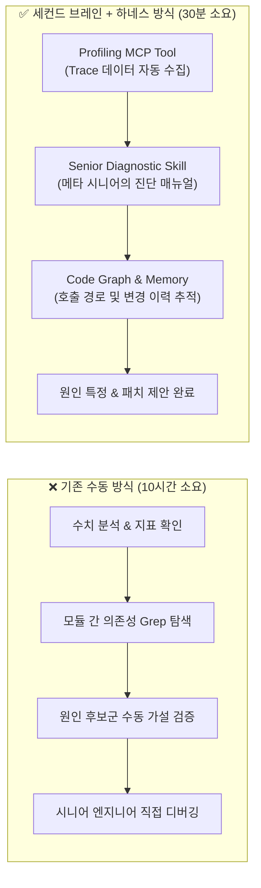
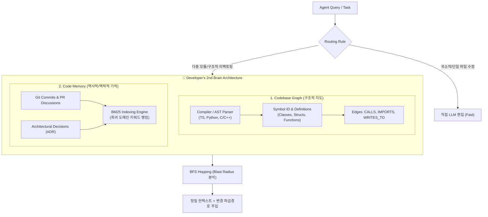
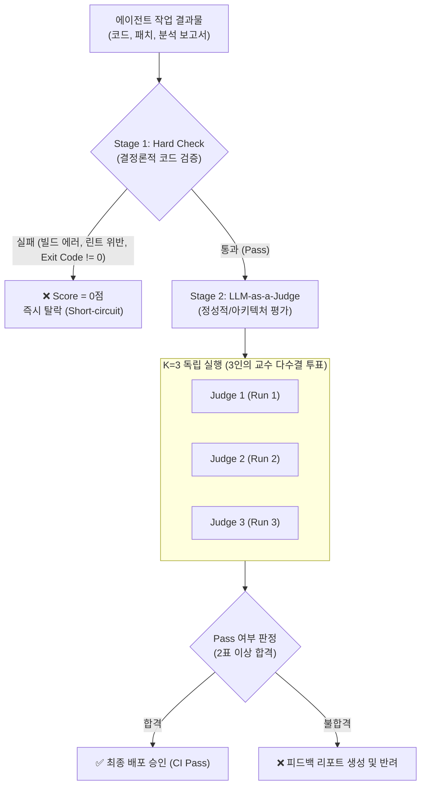
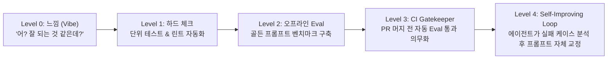
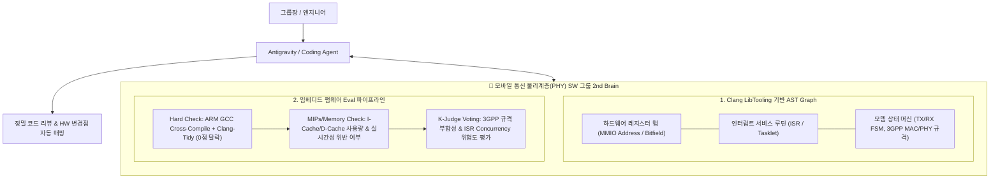

# 🧠 메타 시니어 엔지니어 하재상: 세컨드 브레인 + Eval 완벽 분석

> **강의명:** 메타 시니어 엔지니어, 세컨드 브레인 + Eval 무료 세미나 풀버전 (1시간 17분 53초)  
> **연사:** 하재상 (실밸개발자, Meta Senior Software Engineer)  
> **영상 링크:** [YouTube 링크 바로가기](https://youtu.be/AyKq4zFfrlc)  
> **분석 목적:** AI 에이전트 도입의 두 기둥인 **컨텍스트 주입(Second Brain)**과 **자동 검증 체계(Eval)**의 프로덕션 엔지니어링 패턴 전수 분석 및 임베디드/모바일 통신 SW 적용 모델 도출.

---

## 📑 목차 및 타임라인 네비게이션

| 챕터 타임라인 | 핵심 주제 | 주요 엔지니어링 키워드 |
| :--- | :--- | :--- |
| **[00:00 - 05:00]** | 세미나 오프닝 & 에이전트 신뢰의 본질 | Bottleneck Shift, Context & Verification |
| **[05:00 - 15:00]** | 연사 소개 및 메타의 \$30k/월 에이전트 실험 | Meta Internal Dashboard, Planning vs Verification |
| **[15:00 - 25:00]** | [실전 사례] 메타 성능 프로파일링 10시간 ➔ 30분 단축 | Profiling MCP Tool + Senior Skill Manual, Grep 한계 |
| **[25:00 - 35:00]** | 세컨드 브레인 1부: Codebase Graph 아키텍처 | AST Adapter, Symbol ID, BFS Hopping, Blast Radius |
| **[35:00 - 45:00]** | 세컨드 브레인 2부: Code Memory와 "Why" 추적 | `why.mjs`, `query.mjs`, BM25 커밋 인덱싱, Routing Rule |
| **[45:00 - 55:00]** | Eval 1부: 에이전트 검증 없는 배포의 위험성과 2단계 구조 | Claude Code 프롬프트 재앙, Hard Check, K-Judge Voting |
| **[55:00 - 01:05:00]** | Eval 2부: 샌드박스 격리와 골든 프롬프트 벤치마크 | Sandbox Isolation, Ground Truth 은닉, Baseline 비교 |
| **[01:05:00 - 01:15:00]** | 메타의 Eval 성숙도 5단계 (Level 0~4) 및 3대 핵심 질문 | Trigger Accuracy, Performance Gain, Non-regression |
| **[01:15:00 - 01:17:53]** | 에필로그: 에이전트 시대의 인간 엔지니어 철학 | 주도권 확보, 삶의 가치와 엔지니어링 본질 |

---

## 1. 서론: AI 코딩 병목의 거대한 이동 [00:00 - 15:00]

### 1.1 "코딩 속도"에서 "검증(Verification) 병목"으로의 전이
* **과거:** 코드 작성 및 타이핑 자체가 병목.
* **현재:** 에이전트가 코드를 찍어내는 것은 초 단위로 가능하지만, **"과연 이 코드가 올바른가?", "다른 모듈을 깨뜨리지 않는가?", "우리 팀의 아키텍처 원칙을 준수했는가?"**를 확인하는 인간의 인지 부하가 극한의 병목으로 떠오름.
* **메타의 \$30k/월 에이전트 실험:**
  > *"제가 실리콘밸리 메타에서 일하면서 최근 한 달 동안 에이전트를 얼마나 썼는지 회사 대시보드를 보니 **3만 달러(\$30,000)**를 썼다고 찍혀 있더라고요. 제 돈이 아닌 회사의 3만 달러를 쓰면서 절실히 깨달은 것은, 하네스(규칙, 툴, 프롬프트)를 아무리 잘 줘도 검증 시스템이 없으면 일을 믿고 맡길 수 없다는 것입니다."*

### 1.2 에이전틱 엔지니어링의 3대 핵심 질문
1. **신뢰의 문제:** 어떻게 하면 에이전트에게 자율적 작업을 믿고 위임할 수 있는가?
2. **하네스 세팅:** 에이전트가 방황하지 않도록 어떤 컨텍스트와 도구를 제공해야 하는가?
3. **환경 인프라:** 에이전트의 작업 결과물을 어떻게 자동으로 검증(Eval)하고 CI에 게이트로 걸 것인가?

---

## 2. [실전 사례] 메타 성능 프로파일링: 10시간 ➔ 30분 단축 [15:00 - 25:00]

하재상 엔지니어가 메타 내부 프로덕션에서 직접 수행한 대표적인 에이전트 최적화 사례:

* **배경:** 복잡한 대규모 분산 시스템에서 특정 서비스의 지연(Latency) 및 리소스 병목 발생 시, 시니어 엔지니어가 수작업으로 프로파일링 데이터를 파악하고 코드 경로를 역추적하는 데 평균 10시간 이상 소요.
* **해결책의 결합:**
  1. **표준 도구 (Profiling MCP):** 성능 메트릭 수치와 Flame Graph 데이터를 LLM이 질의할 수 있는 API/MCP 도구로 제공.
  2. **시니어의 도메인 지식 (Skill Manual):** 메타 시니어 엔지니어들이 병목을 진단할 때 사용하는 5단계 체크리스트와 가설 검증 절차를 마크다운 형태의 Skill로 패키징.
  3. **코드베이스 그래프 (Second Brain):** 함수 호출 그래프와 데이터 흐름을 즉시 조회하여 영향 범위(Blast Radius)를 좁힘.
* **결과:** **10시간 이상의 고숙련 수작업이 30분 만에 완전 자동화/반자동화**로 해결됨.

---

## 3. 세컨드 브레인 아키텍처: Code Graph + Code Memory [25:00 - 45:00]

에이전트가 새로운 세션을 시작할 때마다 프로젝트 전체를 Grep하거나 무한 루프에 빠지는 문제를 원천 차단하는 지식 계층:

### 3.1 Codebase Graph (정밀한 구조적 지도)
* **Grep의 치명적 한계:**
  * 키워드로 검색하면 매번 프롬프트마다 엉뚱한 파일들을 뒤적거림.
  * 검색 결과의 90%가 주석, 테스트 더미, 유사한 이름의 미관련 변수.
  * LLM 컨텍스트 윈도우 낭비 및 환각 유발.
* **컴파일러/AST 기반 그래프 구축 (`brain build`):**
  * 언어별 파서(TypeScript Compiler API, Python AST, Clang/LibTooling for C/C++)를 통해 모든 식별자를 고유 `Symbol ID`로 인덱싱.
  * `A -> CALLS -> B`, `C -> IMPORTS -> D`, `FuncX -> WRITES_TO -> RegisterY` 등 관계를 엣지(Edge)로 저장.
  * **BFS Hopping (너비 우선 탐색):** "이 함수를 수정하면 파급되는 2차, 3차 영향권(Blast Radius)은 어디인가?"를 수학적으로 100% 결정론적(Deterministic) 추출.

### 3.2 Code Memory: "Why"를 설명하는 기억
* **코드 그래프만으로 부족한 이유:**
  * 그래프는 "코드의 현재 상태(What & How)"만 보여줄 뿐, **"왜 이 코드를 이렇게 복잡하게 짰는지(Why)"**를 말해주지 않음.
* **`why.mjs` & `query.mjs` 구현:**
  * Git 커밋 로그, PR 리뷰 코멘트, 아키텍처 결정(ADR), 이슈 트래커를 연동.
  * **BM25 검색 알고리즘 채택:** 단순 의미론적 벡터 검색(Cosine Similarity)은 전문 엔지니어링 용어나 약어(e.g., `CPHY`, `DPHY`, `MIPs`, `HARQ`) 매칭에 취약함. BM25는 희귀 고유명사에 가중치를 부여하여 정확한 커밋/PR 히스토리를 적중시킴.

### 3.3 Routing Rule (트레이드오프와 라우팅 규칙)
* 모든 요청에 세컨드 브레인을 조회하면 응답 지연(Latency)과 오버헤드가 발생함.
* **단순 로컬 버그 픽스/타이포 수정:** 에이전트가 직접 파일 읽고 수정 (Brain 바이패스).
* **크로스 모듈 변경, 인터페이스 수정, 아키텍처 리팩토링:** 반드시 세컨드 브레인(Graph BFS + Why Memory)을 조회하도록 프롬프트 하네스에 명시.

---

## 4. Eval (평가 체계): EDD (Eval-Driven Development) [45:00 - 01:05:00]

### 4.1 실리콘밸리 기업들의 뼈아픈 교훈
* **Anthropic의 Claude Code 참사:** 시스템 프롬프트를 미세하게 업데이트한 후 내부 벤치마크 평가를 전수 수행하지 않아, 기존에 잘 동작하던 복잡한 리팩토링 기능이 침묵 속에서 망가지는 리그레션 발생.
* **Amazon, Vercel 사례:** 에이전트 스킬을 배포했으나 실제 프로덕션 환경의 엣지 케이스에서 오작동하며 서비스 장애 유발.
* **교훈:** *"테스트 코드(TDD) 없이 프로덕션 코드를 배포하지 않듯이, **Eval 체계 없이 에이전트 스킬(Harness)을 배포하는 것은 자살행위다**."*

### 4.2 Eval의 2단계 검증 아키텍처

#### ① Stage 1: Hard Check (결정론적 하드 체크)
* 정답 여부를 코드로 즉각 검증 가능한 항목:
  * 컴파일 성공 여부 (GCC/Clang, TypeScript compile exit code == 0)
  * 정적 분석 및 린트 통과 (Clang-Tidy, ESLint, Flake8)
  * 단위 테스트 통과 (Unit Test Pass)
  * 스키마 규격 준수 (JSON/YAML Schema Validation)
* **단 1개라도 실패 시 즉시 0점 처리.** 정성 평가로 넘어가지 않음.

#### ② Stage 2: LLM-as-a-Judge with $K$-Run Majority Voting
* 하드 체크를 통과한 결과물에 대해 질적 품질, 가독성, 예외 처리, 아키텍처 원칙 준수 여부를 평가.
* **$K=3$ 다수결 투표 (Majority Voting):**
  * LLM 평가는 고유의 확률적 변동성(Non-deterministic variance)이 존재.
  * 동일한 결과물에 대해 독립된 3개의 프롬프트/인스턴스로 채점을 수행하여 2표 이상 찬성 시에만 통과시킴. (학술 논문 심사위원 3인 판정 모델 차용).

### 4.3 샌드박스 격리(Sandbox Isolation)와 골든 프롬프트
* **오염 방지 격리 원칙:**
  * 에이전트가 테스트를 통과하기 위해 정답 파일(Ground Truth)이나 이전 실행 로그를 참조하지 못하도록 독립된 임시 디렉토리/컨테이너(Sandbox)에서 실행.
  * 사용자의 전역 클로드 설정(`~/.claude/settings.json`)이나 캐시가 유입되지 않도록 환경변수 엄격 격리.
* **골든 프롬프트 벤치마크 (Golden Prompts):**
  * 실무에서 자주 발생하는 전형적 문제 20~30개를 선별하여 표준 테스트셋 구축.
  * Baseline(도구 없음) vs Skill 적용군의 점수를 정량 비교.

---

## 5. 메타의 Eval 성숙도 5단계 및 필수 3대 질문 [01:05:00 - 01:15:00]

하재상 엔지니어가 밝힌 메타 팀의 에이전트 하네스 진화 과정:

### 스킬 개발 시 반드시 답해야 하는 3대 질문
1. **Triggering Accuracy (호출 정확도):**
   * 불려야 할 때 정확히 불리는가?
   * 불필요한 상황에서 과도하게 호출되어 토큰과 시간을 낭비하지 않는가?
2. **Performance Gain (실질적 성능 향상):**
   * 기존 방식(No-skill Baseline) 대비 작업 성공률이나 속도가 유의미하게 개선되었는가?
3. **Non-Regression (기존 역량 보존):**
   * 새로운 스킬을 추가했더니 기존에 잘 되던 기능이 깨지는 부작용이 없는가?

---

## 6. 결론: 에이전트 시대, 인간 엔지니어의 주도권 [01:15:00 - 01:17:53]

> *"에이전트가 나 대신 일을 해주니까 노트북을 덮어도 머릿속에서 '에이전트 잘 돌아가고 있나?', '지금 에이전트 놀고 있는 거 아닌가?' 하면서 24시간 쉬지 못하는 제 자신을 발견했습니다. 가족과 하와이 여행을 가서도 에이전트 생각만 하고 있더라고요.  
> **우리가 왜 AI를 씁니까? 에이전트한테 주도권을 뺏기지 마세요.** 나의 1번 가치가 무엇인지(가족, 건강, 행복) 명확히 정의하고, 에이전트는 나를 그 가치로 데려다주는 강력한 도구로 부려야 합니다."*

---

## 7. 💡 MyWiki & 모바일 통신/물리계층(PHY) SW 그룹 적용 가이드

우리 그룹(Mobile SW 통신 프로토콜 / PHY Embedded SW) 환경에 본 세미나 내용을 1:1 대응 적용하는 실행 계획:

1. **Codebase Graph의 특화:**
   * 일반 웹/서버 언어와 달리, 우리는 **C/C++ 기반의 하드웨어 레지스터 매핑(`volatile` 포인터, 비트마스크, 인터럽트 벡터 테이블)**이 핵심.
   * `brain build` 파서에 ARM Clang 기반 헤더 파싱을 연동하여, 레지스터 쓰기(`WRITES_TO_REG`)와 인터럽트 트리거 경로를 엣지로 구축.
2. **Code Memory의 특화:**
   * 3GPP 표준 릴리즈 변경점, 퀄컴/경쟁사 칩셋 호환성 패치, 과거 모뎀 IODT(Inter-Operability Development Testing) 실패 이력을 BM25로 인덱싱.
   * "왜 여기서 10us 딜레이를 넣었는가?" ➔ 과거 실리콘 에라타(Silicon Errata) 버그 회피용임을 즉시 에이전트에게 주입.
3. **Firmware Eval 체계:**
   * **Stage 1 (Hard Check):** 타겟 보드 Cross-Compiler 빌드 성공 여부 + 정적 분석 메모리 누수 제로.
   * **Stage 2 (Domain Judge):** $K=3$ 다수결로 ISR 재진입(Reentrancy) 위험, 크리티컬 섹션 락 경합, 실시간 마이크로세컨드(us) 데드라인 위반 여부 평가.
