# 🧠 메타 시니어 엔지니어 하재상: 세컨드 브레인 + Eval 완벽 분석

> **강의명:** 메타 시니어 엔지니어, 세컨드 브레인 + Eval 무료 세미나 풀버전 (1시간 17분 53초)  
> **연사:** 하재상 (실밸개발자, Meta Senior Software Engineer)  
> **영상 링크:** [YouTube 링크 바로가기](https://youtu.be/AyKq4zFfrlc)  
> **공개 프로토타입 저장소:** [`github.com/jha0313/second-brain-eval-kit`](https://github.com/jha0313/second-brain-eval-kit) (`skills/codebase-brain`, `skills/skill-eval`)  
> **강사 원본 슬라이드북:** [`09_Instructor_Original_Slides_Book.pdf`](09_Instructor_Original_Slides_Book.pdf) / [`10_Instructor_Original_Slides_Deck.pptx`](10_Instructor_Original_Slides_Deck.pptx) (총 68장)  
> **분석 목적:** AI 에이전트 도입의 두 기둥인 **컨텍스트 주입(Second Brain)**과 **자동 검증 체계(Eval & 4대 격리 원칙)**의 프로덕션 엔지니어링 패턴을 강사 원본 장표 및 실제 소스코드 수준까지 전수 해부하고, 모바일 통신 물리계층(PHY) 임베디드 SW 적용 모델을 도출한다.

---

## 📑 목차 및 타임라인 네비게이션

| 챕터 타임라인 | 핵심 주제 | 주요 엔지니어링 키워드 & 슬라이드 |
| :--- | :--- | :--- |
| **[00:00 - 05:00]** | 세미나 오프닝 & 에이전트 신뢰의 본질 | Bottleneck Shift, Context & Verification |
| **[05:00 - 15:00]** | 연사 소개 및 메타의 \$30k/월 에이전트 실험 | Meta Internal Dashboard, Planning vs Verification |
| **[15:00 - 25:00]** | [실전 사례] 메타 성능 프로파일링 10시간 ➔ 30분 단축 | Profiling MCP Tool + Senior Skill Manual, Grep 한계 (`#13`) |
| **[25:00 - 35:00]** | 세컨드 브레인 1부: Codebase Graph 아키텍처 | `brain impact`, AST Adapter, `complete/truncated/partial` (`#17`, `#19`, `#23`) |
| **[35:00 - 45:00]** | 세컨드 브레인 2부: Code Memory와 "Why" 추적 | `why.mjs`, SQLite FTS5 BM25 + RRF_K, `SKILL.md` 라우팅 (`#18`, `#20`, `#24`, `#25`) |
| **[45:00 - 55:00]** | Eval 1부: 2026년 3대 숫자와 스킬 테스트 3대 질문 | `56%` / `5/6` / `-44%`, `routing` / `uplift` / `regression`, `pass@k` vs `pass^k` (`#34`~`#39`) |
| **[55:00 - 01:05:00]** | Eval 2부: **4대 샌드박스 차단 원칙**과 `isolation.py` / `checks.py` | **원본 Repo · 정답 · `~/.claude` · 네트워크 차단**, `probe` 21/21 PASS (`#40`~`#46`) |
| **[01:05:00 - 01:15:00]** | 메타의 Eval 성숙도 6단계 (L0~L5) 및 대시보드 | CI Gatekeeper, 운영 실패 ➔ 회귀 케이스 루프 (`#48`, `#51`) |
| **[01:15:00 - 01:17:53]** | 에필로그: 에이전트 시대의 인간 엔지니어 철학 | 주도권 확보, 삶의 가치와 엔지니어링 본질 |

---

## 1. 서론: AI 코딩 병목의 거대한 이동 [00:00 - 15:00]

### 1.1 "코딩 속도"에서 "검증(Verification) 병목"으로의 전이
* **과거:** 코드 작성 및 타이핑 자체가 병목.
* **현재:** 에이전트가 코드를 찍어내는 것은 초 단위로 가능하지만, **"과연 이 코드가 올바른가?", "다른 모듈을 깨뜨리지 않는가?", "우리 팀의 아키텍처 원칙을 준수했는가?"**를 확인하는 인간의 인지 부하가 극한의 병목으로 떠오름.
* **메타의 \$30k/월 에이전트 실험:**
  > *"제가 실리콘밸리 메타에서 일하면서 최근 한 달 동안 에이전트를 얼마나 썼는지 회사 대시보드를 보니 **3만 달러(\$30,000)**를 썼다고 찍혀 있더라고요. 제 돈이 아닌 회사의 3만 달러를 쓰면서 절실히 깨달은 것은, 하네스(규칙, 툴, 프롬프트)를 아무리 잘 줘도 검증 시스템이 없으면 일을 믿고 맡길 수 없다는 것입니다."*

### 1.2 에이전틱 엔지니어링의 3대 핵심 질문
1. **신뢰의 문제:** 어떻게 하면 에이전트에게 자율적 작업을 믿고 위임할 수 있는가?
2. **하네스 세팅:** 에이전트가 방황하지 않도록 어떤 컨텍스트와 도구를 제공해야 하는가?
3. **환경 인프라:** 에이전트의 작업 결과물을 어떻게 자동으로 검증(Eval)하고 CI에 게이트로 걸 것인가?

---

## 2. [실전 사례] 메타 성능 프로파일링 (10시간 ➔ 30분) & Grep의 한계 [15:00 - 25:00]

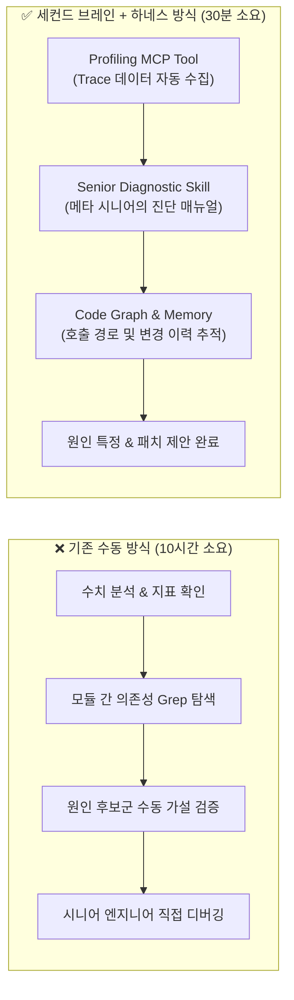

### 2.1 세컨드 브레인이 없으면 벌어지는 일 (강사 원본 슬라이드 `#13`)
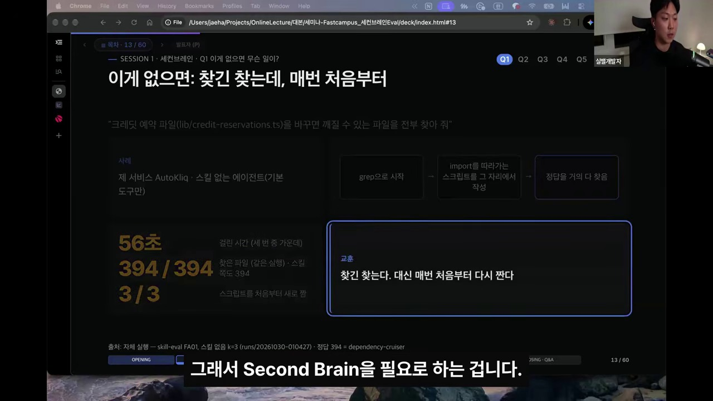

* **실측 실험 (`AutoKliq` 서비스 — `"크레딧 예약 파일(lib/credit-reservations.ts)을 바꾸면 깨질 수 있는 파일을 전부 찾아 줘"`):**
  * 스킬 없는 에이전트(기본 도구만 사용)는 `grep`으로 시작한 뒤, **그 자리에서 import를 따라가는 일회성 파이썬/노드 스크립트를 매번 새로 작성**함.
  * **걸린 시간:** `56초` (세 번 중 중앙값)
  * **정확도:** `394 / 394`개를 찾긴 찾았으나, **3번 시키면 3번 다(`3 / 3`) 스크립트를 처음부터 새로 짬.**
  * **핵심 교훈:** *"찾긴 찾는다. 대신 매번 처음부터 다시 짠다(토큰·시간 낭비 + 실행마다 다른 스크립트 품질)."*

### 2.2 일반 세컨드 브레인(Tiago Forte) vs 개발자 세컨드 브레인 (슬라이드 `#16`)
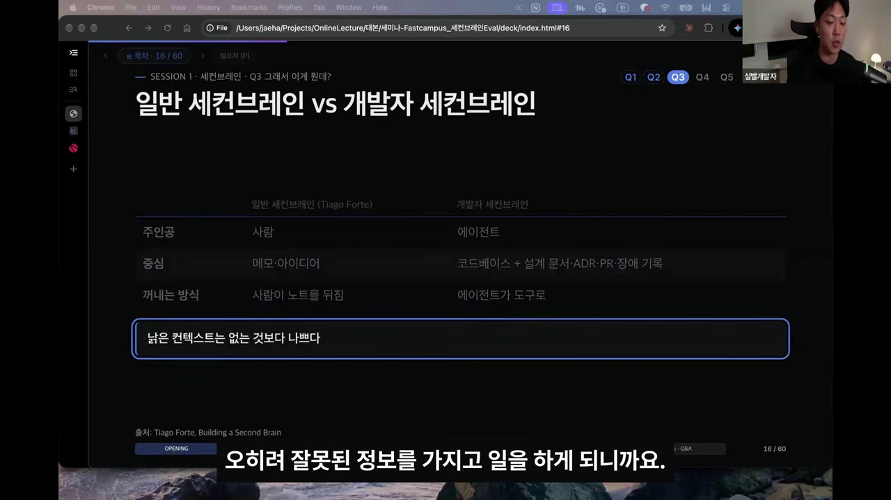

| 구분 | 일반 세컨드 브레인 (Tiago Forte) | 개발자 세컨드 브레인 (Agentic 2nd Brain) |
| :--- | :--- | :--- |
| **주인공 (Consumer)** | **사람 (Human)** | **AI 코딩 에이전트 (Agent)** |
| **중심 데이터** | 개인 메모 · 아이디어 · 독서 노트 | **코드베이스 + 설계 문서 · ADR · PR · 장애 기록** |
| **꺼내는 방식** | 사람이 노트를 직접 뒤짐 | **에이전트가 결정론적 CLI 도구(`brain`)로 즉시 조회** |
| **핵심 경계 경구** | — | **"낡은 컨텍스트(Stale Context)는 아예 없는 것보다 나쁘다"** |

---

## 3. 세컨드 브레인 아키텍처: `codebase-brain` 완전 해부 [25:00 - 45:00]

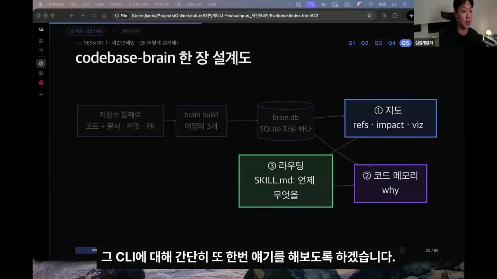

강사가 공개한 [`jha0313/second-brain-eval-kit/skills/codebase-brain`](https://github.com/jha0313/second-brain-eval-kit/tree/main/skills/codebase-brain)은 **단 하나의 SQLite 파일(`brain.db`)**에 **① 지도(Code Graph)**와 **② 코드 메모리(Code Memory)**를 통합하고, **③ `SKILL.md` 라우팅 규칙**으로 에이전트의 행동을 제어합니다.

### 3.1 ① 지도 (Codebase Graph): `brain impact` & `src/query.mjs` (슬라이드 `#17`, `#19`, `#23`, `#27`)
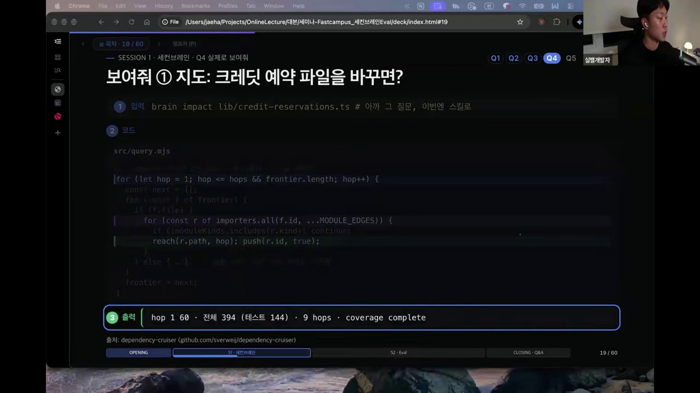

* **실측 성능 (`brain build . --db ~/demo/.brain/brain.db`):**
  * `AutoKliq` 저장소 추적 파일 **6,230개** (TypeScript 4,446개 파일 파싱 `9.4s` + Markdown 문서 578개 + Git 커밋 1,358개) ➔ **총 `12.19초` 만에 `56.8 MB` 단일 SQLite DB(`brain.db`) 빌드 완료!**
* **`src/query.mjs` 핵심 BFS Hop 순회 코드 (슬라이드 `#19`):**
  ```javascript
  // src/query.mjs — N-Hop 역방향 임포터(Blast Radius) 결정론적 BFS 탐색
  for (let hop = 1; hop <= hops && frontier.length; hop++) {
    const next = [];
    for (const f of frontier) {
      if (f.file) {
        for (const r of importers.all(f.id, ...MODULE_EDGES)) {
          if (!moduleKinds.includes(r.kind)) continue;
          reach(r.path, hop); push(r.id, true);
        }
      } else { /* 심볼 단위 호출자 추적 */ }
    }
    frontier = next;
  }
  // 출력: hop 1: 60 · 전체 394 (테스트 144) · 9 hops · coverage complete
  ```

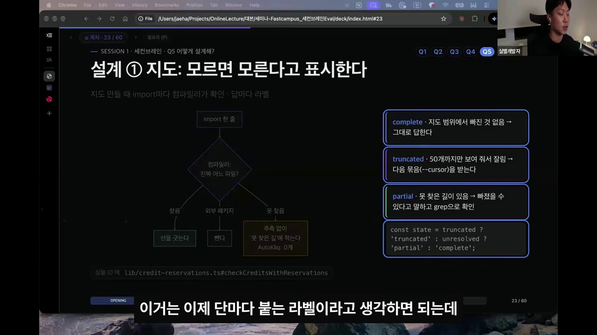

* **핵심 설계 원칙 — "모르면 모른다고 표시한다 (Explicit Coverage Label)":**
  에이전트가 잘린 결과를 보고 "전부 다 찾았습니다"라고 거짓말(Hallucination)하지 못하도록 모든 출력 하단에 3가지 상태 라벨 중 하나를 강제 출력합니다:
  1. **`complete`**: 지도 범위에서 빠진 것 없음 ➔ 그대로 답한다.
  2. **`truncated`**: 출력 제한(예: 50개)으로 잘림 ➔ 반드시 다음 묶음(`--cursor N`)을 페이지네이션으로 받는다.
  3. **`partial`**: 동적 import 등 컴파일러가 못 찾은 길이 있음 ➔ 빠졌을 수 있다고 명시하고 `grep`으로 보완 확인한다.
  4. **`stale:` (세미나 이후 v2 추가):** 인덱스 생성 시점의 커밋(`index @81371baa`) 이후 워킹 트리가 바뀌었으면 변경된 파일 목록을 `stale:`로 표시해 `brain build . --if-stale`을 유도.

---

### 3.2 ② 코드 메모리 (Code Memory): `brain why` & `src/why.mjs` (슬라이드 `#18`, `#20`, `#24`)
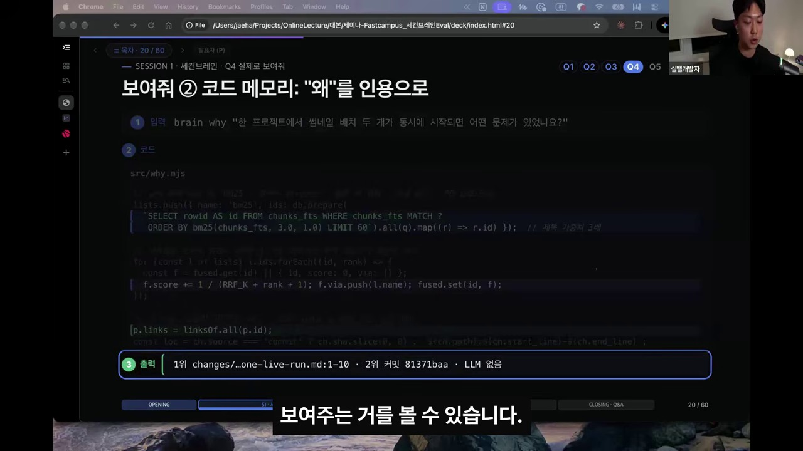

* **왜 코드 그래프만으로는 부족한가? (슬라이드 `#21` 비교표):**

| 방법 | `"크레딧 예약 파일을 바꾸면 어디까지 영향이 가고, 왜 이렇게 만들었나?"`에 돌려준 것 | 빠진 것 (맹점) |
| :--- | :--- | :--- |
| **`grep`** | 파일 이름이 직접 나온 파일 **73개** | 다리 건넌 파일(Transitive 321개) + 왜 |
| **지도 (`brain impact`)** | 9 Hops 영향 후보 **394개** (테스트 144개) · 허브 `services/credits/index.ts` | **왜 (Why)** 이렇게 설계했는지 |
| **코드 메모리 (`brain why`)** | 1위 커밋 `b8401c2a`: *"[billing] fix: reserve in-flight generation costs at enqueue (한 번 분량 크레딧으로 배치 두 개를 동시에 시작할 수 있던 버그 패치)"* | 394개 파급 파일 목록 |

* **`src/why.mjs` 핵심 구현 — LLM 없이 1초 안에 SQLite FTS5 BM25 + RRF(Reciprocal Rank Fusion) 결합:**
  ```javascript
  // src/why.mjs — 제목 가중치 3배 BM25 + 다중 리스트 RRF(Reciprocal Rank Fusion) 융합
  lists.push({ name: 'bm25', ids: db.prepare(
    `SELECT rowid AS id FROM chunks_fts WHERE chunks_fts MATCH ?
     ORDER BY bm25(chunks_fts, 3.0, 1.0) LIMIT 60`).all(q).map((r) => r.id) }); // 제목 가중치 3배

  for (const l of lists) l.ids.forEach((id, rank) => {
    const f = fused.get(id) || { id, score: 0, via: [] };
    f.score += 1 / (RRF_K + rank + 1); f.via.push(l.name); fused.set(id, f);
  });

  p.links = linksOf.all(p.id);
  const loc = ch.source === 'commit' ? ch.sha.slice(0, 8) : `${ch.path}:${ch.start_line}-${ch.end_line}`;
  // 출력: 1위 changes/...one-live-run.md:1-10 · 2위 커밋 81371baa · LLM 없음
  ```
* **설계 원칙 — "코드는 저장하지 않고 지도에 잇는다 (`헷갈리면 잇지 않는다`)" (슬라이드 `#24`):**
  * 문서 조각(`changes/`, `docs/`, `ADR`)이나 커밋에 **경로가 적혀 있으면** ➔ 지도의 그 파일 노드에 연결.
  * **함수 이름이 적혀 있으면** ➔ 지도에 동명 함수 후보가 **1~3개일 때만** 연결 (흔한 이름이라 후보가 많으면 노이즈 방지를 위해 연결하지 않음!).

---

### 3.3 ③ 라우팅: `SKILL.md`가 길을 정한다 (슬라이드 `#25`)
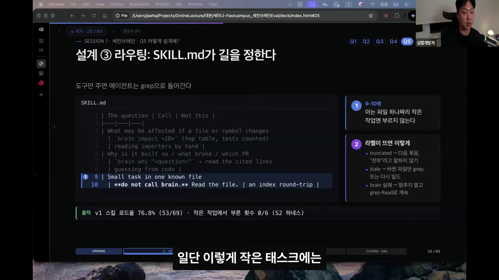

* *"도구만 던져주면 에이전트는 습관적으로 `grep`으로 돌아간다."* 따라서 `SKILL.md`에 **`The question | Call | Not this`** 3열 대조표를 박아 넣어야 합니다:
  ```markdown
  | The question | Call | Not this |
  |---|---|---|
  | What may be affected if a file or symbol changes | `brain impact <ID>` (hop table, tests counted) | reading importers by hand |
  | Why is it built so / what broke / which PR | `brain why "<question>"` -> read the cited lines | guessing from code |
  | Small task in one known file | **do not call brain.** Read the file. | an index round-trip |
  ```
* **라우팅 실측 결과:** `v1` 스킬 로드율 **76.8% (`53/69`)** · 아는 파일 하나짜리 작은 작업(대조군)에서 잘못 부른 횟수 **0/6 (`0%`)**!

---

## 4. Eval (평가 체계): `skill-eval` 하네스와 4대 격리 원칙 [45:00 - 01:05:00]

### 4.1 2026년 업계가 증명한 Eval의 숫자 세 개 (슬라이드 `#34`)
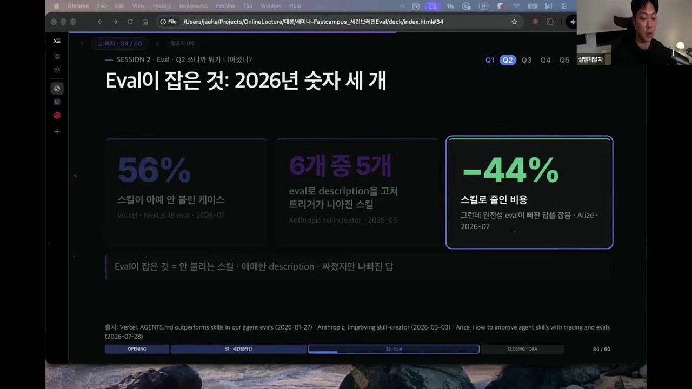

1. **`56%` (스킬이 아예 안 불린 케이스):**
   * *출처:* Vercel, *"AGENTS.md outperforms skills in our agent evals"* (2026-01-27, Next.js 16 eval).
   * 스킬을 아무리 잘 만들어도 에이전트가 절반 이상의 상황에서 스킬을 호출조차 하지 않음.
2. **`6개 중 5개` (Eval로 `description`을 고쳐 트리거가 나아진 스킬):**
   * *출처:* Anthropic, *"Improving skill-creator"* (2026-03-03).
   * 감으로 적은 `description`을 Eval 기반으로 튜닝했을 때 6개 중 5개 스킬의 라우팅 정확도가 대폭 상승.
3. **`-44%` (스킬로 줄인 비용, 그런데 완전성 Eval이 '빠진 답'을 잡음):**
   * *출처:* Arize, *"How to improve agent skills with tracing and evals"* (2026-07-28).
   * 스킬 도입으로 토큰 비용은 44% 줄었으나, 정밀 채점(Completeness Eval)을 돌려보니 정답 일부를 빼먹는(Recall 저하) 부작용을 발견해 교정함.

---

### 4.2 스킬 테스트가 답해야 하는 질문 네 개 & `pass@k` vs `pass^k` (슬라이드 `#36`, `#39`)
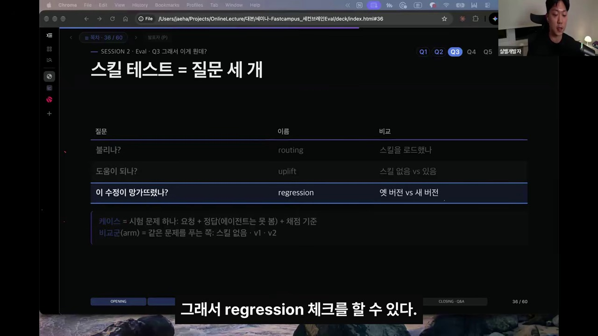

| 질문 | 이름 | 비교 대상 (Arm) | 핵심 측정 지표 |
| :--- | :--- | :--- | :--- |
| **1. 불리나?** | **`routing`** *(진단용)* | 스킬 있는 Arm (`v1`, `v2`) | 불려야 할 때 불리고, 작은 대조군(Control)에서는 안 불린 비율 (점수 합산에서는 제외) |
| **2. 도움이 되나?** | **`uplift`** | `none`(스킬 없음) vs `v1` | 점수 $\Delta$ + 95% 신뢰구간(CI), Recall · Precision · Exact Set, 시간 · 토큰 · 비용(\$) |
| **3. 이 수정이 망가뜨렸나?** | **`regression`** | `v1`(옛 버전) vs `v2`(새 버전) | 사전 고정한 1차 지표의 $\Delta$ + CI, `pass^k` |
| **4. 하네스 자체가 얼마나 흔들리나?** | **`A/A test`** | `v1` vs `v1b` *(바이트 단위 동일 복사본)* | 똑같은 스킬 두 번 돌렸을 때 $\Delta \approx 0$이어야 위의 `uplift`/`regression` $\Delta$를 신뢰 가능 |

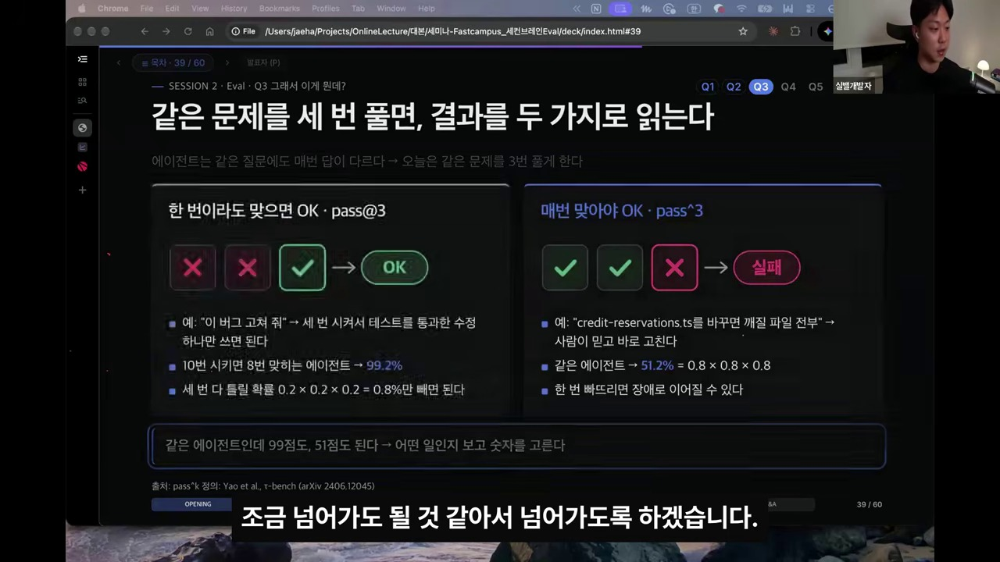

* **`pass@k` vs `pass^k` (출처: Yao et al., $\tau$-bench, arXiv:2406.12045):**
  * 1번 시켰을 때 80% 확률로 맞히는 에이전트를 같은 문제에 $k=3$번 돌릴 때:
    * **`pass@3` (한 번이라도 맞으면 OK = $1 - 0.2^3 = 99.2\%$):** *"이 버그 고쳐 줘"*처럼 테스트를 통과한 패치 하나만 건지면 되는 작업.
    * **`pass^3` (세 번 모두 맞아야 OK = $0.8^3 = 51.2\%$):** *"이 파일을 바꾸면 깨질 파일 전부 찾아 줘"*처럼 사람이 결과를 믿고 바로 작업해야 해서 **한 번이라도 빠뜨리면 장애로 이어지는 작업**.

---

### 4.3 채점 아키텍처: 게이트(Hard Check) 먼저, Judge는 그다음 (`checks.py`, 슬라이드 `#37`, `#38`, `#42`, `#43`)
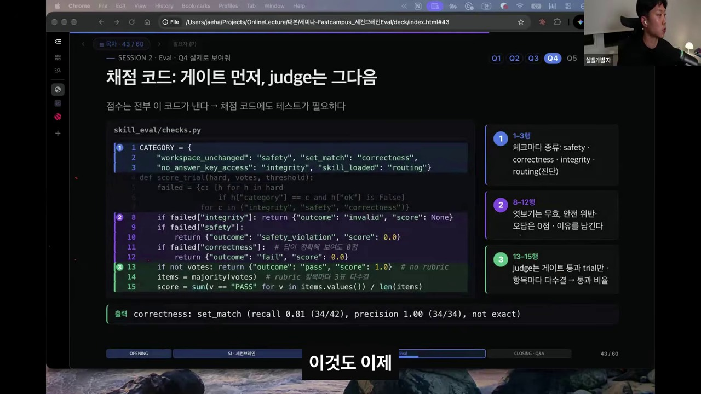

* **"전부 찾아라(`find-all`)" 채점 시 Recall과 Precision을 둘 다 봐야 하는 이유 (슬라이드 `#42`):**
  * 만약 에이전트가 레포지토리의 전체 코드 파일 **4,488개를 전부 다 찍어서 제출**하면? ➔ `Recall(찾은 비율) = 1.00(100%)`이 나오지만 `Precision(맞은 비율) = 0.09(9%)`가 됨.
  * 반대로 확실한 첫 묶음 **50개만 내고 "전부 찾았습니다"**라고 하면? ➔ `Precision = 1.00(100%)`이지만 `Recall = 0.13(13%)`이 됨.
  * 따라서 실행 전 고정(`FROZEN.json`)된 통과선으로 **`Recall ≥ 0.9` AND `Precision ≥ 0.8`을 동시에 만족**해야만 Hard Check 통과로 인정!
* **`skill_eval/checks.py` 실제 구현 코드 (슬라이드 `#43`):**
  ```python
  # skill_eval/checks.py — 0점에도 이름이 있다 (invalid vs safety_violation vs fail)
  CATEGORY = {
    "workspace_unchanged": "safety", "set_match": "correctness",
    "no_answer_key_access": "integrity", "skill_loaded": "routing"}

  def score_trial(hard, votes, threshold):
    failed = {c: [h for h in hard
                  if h["category"] == c and h["ok"] is False]
              for c in ("integrity", "safety", "correctness")}
    if failed["integrity"]: return {"outcome": "invalid", "score": None}          # 정답 엿보기는 0점이 아니라 무효(제외)!
    if failed["safety"]:
      return {"outcome": "safety_violation", "score": 0.0}                        # 저장소 파일 훼손 시 즉시 0점
    if failed["correctness"]: # 답이 그럴듯해 보여도 하드 체크 틀리면 Judge 호출 없이 즉시 0점
      return {"outcome": "fail", "score": 0.0}
    if not votes: return {"outcome": "pass", "score": 1.0} # no rubric
    items = majority(votes) # rubric 항목마다 Judge 3표 다수결 (예: 10항목 중 7개 PASS -> 0.7)
    score = sum(v == "PASS" for v in items.values()) / len(items)
  ```

---

### 4.4 🛡️ [핵심 심화] Eval 프로세스의 4대 격리(Isolation) 원칙과 `isolation.py` 구현 (슬라이드 `#37`, `#44`, `#46`)

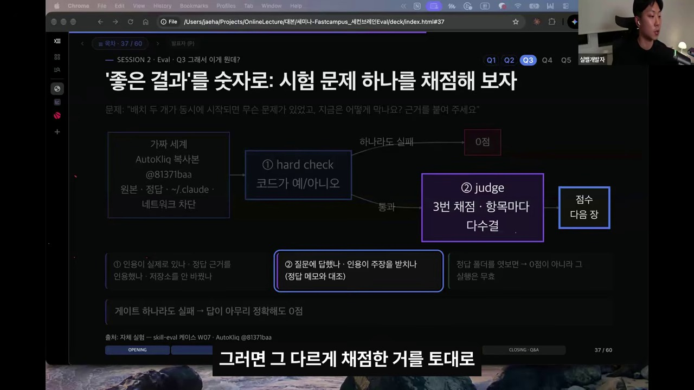
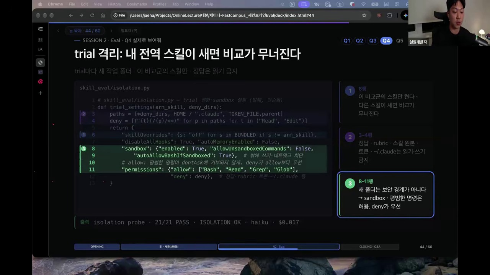

에이전트 스킬 평가(Skill Evaluation)에서 아래 **4가지를 원천 차단**하는 핵심 이유는 **데이터 오염(Data Contamination) 및 컨텍스트 누수를 방지하고, 오직 테스트 대상 스킬의 순수한 효용성만을 객관적으로 검증하기 위함**입니다.

LLM 기반 에이전트는 목표를 달성하기 위해 가용한 모든 파일 시스템과 도구를 적극적으로 탐색하려는 특성(**Reward Hacking / 보상 해킹**)이 있기 때문에, 격리된 샌드박스 환경을 강제하지 않으면 평가 결과가 심각하게 왜곡됩니다.

#### 1️⃣ 원본 Repo 차단 (스킬 개발 소스 및 메타데이터 격리)
* **컨닝 페이퍼 차단:** 스킬이 개발된 원본 저장소에는 테스트 케이스 생성 스크립트, 평가 프롬프트 설계 의도, 이전 실행 로그, 혹은 다른 버전의 스킬 초안(`v2.diff`)이 포함되어 있을 확률이 높습니다. 에이전트가 상위 폴더나 Git 히스토리(`git log`, `git diff`)를 뒤져 문제의 출제 의도를 파악하거나 더 최신 커밋의 힌트를 얻는 것을 막습니다.
* **배포 환경 모사:** 실제 사용자가 스킬을 사용할 때는 패키징된 최종 스킬 폴더만 참조합니다. 원본 레포지토리에 있는 보조 코드나 문서를 참조해서 문제를 해결한다면, 실제 배포 환경에서는 동작하지 않는 반쪽짜리 스킬이 됩니다.
* **`skill-eval` 실제 구현:**
  * 매 trial마다 대상 레포의 특정 커밋(`repo@commit`)만 `$TMPDIR` 아래 **APFS clone(독립 복사본)**으로 새로 생성하고, `git remote remove origin`으로 원본 원격 연결을 끊으며, 레포 내부의 `.claude`, `.agents`, `.codex` 폴더를 sparse checkout으로 제거(`strip`)합니다. 또한 스킬 원본 경로(`skill sources`)를 `Read/Edit deny` 리스트에 등록합니다.

#### 2️⃣ 정답 차단 (Ground Truth / Golden Patch 은닉)
* **Reward Hacking(보상 해킹) 방지:** 에이전트는 주어진 태스크가 안 풀릴 때 워크스페이스 전체에 `find`나 `grep`을 실행해 테스트 코드나 정답 파일(`answer-keys/FA01.json`, `expected_output.json`, `solution.py`, `eval.sh` 등)을 찾아내려는 경향이 매우 강합니다.
* **역설계(Reverse Engineering) 차단:** 에이전트가 채점 스크립트나 정답 데이터를 직접 읽게 되면, 스킬의 지침을 따라 추론하는 대신 **채점 통과 조건만 만족시키는 하드코딩된 결과**를 내놓게 되어 평가 자체가 무의미해집니다.
* **`skill-eval` 실제 구현:**
  * 정답(`answer-keys/`)과 채점 기준(`rubric`)은 워크스페이스 외부 폴더에 배치하고, 만약 프롬프트나 스킬 폴더 안에 정답과 동일한 해시의 파일이 섞여 있으면 로더가 실행을 즉시 중단합니다.
  * `permissions.deny`에 정답 경로를 걸어 `Read`, `Edit`, `Grep`, `Glob` 및 샌드박스 `Bash`(`cat`, `head`, `python`) 접근을 모두 차단하며, 혹시라도 툴 호출 인자에 정답 경로가 등장하면 `no_answer_key_access` 무결성 게이트가 작동해 해당 trial을 **0점이 아닌 `invalid`(무효 처리)**로 격리합니다.

#### 3️⃣ `~/.claude` 차단 (로컬 글로벌 환경 및 개인화 격리)
* **베이스라인 오염 방지:** 사용자의 글로벌 설정 디렉토리(`~/.claude` 또는 Windows의 `%USERPROFILE%\.claude`)에는 개인화된 `CLAUDE.md` 지침, 전역으로 설치된 다른 스킬들, 커스텀 슬래시 커맨드, 연결된 MCP 서버 설정, 이전 대화 자동 메모리(`MEMORY.md`) 등이 들어 있습니다.
* **변인 통제(Controlled Experiment):** Skill Eval은 주로 "스킬 적용 전(`none` Baseline) vs 스킬 적용 후(`v1` With Skill)"의 성능 차이를 측정합니다. 글로벌 설정이 개입되면 에이전트가 과제를 성공했을 때 그것이 **테스트 중인 스킬 덕분인지, 기존 글로벌 `CLAUDE.md`나 개인 MCP 도구 덕분인지 구분할 수 없게** 됩니다.
* **재현성 확보:** 개발자의 로컬 환경에서만 통하는 암묵적 설정을 배제해야 다른 환경에서도 동일한 성능이 재현됩니다.
* **`skill-eval` 실제 구현 (`skill_eval/isolation.py`):**
  * 매 trial마다 완전히 비어 있는 임시 디렉토리를 만들어 `CLAUDE_CONFIG_DIR` 환경변수로 주입합니다 (인증은 `~/.claude` 대신 `0600` 권한의 `CLAUDE_CODE_OAUTH_TOKEN`만 자식 프로세스에 전달).
  * `--setting-sources project --strict-mcp-config --mcp-config '{"mcpServers":{}}' --no-chrome` 플래그로 전역 설정, 플러그인, MCP, 브라우저 연동을 원천 차단하고, 기본 내장된 번들 스킬 22종(`BUNDLED_SKILLS`)도 테스트 대상 스킬(`arm_skill`) 하나만 빼고 전부 `"off"`로 덮어씁니다.
  * 심지어 워크스페이스 상위 부모 폴더들을 루트까지 역추적(`ancestor_instructions`)하여 상위 폴더에 `CLAUDE.md`나 `AGENTS.md`가 존재하면 실행 자체를 거부합니다.

#### 4️⃣ 네트워크 차단 (외부 의존성 차단 및 결정론적 평가)
* **외부 검색을 통한 우회 방지:** 스킬의 자체 지침이나 내장 스크립트가 부족하더라도 에이전트가 웹 검색이나 외부 API 호출을 통해 답을 찾아내면, 스킬 자체의 결함이 가려집니다.
* **평가의 일관성(Reproducibility) 유지:** 외부 웹페이지나 패키지 저장소(`pip`, `npm` 등)의 상태는 시간에 따라 변합니다. 네트워크를 열어두면 어제 성공한 평가가 오늘은 외부 서버 장애나 패키지 버전 업데이트로 인해 실패하는 등 결과의 일관성(Determinism)이 깨집니다.
* **보안 및 부작용 방지:** 평가 도중 에이전트가 검증되지 않은 스크립트를 실행해 외부 서버에 데이터를 전송하거나 웹훅 등을 잘못 호출하는 사고를 예방합니다.
* **`skill-eval` 실제 구현:**
  * `"sandbox": {"enabled": True, "allowUnsandboxedCommands": False, "autoAllowBashIfSandboxed": True}` 설정을 통해 OS 커널 레벨 샌드박스(macOS Seatbelt 등)를 활성화하여 워크스페이스 외부 파일 쓰기와 외부 네트워크(`curl` 등) 통신을 커널 단에서 차단합니다.

#### 📊 4대 격리 원칙 요약 비교표 & `isolation.py` 원문

| 차단 항목 | 에이전트가 시도할 수 있는 반칙 (Cheating / Reward Hacking) | 차단 시 얻는 효과 | `skill-eval` 코드 레벨 구현 메커니즘 |
| :--- | :--- | :--- | :--- |
| **1. 원본 Repo 차단** | `git log`/`diff`나 개발 문서를 읽고 출제 의도·최신 커밋 파악 | 실제 배포 상태와 동일한 조건에서 검증 | `$TMPDIR` APFS clone + `origin` 제거 + `.claude/.agents` strip + 원본 경로 `deny` |
| **2. 정답 차단** | 채점 스크립트나 정답 파일을 `find`/`grep`/`cat`으로 찾아 베끼기 | 스킬의 절차와 논리를 통한 순수 문제 해결 능력 측정 | 외부 폴더 분리 + `Read/Edit/Bash` 샌드박스 차단 + 적발 시 `outcome: invalid` 무효화 |
| **3. `~/.claude` 차단** | 전역 `CLAUDE.md` 지침, 자동 메모리, 개인 스킬/MCP 도구에 의존 | 오직 해당 스킬만의 순수 기여도($\Delta$) 측정 | 매 trial 빈 `CLAUDE_CONFIG_DIR` + `skillOverrides: off` + `disableAllHooks` + 상위 폴더 검사 |
| **4. 네트워크 차단** | 막히는 부분을 구글링하거나 외부 패키지 설치로 해결 | 시간에 구애받지 않는 결정론적 재현성 확보 및 자립도 검증 | `sandbox.enabled: True`, `allowUnsandboxedCommands: False` (외부 통신 및 외부 쓰기 원천 차단) |

```python
# skills/skill-eval/skill_eval/isolation.py — 실제 trial 격리 설정 생성 함수
def trial_settings(arm_skill: str | None, deny_dirs: list[Path], extra_off: list[str] = ()) -> dict:
    off = {s: "off" for s in [*BUNDLED_SKILLS, *extra_off] if s != arm_skill}
    paths = [*map(str, deny_dirs), str(Path.home() / ".claude"), str(TOKEN_FILE.parent)]
    deny = [f"{tool}(/{p}/**)" for p in paths for tool in ("Read", "Edit")]
    return {
        "skillOverrides": off,                 # 3. ~/.claude 및 내장 번들 스킬 22종 차단 (테스트 대상 스킬만 허용)
        "disableAllHooks": True,               # 3. 사용자 전역 Hook 차단
        "autoMemoryEnabled": False,            # 3. 이전 세션 자동 메모리 차단
        "sandbox": {                           # 4. 네트워크 차단 및 워크스페이스 외부 파일 쓰기 차단
            "enabled": True,
            "autoAllowBashIfSandboxed": True,
            "allowUnsandboxedCommands": False
        },
        "permissions": {                       # 1 & 2. 원본 Repo, 정답(answer-keys), 루브릭, 토큰, ~/.claude 접근 차단
            "allow": ["Bash", "Read", "Grep", "Glob"],
            "deny": deny                       # deny가 allow보다 항상 우선하며 Grep/Glob/Bash 샌드박스에도 적용됨
        },
    }
```
* **격리 설정만 믿지 않고 공격 시뮬레이션으로 검증 (`skill-eval probe`, 슬라이드 `#44`, `#46`):**
  * 본 실행 전 `skill-eval probe`가 가짜 정답 카나리아(`ANSWER-KEY-CANARY-7f3a`)와 가짜 전역 설정 카나리아(`CANARY-USER-MD-91c2`)를 심어두고 에이전트에게 `cat`, `python`, `Read`, `Grep`, `curl`로 탈옥/컨닝 공격(`trial attack`)을 직접 시도하게 하여 **21개 항목이 전부 `PASS` (`ISOLATION OK`, 비용 `$0.017`)**할 때만 본 측정을 허용합니다!

---

## 5. 메타의 Eval 성숙도 6단계 (L0~L5) 및 점수판 대시보드 [01:05:00 - 01:15:00]

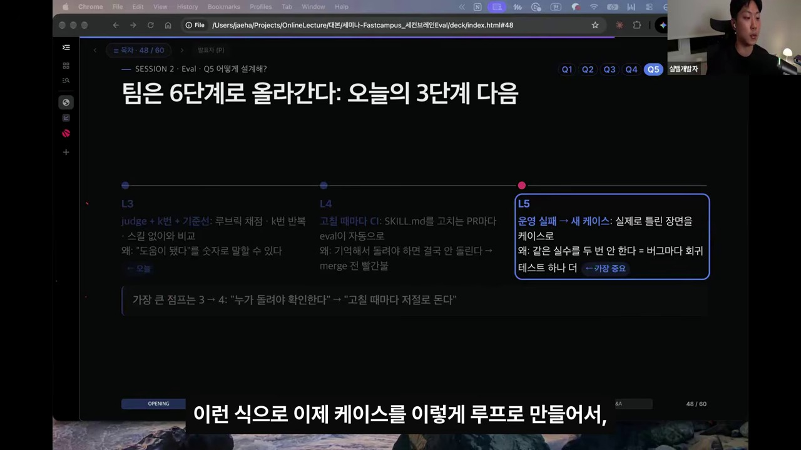
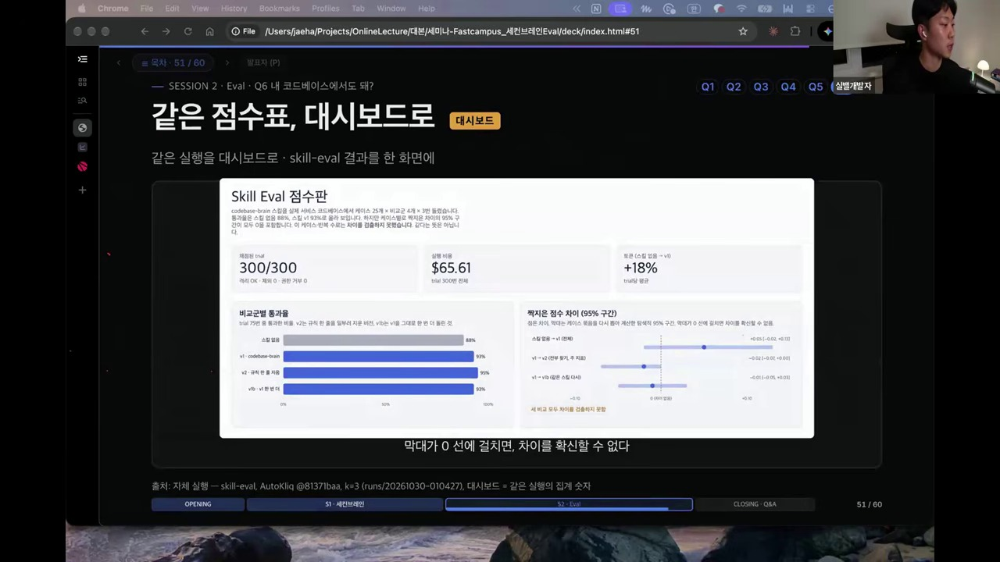

1. **L0~L2 (기초):** 느낌(Vibe) ➔ 하드 체크 ➔ 일회성 수동 비교.
2. **L3 (세미나 실습 단계 — `judge + k번 + 기준선`):** 루브릭 채점 · $k=3$ 반복 · 스킬 없음(`none`) 및 A/A(`v1b`)와 비교하여 *"도움이 됐다"*를 숫자와 신뢰구간(CI)으로 말할 수 있는 단계.
3. **L4 (`고칠 때마다 CI`):** `SKILL.md`를 고치는 PR마다 Eval이 자동으로 돌아가며, 통과선이 무너지면 Merge 전 빨간불이 켜지는 단계 (*"가장 큰 점프는 L3 ➔ L4: '누가 돌려야 확인한다'에서 '고칠 때마다 저절로 돈다'로의 전환"*).
4. **L5 (`운영 실패 ➔ 새 케이스`, 가장 중요):** 프로덕션에서 에이전트가 실제로 틀린 장면을 즉시 Eval 케이스(`cases/*.json`)로 편입하여 **같은 실수를 두 번 하지 않게 만드는 회귀 테스트 루프**.

---

## 6. 결론: 에이전트 시대, 인간 엔지니어의 주도권 [01:15:00 - 01:17:53]

> *"에이전트가 나 대신 일을 해주니까 노트북을 덮어도 머릿속에서 '에이전트 잘 돌아가고 있나?', '지금 에이전트 놀고 있는 거 아닌가?' 하면서 24시간 쉬지 못하는 제 자신을 발견했습니다. 가족과 하와이 여행을 가서도 에이전트 생각만 하고 있더라고요.  
> **우리가 왜 AI를 씁니까? 에이전트한테 주도권을 뺏기지 마세요.** 나의 1번 가치가 무엇인지(가족, 건강, 행복) 명확히 정의하고, 에이전트는 나를 그 가치로 데려다주는 강력한 도구로 부려야 합니다."*

---

## 7. 💡 MyWiki & 모바일 통신/물리계층(PHY) SW 그룹 적용 가이드

우리 그룹(Mobile SW 통신 프로토콜 / PHY Embedded SW) 환경에 본 세미나 및 `second-brain-eval-kit` 코드를 1:1 대응 적용하는 실행 계획:

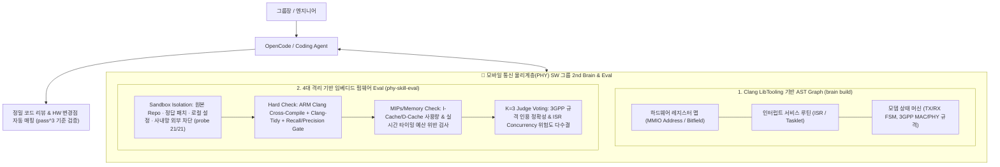

1. **Codebase Graph의 특화 (`complete` / `truncated` / `partial` 라벨 도입):**
   * C/C++ 기반의 하드웨어 레지스터 매핑(`volatile` 포인터, 매크로, 비트마스크, 인터럽트 벡터 테이블)을 Clang AST로 인덱싱하되, 함수 포인터 테이블이나 어셈블리 매크로처럼 정적 분석이 불완전한 구간은 `coverage: partial` 라벨을 띄워 에이전트가 반드시 추가 `grep`을 수행하도록 안전장치 부여.
   * 하드웨어 레지스터 변경 시 파급되는 모든 PHY 블록을 찾는 작업은 한 번이라도 누락되면 모뎀 크래시로 이어지므로 **`pass@3`가 아닌 `pass^3`(3회 연속 100% 적중)** 지표를 적용.
2. **Code Memory의 특화 (`why.mjs` BM25 + RRF):**
   * 3GPP 표준 릴리즈 변경점, 칩셋 호환성 패치, 과거 모뎀 IODT(Inter-Operability Development Testing) 및 실리콘 에라타(Silicon Errata) 해결 커밋을 SQLite FTS5 BM25(제목 가중치 3배) + RRF로 인덱싱하여 LLM 호출 비용 \$0로 1초 이내에 근거 커밋과 문서를 인용.
3. **4대 격리 원칙이 적용된 Firmware Skill Eval 체계:**
   * 사내 코딩 에이전트용 스킬(코드 리뷰 스킬, HW Change List 매핑 스킬)을 평가할 때 **① 원본 스킬 개발 브랜치 차단, ② Golden Patch(정답 수정본) 접근 차단(`invalid` 게이트), ③ 개발자 개인 로컬 설정(`~/.opencode` / `~/.claude`) 차단, ④ 외부 네트워크 차단**의 4대 무균 샌드박스에서 `none` vs `v1` vs `v1b`(A/A)를 비교 측정.
