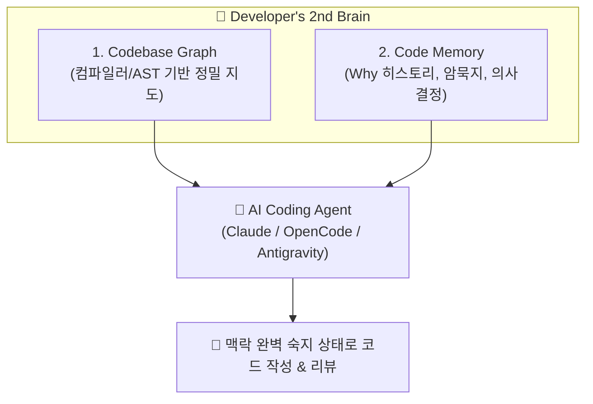

# 🧠 메타 시니어 엔지니어 세미나: AI 에이전트를 위한 2nd Brain과 Eval

> **연사:** 실밸개발자 (Meta 8년차 시니어 소프트웨어 엔지니어)  
> **핵심 주제:** AI 에이전트에게 일을 믿고 맡기는 두 개의 기둥 — **Context(2nd Brain)** & **Verification(Eval)**

---

## 1. 패러다임 전환: AI 코딩의 진짜 병목은 어디인가?

```
[과거 코딩 병목] ➔ 코드 타이핑, 알고리즘 구현 (시간 소모 큼)
[AI 도입 초기]  ➔ LLM이 코드 순식간에 작성 (생산성 3~5배 증가)
[현재 진짜 병목] ➔ 초대형 PR 쏟아짐, 환각 검증 부담 폭증, "결과물을 믿을 수 없음"
```

* **병목의 이동:** 코드를 찍어내는 것은 LLM이 1초 만에 하지만, 그 코드가 맞는지 검증하고 리뷰하는 인간 개발자의 뇌가 극한의 병목에 직면함.
* **프롬프팅 ➔ 하네스(Harness) 전환:**
  * 프롬프트를 매번 세심하게 수정하는 것은 아마추어 방식.
  * 엔터프라이즈 환경에서는 **시스템(하네스)이 에이전트에게 필요한 맥락을 자동으로 먹여주고(Context Layer)**, **그 결과물을 자동으로 검증(Eval Layer)**해야 함.

---

## 2. 1부: 개발자용 세컨드 브레인 (Developer's Second Brain)

새로운 프로젝트나 새로운 AI 세션이 열릴 때마다 "이 코드는 어떤 라이브러리를 쓰고, 아키텍처는 이렇고..."를 사람이 설명하고 있다면 시스템의 실패다.

### 세컨드 브레인의 2대 구성 요소


1. **Codebase Graph (코드베이스 그래프):**
   * 단순 키워드 검색(grep)이나 벡터 RAG로는 함수 호출 체인, 클래스 상속 관계를 파악하지 못함.
   * 컴파일러 AST 기반으로 $k$-Hop 관계망을 인덱싱하여, 변경 시 영향 범위(Blast Radius)를 결정론적으로 계산.
2. **Code Memory (코드 메모리):**
   * 코드 자체에는 적혀있지 않은 **"왜(Why) 이렇게 짰는가?"**, 과거 장애 회고, 아키텍처 결정(ADR)을 지속 축적.
   * 에이전트가 사내 신규 입사자 온보딩을 받듯 코드를 이해함.

---

## 3. 2부: 에이전트 검증 파이프라인 (Eval & EDD)

> *"테스트 코드 없이 배포하지 않듯, Eval 없이 에이전트 스킬을 쓰지 마라."*

### Eval-Driven Development (EDD) 3대 원칙
1. **정량적 점수화 (Pass Rate):**
   * "잘하는 것 같다"가 아니라 $K$번 시도하여 $N$번 성공하는지 수치로 측정.
2. **3대 핵심 질문:**
   * ① 스킬이 의도한 시점에 정확히 트리거되는가? (Trigger Accuracy)
   * ② 기존 방식 대비 실제로 성능/품질이 좋아졌는가? (Quality Improvement)
   * ③ 다른 기존 기능이나 코드를 깨뜨리지 않았는가? (Regression / Side-Effect)
3. **LLM-as-a-Judge & CI 통합:**
   * 결정론적 정적 분석(Linter/Compiler) 통과 후, 시니어 프롬프트를 장착한 평가관 LLM이 다수결로 최종 판정.
   * 로컬 실험에 그치지 않고 GitHub Actions 등 CI에 통합되어 PR 머지를 통제.

---

## 4. 우리 그룹 (Mobile PHY SW / 2nd Brain) 시사점

1. **PHY Embedded CodeGraph 연결:**
   * 이미 우리가 구축한 `ARM Clang .clangd 정규화 + Property Graph (ISR Distance)`가 메타 시니어가 말한 Codebase Graph의 정석 구현체임.
2. **Eval 파이프라인 도입:**
   * 코드 리뷰 에이전트(`phy-chief-verifier`)의 반증(Disproving) 패스를 GitHub CI에 태워 오탐율(False Positive)을 $0\%$로 제어하는 Eval 체계 완성 필요.
