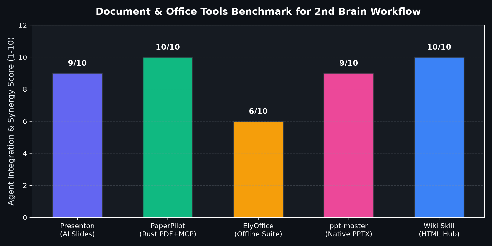
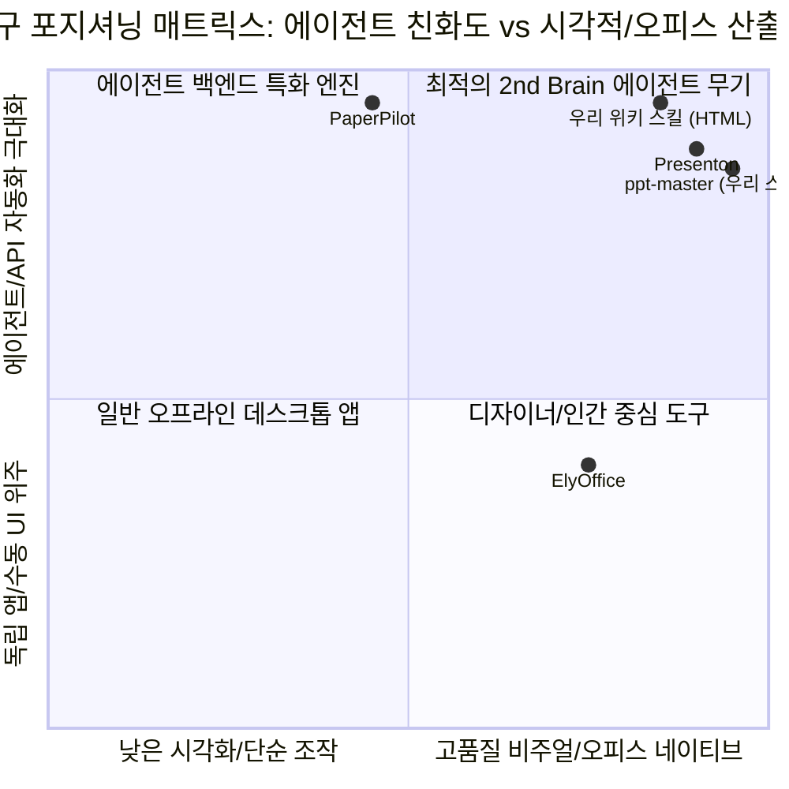

# 🚀 차세대 오피스/문서 자동화 3대 오픈소스 심층 비교 & 벤치마킹 리포트

> **분석 대상:**
> 1. `presenton/presenton` (⭐ 11,000+ | TypeScript / React | AI 프레젠테이션 & API)
> 2. `KrushnaVardhanReddy/PaperPilot` (⭐ 680 | Pure Rust | 로컬 PDF 조작 & MCP 서버)
> 3. `ELY-Open-Source/ElyOffice` (⭐ 1,037 | Rust / GPUI | 오프라인 데스크톱 오피스 스위트)

---

## 1. 종합 벤치마킹 요약 & 에이전트 결합 지표





---

## 2. 도구별 심층 아키텍처 및 강약점 해부

### ① `presenton/presenton`: "감마(Gamma)·캔바(Canva)를 대체하는 오픈소스 AI 발표자료 생성기"
* **아키텍처:** Next.js + Tailwind CSS 기반 시각화 캔버스 + 멀티 LLM 브릿지 (BYOK: Gemini, Claude, Ollama 등 지원).
* **차별화된 강점:**
  * 자연어 프롬프트나 마크다운 문서를 입력하면, AI가 **슬라이드 레이아웃, 컬러 팔레트, 아이콘, 스톡 이미지(Pexels/Unsplash)**를 조합하여 세련된 카드형 슬라이드를 실시간 생성.
  * REST API를 기본 제공하여, 파이썬 스크립트나 AI 에이전트가 헤드리스(Headless)로 슬라이드를 생성하고 `.pptx` 또는 PDF로 추출 가능.
* **약점 & 고려사항:** Node.js/Docker 런타임이 필요하며, 생성되는 `.pptx`의 일부 복잡한 커스텀 도형은 벡터가 아닌 고해상도 이미지 블록으로 삽입되는 경우가 있음.

---

### ② `KrushnaVardhanReddy/PaperPilot`: "AI 에이전트에게 PDF 조작 손발을 달아주는 순수 Rust 로컬 엔진"
* **아키텍처:** Zero-Cloud Pure Rust 코어 + PaddleOCR (`rten`) + Tauri 데스크톱 UI + **Native MCP Server**.
* **차별화된 강점:**
  * **MCP 서버 네이티브 탑재:** Claude Code, Antigravity, Cursor 등 코딩 에이전트가 `mcp` 호출을 통해 로컬 PDF 병합, 특정 페이지 분할, OCR 텍스트 추출, 메타데이터 제거를 100% 로컬에서 실행.
  * 외부 서버 통신이 전혀 없으므로 사내 기밀 보고서, 통신 규격서, 특허 PDF를 안심하고 다룰 수 있음.
* **약점 & 고려사항:** 문서를 새로 '디자인'하여 생성하는 도구가 아니라, 기존 PDF 문서를 전처리·편집·추출하는 '프로세싱 도구'임.

---

### ③ `ELY-Open-Source/ElyOffice`: "Rust와 GPUI로 빚어낸 초경량 제로-클라우드 오피스"
* **아키텍처:** Zed 에디터에서 사용하는 초고속 GPU 렌더링 프레임워크(GPUI) + Rust 코어 + LibreOfficeKit/MuPDF C++ 백엔드.
* **차별화된 강점:**
  * MS Office나 무거운 LibreOffice 없이도 윈도우 환경에서 즉시 뜨는 7종 네이티브 앱 (`ElyDoc`, `ElyTable`, `ElyShow`, `ElyPDF`, `ElyMail`, `ElyTree`, `ElyMark`).
  * 텔레메트리, 로그인, 클라우드 동기화가 완전히 배제된 극단적 프라이버시 보장.
* **약점 & 고려사항:** 독립 데스크톱 GUI 프로그램 중심이므로, AI 에이전트가 백그라운드에서 스크립트로 문서를 컴파일하는 파이프라인 연동성은 상대적으로 낮음 (인간의 수동 검토용에 최적).

---

## 3. 5대 핵심 차원 비교 매트릭스

| 평가 항목 | `presenton` | `PaperPilot` | `ElyOffice` | `ppt-master` (현재 구현) | 내 위키 스킬 (`lecture-html`) |
| :--- | :---: | :---: | :---: | :---: | :---: |
| **주요 역할** | AI 슬라이드 자동 생성 | PDF 로컬 가공 & OCR | 데스크톱 오피스 스위트 | Python Native PPTX 빌더 | 인터랙티브 웹 리포트/슬라이드 |
| **시각적 완성도** | ⭐⭐⭐⭐⭐ (상용급) | ⭐⭐⭐ (문서 규격) | ⭐⭐⭐⭐ (MS오피스형) | ⭐⭐⭐⭐⭐ (다크 테마) | ⭐⭐⭐⭐⭐ (다크 ScrollSpy) |
| **에이전트 결합도** | ⭐⭐⭐⭐ (REST API) | ⭐⭐⭐⭐⭐ (MCP 지원) | ⭐⭐ (GUI 위주) | ⭐⭐⭐⭐⭐ (CLI/스크립트) | ⭐⭐⭐⭐⭐ (네이티브) |
| **설치 & 종속성** | Docker / Node.js | 단일 Rust 바이너리 | 단일 설치형 앱 | `python-pptx` (초경량) | 종속성 없음 (순수 HTML/JS) |
| **PowerPoint (.pptx)** | 자동 디자인 변환 | N/A (PDF/Excel 위주) | 지원 (ElyShow) | 네이티브 벡터/도형/차트 | N/A (웹 브라우저 렌더링) |

---

## 4. 내 볼트(Brain) 실무 파이프라인 구축 결론

```
[내 2nd Brain의 궁극적 문서 시각화 파이프라인]

1. [텍스트/위키 수집] ➔ Obsidian Markdown (수렴된 지식 원본)
          │
          ├──▶ 🌐 빠른 웹 브리핑/모바일 공유  ➔ [위키 스킬 (HTML/Bento)] (즉시 열람)
          │
          ├──▶ 📊 사내 정기/임원 보고용 PPT  ➔ [ppt-master / python-pptx] (편집 가능한 16:9 와이드)
          │
          ├──▶ 🎨 디자인 가미된 대외 발표    ➔ [Presenton API] (AI 레이아웃 & 이미지)
          │
          └──▶ 📑 대용량 PDF 규격서/문서 분석  ➔ [PaperPilot MCP] (로컬 OCR & 파싱)
```

우리의 볼트에는 **① 일상적 지식 열람용 HTML(현재 위키 스킬)**과 **② 실무 보고용 파이썬 PPTX 자동화(오늘 구축한 ppt-master)**가 이미 최고 수준으로 갖추어졌으며, 필요 시 **`PaperPilot`의 MCP 서버**를 얹어 PDF 규격서 분석 능력을 추가하는 것이 가장 이상적인 구성입니다.

