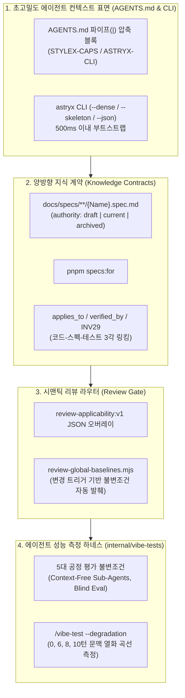

# Meta Astryx (`meta/astryx`) 심층 해부 — Agent-Ready 아키텍처와 Knowledge Contracts

> **핵심 요약 (Executive Summary)**
> **[`meta/astryx`](https://github.com/meta/astryx)**(★ 15,000+, MIT 라이선스)는 겉으로는 Meta가 8년간 사내 13,000개 이상의 앱에서 사용한 **React 19 + StyleX 기반 UI 디자인 시스템**입니다. 그러나 아키텍처 관점에서 진짜 핵심 가치는 **"사람과 AI 에이전트가 동일한 도구와 단일 진실 공급원(Single Source of Truth)으로 협업하도록 설계된 최초의 엔터프라이즈 Agent-Native 레퍼런스 저장소"**라는 데 있습니다.
> 오늘 학습한 [[01_Meta_Senior_2ndBrain_and_Eval_Notes|실밸개발자(하재상)의 2nd Brain & Eval 세미나]]와 [[AI_시대_새로운_패러다임_Spec_Driven_Development_실밸개발자|Spec-Driven Development(SDD)]]의 개념들이 Meta의 실제 오픈소스 프로덕션 저장소에서 어떻게 코드로 구현되어 있는지 보여주는 살아있는 교과서입니다.

---

## 1. 기본 프로필 및 UI/프론트엔드 계층 아키텍처

| 항목 | 상세 내용 |
| :--- | :--- |
| **저장소 URL** | [https://github.com/meta/astryx](https://github.com/meta/astryx) (`https://astryx.atmeta.com`) |
| **핵심 기여자** | `cixzhang` (3,436+ commits), `vjeux` (Christopher Chedeau — React Native, Prettier, Excalidraw 창시자) 외 Meta 코어 엔지니어링 팀 |
| **기술 스택** | TypeScript, React 19+, `@stylexjs/stylex` (빌드 타임 Atomic CSS 컴파일러), pnpm 11 워크스페이스, Vitest, Playwright |
| **패키지 구성** | `@astryxdesign/core` (150+ 컴포넌트), `@astryxdesign/cli` (에이전트/개발자 통합 CLI), `@astryxdesign/build`, `@astryxdesign/themes` (7대 테마: neutral, butter, chocolate, matcha, stone, gothic, y2k), `@astryxdesign/charts`, `@astryxdesign/vega` |

### 1.1 UI 디자인 시스템으로서의 4대 차별점
1. **Open Internals & `swizzle` (내부 개방성):** 컴포넌트를 닫힌 최상위 API 뒤에 가두지 않고 하위 빌딩 블록을 직접 노출합니다. 깊은 커스터마이징이 필요하면 `astryx swizzle <Component>` 명령으로 원본 TypeScript/StyleX 소스코드를 프로젝트 내부로 즉시 추출(Eject)하여 소유할 수 있습니다.
2. **No Styling Lock-in (스타일링 종속성 탈피):** 내부적으로는 Meta의 `StyleX`로 작성되었으나, 외부 소비자는 StyleX를 전혀 몰라도 일반 `className`, Tailwind CSS, CSS Modules로 자유롭게 오버라이드할 수 있습니다.
3. **CSS Custom Property 기반 테마 분리:** 컴포넌트 코드를 래핑(Wrapping)하거나 포크(Fork)하지 않고도 CSS 변수 오버라이드만으로 브랜드 테마를 100% 교체합니다.
4. **Built for People and Agents (인간-에이전트 통합 인터페이스):** 문서(`.doc.mjs`), CLI(`@astryxdesign/cli`), MCP 서버가 하나의 스키마로 설계되어 인간 개발자와 AI 에이전트가 동일한 명령어로 컴포넌트를 탐색하고 조립합니다.

---

## 2. 핵심 분석: `meta/astryx`의 4대 Agent-Native 하네스 엔지니어링



### 2.1 토큰 극한 압축형 `AGENTS.md` 및 `--dense` CLI (2nd Brain Bootstrap)
일반적인 마크다운 줄글은 토큰을 과도하게 소모하고 LLM의 주의력(Attention)을 분산시킵니다. `meta/astryx`는 `AGENTS.md` 최하단에 **파이프(`|`) 구분자 기반의 결정론적 치트시트 블록**을 배치했습니다:

```text
<!-- STYLEX-CAPS:START -->
[StyleX v0.19.0 CSS Support]|Use CSS-native solutions. Don't build JS workarounds for supported features.
|AT-RULES: @media, @supports, @container (+named), @starting-style, @scope — YES
|AT-RULES: @layer, @property (explicit) — NO (compiles but invalid CSS output)
|NESTING: CSS nesting with & — NO (use stylex.when.ancestor/descendant/sibling for parent-child state)
|PATTERN: dialog entry animation -> @starting-style (not useState+rAF)
|VERIFY: node internal/stylex-capabilities/scan.mjs
<!-- STYLEX-CAPS:END -->
```

또한 에이전트가 작업 전 **500ms 이내에 필요한 지식만 on-demand로 조회**할 수 있도록 CLI에 에이전트 전용 플래그(`--dense`, `--skeleton`, `--index`)를 구현했습니다:
- `astryx docs principles --dense`: 불필요한 수식어를 제거한 고밀도 토큰 포맷으로 디자인 원칙 덤프.
- `astryx component <Name> --dense`: 특정 컴포넌트 수정 전 Props, Variants, Anatomy만 압축 조회.
- `astryx template <name> --skeleton`: 전체 보일러플레이트 대신 공간 주석(Spatial Annotations)이 달린 레이아웃 뼈대만 출력.

---

### 2.2 Knowledge Contracts & `pnpm specs:for <path>` (스펙-코드 양방향 그래프)
`docs/architecture/knowledge-contracts.md`는 이 시스템의 목적을 단 두 줄로 정의합니다:
> **"리뷰어는 과거의 수많은 PR 히스토리를 뒤지지 않고도 다음 두 가지 질문에 즉시 답할 수 있어야 한다:**
> **1. 인간이 이미 결정한 동작(Behavior)은 무엇인가?**
> **2. 이번 PR은 인간의 승인이 필요한 새로운 결정을 내리고 있는가?"**

이를 위해 모든 스펙 문서(`docs/specs/`)는 엄격한 YAML Frontmatter 스키마를 가집니다:
```yaml
---
schema_version: 1
kind: architecture # 또는 component, module, family, theme, system-spec
id: architecture:knowledge-contracts
authority: current # draft | current | archived
approved_by: cixzhang
applies_to: [AGENTS.md, docs/, packages/]
verified_by: [scripts/check-knowledge.test.mjs, scripts/specs-for-file.test.mjs]
---
```
- **권위 상태 머신 (`authority: draft | current | archived`):** 오직 `.github/ENGOWNERS` 또는 `DESIGNOWNERS`가 승인한 **`current`** 문서만 구현과 코드 리뷰의 법적 근거(Authority)가 됩니다. 병합된 코드나 오래된 위키 페이지에서 암묵적으로 승인을 추론하는 행위를 원천 금지합니다.
- **양방향 추적기 (`pnpm specs:for`):**
  - 파일 수정 전: `pnpm specs:for <path>`를 실행하면 해당 소스 파일에 연결된 컴포넌트 스펙, 상위 패밀리 계약, 시스템 스펙 조항(`spec:AST-108/FR4`), 검증 테스트(`verified_by`)를 즉시 출력합니다.
  - 파일 수정 후: `pnpm specs:for --diff origin/main`을 실행하면 변경된 코드 라인(Concerns)과 매칭되는 불변조건(Claims)만 우선순위로 정렬해 보여줍니다.
- **주석 불변조건 (`INV29` & ASD-STE100):**
  - 각 소스 파일 상단에는 최대 12줄 이내의 `@input`, `@output`, `@position`, `SYNC:` 헤더만 유지합니다.
  - 코드 내부 주석은 코드를 중언부언 설명하지 않고 오직 **이유(Reason), 제약조건(Constraint), 불변조건(Invariant)**만 **ASD-STE100(항공우주 표준 간소화 기술 영어: 짧은 단문, 능동태, 현재 시제)**으로 작성하도록 강제합니다.

---

### 2.3 시맨틱 트리거 기반 리뷰 라우팅 (`review-applicability:v1`)
전체 스펙 문서를 통째로 컨텍스트에 넣으면 토큰 낭비와 환각이 발생하므로, 각 문서 내부에 `review-applicability:v1` JSON 블록을 두어 **특정 시맨틱 트리거가 발동할 때만 해당 조항 ID(`INV9`, `DEC-12` 등)를 라우팅**합니다:
```bash
node scripts/review-global-baselines.mjs \
  --authority-commit <base-sha> \
  --review-head <head-sha> \
  --triggers <comma-separated-triggers>
```
이를 통해 에이전트와 인간 리뷰어는 전체 문서가 아니라 **"이번 변경사항이 직접 건드린 조항(Claim)"**만 핀셋처럼 발췌하여 검증합니다.

---

### 2.4 에이전트 코드 생성 Eval 하네스 (`internal/vibe-tests` & `/vibe-test`)
`meta/astryx`는 **"우리가 작성한 `AGENTS.md`와 CLI가 실제로 LLM의 코드 생성 품질을 높이는가?"**를 감이 아닌 정량 지표로 검증하기 위해 `internal/vibe-tests/` 패키지를 내장하고 있습니다.

#### ① Checker Protocol 5대 불변조건 (Eval 무결성 원칙)
1. **Fair Evaluators (공정한 평가기):** 어떤 설정이 생성한 코드인지 블라인드 처리한 상태에서 동일한 `tsc` 컴파일 및 스코어링 로직 적용.
2. **Only the System Under Test Varies (단일 변인 통제):** 프롬프트 텍스트, 페르소나, 출력 포맷을 100% 동일하게 고정.
3. **Never Leak the Answer (정답 유출 금지):** 평가 기준인 `expectedComponents`(예: `["RadioList", "Card"]`)는 평가기만 볼 수 있으며, 서브에이전트 프롬프트에는 절대 힌트를 주지 않음.
4. **Representative Environment (실제 소비자 환경 모사):** 소스 레포지토리 내부가 아니라 실제 외부 개발자가 `npm install`로 패키지를 설치했을 때의 `node_modules` 환경에서 에이전트를 테스트.
5. **Context-Free Sub-Agents (무균 서브에이전트):** 프롬프트마다 이전 대화 문맥이 전혀 없는 새로운 서브에이전트를 생성하여 테스트.

#### ② 10-Turn 컨텍스트 열화 곡선 측정 (`/vibe-test 5 --degradation`)
단발성(One-shot) 프롬프트에서는 잘 동작하던 `AGENTS.md` 규칙도 대화가 길어지면 LLM이 잊어버리는 현상(Context Rot)이 발생합니다.
- `--degradation` 모드는 10턴의 대화 동안 의도적으로 **잡담(Filler), 교란 질문(Distractor), 복구 턴(Recovery)**을 섞어 주입합니다.
- **Turn 0, Turn 6, Turn 8, Turn 10** 시점에 프로브(Probe)를 던져 에이전트가 탈출 해치(Escape Hatches — 규칙을 어기고 인라인 스타일을 쓰는 등)를 얼마나 사용하는지 꺾은선 그래프로 열화 곡선을 측정합니다.

---

## 3. 그룹장 도메인(모바일 통신 프로토콜 / PHY 임베디드 SW) 적용 청사진

`meta/astryx`의 아키텍처는 웹 UI뿐만 아니라 **수천 개의 3GPP 스펙 조항과 하드웨어 레지스터 제약조건을 준수해야 하는 모바일 PHY 임베디드 SW 그룹의 2nd Brain 및 AI 코드 리뷰 하네스**에 1:1로 매핑됩니다.

| `meta/astryx` 핵심 메커니즘 | 모바일 PHY 임베디드 SW 그룹 이식 방안 (`phy-brain`) | 기대 효과 |
| :--- | :--- | :--- |
| **`AGENTS.md` 파이프(`\|`) 압축 블록** | • `[PHY C/C++ Invariants]\|Dynamic alloc (malloc/new) in L1 ISR — NO\|Static DMA ring buffer — YES` 형태로 하드웨어/RTOS 금지 규칙을 30줄 이내로 초고밀도 압축 | 에이전트 부트스트랩 토큰 80% 절감 및 하드웨어 치명적 위반 방지 |
| **`pnpm specs:for <path>` & `--diff`** | • `python scripts/phy_specs_for.py <file.c>` 구현<br>• 각 `.c`/`.h` 파일과 3GPP/모뎀 블록 스펙(`docs/specs/pusch_dmrs.spec.md`, `authority: current`) 및 검증 테스트(`verified_by`)를 양방향 링킹 | 수정할 C 파일이 지켜야 할 타이밍 예산(예: `INV-04: 250us`)과 실리콘 에라타(`ERRATA-402`)를 코딩 전 1초 만에 조회 |
| **12줄 파일 헤더 (`@input`, `@output`, `@position`)** | • 모든 PHY DSP/제어 모듈 상단에 입력 심볼/인터럽트(`@input`), 출력 레지스터/버퍼(`@output`), HARQ/스케줄링 타이밍 내 위치(`@position`) 명시 | 대규모 레거시 C 코드베이스에서 에이전트의 파일 탐색 정확도 극대화 |
| **`/vibe-test --degradation` (10턴 열화 Eval)** | • 사내 오픈소스 모델(DeepSeek/Qwen/GLM)이 10턴 이상 긴 디버깅 세션 후에도 MISRA-C 및 레지스터 락(Lock) 규칙을 유지하는지 Turn 0/6/8/10 열화율 측정 | 모델 교체 또는 `AGENTS.md` 수정 시 정량적 품질 검증 가능 |

---

## 🔗 관련 문서 (Internal Links)
- [[entities/meta-astryx|Meta Astryx (Entity)]]
- [[01_Meta_Senior_2ndBrain_and_Eval_Notes|실밸개발자(Meta 시니어) — 개발자를 위한 2nd Brain과 Eval 전수 노트]]
- [[AI_시대_새로운_패러다임_Spec_Driven_Development_실밸개발자|AI 시대 새로운 패러다임: Spec-Driven Development (SDD)]]
- [[concepts/clang-codegraph|Clang 코드그래프 (Clang CodeGraph)]]
- [[synthesis/phy-sw-ai-code-review-strategy|PHY 임베디드 SW 하이브리드 AI 코드 리뷰 전략]]

