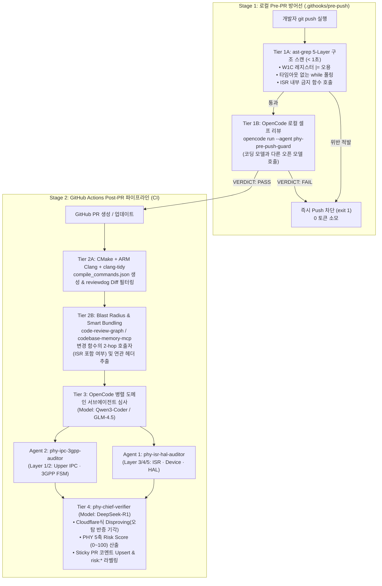

# PHY 임베디드 SW 그룹 차세대 AI 코드 리뷰 마스터 블루프린트

> **문서 위상 (Master Blueprint)**
> 본 문서는 **(1) 실밸개발자(Meta 시니어 엔지니어)의 AI 코드 리뷰 파이프라인 강의**와 **(2) GitHub 상위 25대 코드 리뷰 오픈소스 아키텍처 벤치마크**, 그리고 **(3) 우리 PHY SW 그룹의 5-Layer 임베디드 도메인 특성**을 하나로 통합한 최종 실행 설계서다.
>
> - **선행 분석 문서:**
>   1. 📺 강의 전수 분석: [[코드_리뷰가_병목이_되는_이유_메타_시니어_AI_코드_리뷰_실밸개발자]]
>   2. 📊 25대 오픈소스 벤치마크: [[01_OpenSource_Code_Review_Benchmark]]
>   3. 🛡️ PHY 5-Layer 불변조건 카탈로그: [[02_PHY_5Layer_Review_Invariants_Catalog]]
>   4. ⚙️ 즉시 투입 가능한 설정 파일 패키지: `03_PHY_Review_Harness_PoC/`

---

## 1. 우리 그룹의 엔지니어링 환경 및 설계 제약 조건

| 항목 | 확정 사양 (Confirmed Stack) | 아키텍처 설계 반영 전략 |
| :--- | :--- | :--- |
| **대상 도메인** | **Mobile PHY Embedded SW (ARM Core)** • Layer 1: Upper-layer IPC Interface • Layer 2: 3GPP Standard Procedure • Layer 3: Device Layer • Layer 4: HAL Register Control • Layer 5: Interrupt (ISR) & Event-driven | 범용 웹 보안/DB 루브릭을 폐기하고 **실시간성(ISR/TTI 데드라인), 하드웨어 레지스터(`volatile`/`W1C`/`RMW`/`DMB`), IPC 구조체 정렬, 3GPP 상태 머신 무결성** 중심의 **PHY 5축 리스크 루브릭**으로 전면 재설계 |
| **형상관리 / CI** | **GitHub** (Pull Request & GitHub Actions) | 로컬 `.githooks/pre-push` 1차 방어선 + GitHub Actions `pull_request` 2차 방어선 + `<!-- phy-ai-review -->` 단일 마커 코멘트 Upsert & `risk:*` 라벨 자동 라우팅 |
| **에이전트 하네스** | **`OpenCode`** (`anomalyco/opencode`, ⭐223.4k) | `opencode.json` 및 `.opencode/agent/*.md`, `.opencode/command/*.md` 표준 스키마를 사용하여 로컬 CLI(`opencode run`)와 CI 헤드리스 실행을 단일 설정으로 통일 |
| **사용 LLM** | **Open-Weight Models 전용** (`DeepSeek-V3/R1`, `GLM-4.5`, `Qwen3-Coder`) | 1) **이종 모델 크로스 리뷰:** 코딩/초안(`Qwen` / `GLM`) ↔ 리뷰/최종반증(`DeepSeek-R1`) 교차 배치로 확증 편향 차단 2) 오픈 모델의 긴 컨텍스트 주의력 저하를 막기 위해 **그래프 기반 Smart Bundling** 선행 |
| **컴파일러 & 빌드** | **`ARM Clang` (`armclang`) + `CMake`** | `cmake -DCMAKE_EXPORT_COMPILE_COMMANDS=ON`으로 생성된 **`compile_commands.json`**을 `clangd` (`codebase-memory-mcp`) 및 `clang-tidy`에 직결하여 매크로·타입·호출 그래프를 100% 정확하게 해석 |

---

## 2. End-to-End 하이브리드 리뷰 파이프라인 아키텍처

순수 LLM에게 수천 줄의 C 코드 diff를 그대로 던지면 오탐(False Positive)이 쏟아진다. 본 아키텍처는 알리바바의 **`open-code-review`**(결정론적 번들링 + 반증), **`code-review-graph` / `codebase-memory-mcp`**(파급 반경 추출), **`cloudflare/security-audit-skill`**(오탐 기각 원장), 그리고 실밸개발자의 **2단계(Pre-PR / Post-PR) 리스크 게이트**를 결합한 **4-Tier 파이프라인**이다.

---

## 3. PHY SW 그룹 전용 5축 Risk Score 루브릭 (0~100점) 및 액션 매트릭스

실밸개발자 강의의 5축(Security 30 / Scope 20 / Breaking 20 / Test 15 / Migration 15)을 **결정론적 컴파일러/그래프 지표 + LLM 도메인 평가**가 결합된 **PHY 임베디드 5축 루브릭**으로 정의한다.

### 3.1 5축 채점 기준표 (총점 0 ~ 100점)

| 축 (Axis) | 배점 | 결정론적 기본 점수 산식 (Graph / AST / Compiler) | OpenCode 에이전트 정성 평가 기준 |
| :--- | :---: | :--- | :--- |
| **1. Real-Time & ISR Determinism** *(실시간성 및 인터럽트 결정성)* | **30점** | • 수정된 함수가 `ISR_*`/`FIQ_*`이거나 콜 그래프 상 ISR의 하위 피호출자(Callee)인 경우 기본 `+15점` • 루프(`for`/`while`) 추가 시 `+5점` | • ISR/HISR 경로 내 사이클 예산 증가 가능성 • 블로킹 API, 동적 할당, 무거운 연산, 타임아웃 없는 하드웨어 폴링 존재 시 **즉시 25~30점 부여** |
| **2. HAL Register & Concurrency Safety** *(레지스터 제어 및 동시성 안전)* | **25점** | • `hal/`, `reg/`, `dma/` 경로 파일 포함 시 기본 `+10점` • 전역/정적 공유 변수 쓰기 추가 시 `+5점` | • MMIO `volatile` 누락, 비원자적 Read-Modify-Write(`\|=`), `W1C` 레지스터 오조작, ARM `DMB`/`DSB`/`ISB` 배리어 또는 캐시 Clean/Invalidate 누락 위험 평가 |
| **3. IPC & 3GPP Contract Breakage** *(상위 인터페이스 및 프로토콜 계약)* | **20점** | • `ipc/`, `l1_l2_if/` 헤더 구조체 수정 시 기본 `+12점` • `proc/` 상태 머신 `enum`/`switch` 변경 시 `+8점` | • L2/MAC ↔ L1/PHY 메시지 구조체 바이트 크기·정렬·패딩 변화 여부 • HARQ/RACH/CSI/BWP 절차의 취소(Abort)/타임아웃 Dead-end 상태 존재 여부 |
| **4. Call-Graph Blast Radius** *(컴파일러/그래프 기반 파급 반경)* | **15점** | • 1-hop 호출자 $\le 3$개 & 변경 $\le 100$줄: `0~4점` • 호출자 $4\sim 15$개 또는 공용 `.h` 수정: `5~10점` • 호출자 $> 15$개 또는 코어 공통 헤더 수정: `11~15점` | • 변경된 API의 사전/사후 조건(Pre/Post-condition) 변화가 기존 호출자(Callers)를 깨뜨릴 가능성 (`winnin/farol` 방식) |
| **5. Target Build & Verification Evidence** *(빌드 무결성 및 검증 증적)* | **10점** | • `armclang` / `clang-tidy` 신규 경고 0건 & 테스트 파일 포함: `0점` • 테스트 미포함: `+5점` • 정적 분석 경고 무시(`NOLINT`) 추가: `+10점` | • 변경된 프로시저/HAL 분기를 검증하는 L1 시뮬레이터 테스트 또는 유닛 테스트 시나리오의 충분성 |

### 3.2 점수 구간별 액션 매트릭스 (Action Matrix)

| 총점 구간 | GitHub 라벨 | 자동화된 게이트 및 리뷰 라우팅 규칙 |
| :---: | :---: | :--- |
| **`0 ~ 15점`** | `risk:low` | • AI 요약 코멘트 게시 • **동료 1명 승인(LGTM) 시 즉시 머지 가능 후보** (`auto-merge-candidate`) |
| **`16 ~ 35점`** | `risk:medium` | • AI 코멘트 게시 + **담당 모듈 리뷰어 1명 필수 지정** (`Auto-merge` 비활성) |
| **`36 ~ 60점`** | `risk:high` | • AI 코멘트 게시 + **파트장/시니어 리뷰어 1명 필수 지정** • OpenCode **적대적 심층 리뷰(`phy-adversarial-review`)** 자동 추가 실행 |
| **`61 ~ 100점`** | `risk:critical` | • **GitHub Merge 즉시 차단 (Check Run 실패 처리)** • **그룹장/수석 아키텍트 메신저 호출 + 3GPP/HW 변경 사양서(RFC/ADR) 및 타겟 보드 실측 로그 첨부 요구** |

---

## 4. OpenCode + 오픈 모델(DeepSeek / GLM / Qwen) 최적 구성 전략

### 4.1 왜 OpenCode 내 서브에이전트를 역할별로 분리하는가?
단일 에이전트에게 5개 계층의 모든 규칙을 한 번에 검사하게 하면 프롬프트가 길어져 오픈 모델의 정밀도가 떨어진다. 따라서 `alibaba/open-code-review`와 `cloudflare/security-audit-skill`의 아키텍처를 결합하여 **3개의 전문 에이전트**로 분리한다:

1. **`phy-isr-hal-auditor` (Model: `Qwen3-Coder-480B` 또는 `GLM-4.5`):**
   - `isr/`, `hal/`, `dev/`, `dma/` 변경 시 호출.
   - 하드웨어 레지스터(`volatile`, `W1C`, `RMW`, Shadow Reg), 메모리 배리어(`DMB`/`DSB`), DMA 캐시 일관성, ISR 블로킹/폴링 루프만 전문적으로 사냥.
2. **`phy-ipc-3gpp-auditor` (Model: `Qwen3-Coder-480B` 또는 `GLM-4.5`):**
   - `ipc/`, `proc/`, `ul/`, `dl/`, `meas/` 변경 시 호출.
   - L1-L2 IPC 구조체 정렬/패딩, 범위 검증, 3GPP HARQ/RACH/CSI 상태 머신 전이 누락 및 SFN/Slot 랩어라운드 연산만 전문적으로 사냥.
3. **`phy-chief-verifier` (Model: `DeepSeek-R1` — 추론 특화 모델):**
   - 앞선 두 에이전트의 후보 지적 사항과 `ast-grep`/`clang-tidy` 출력을 입력받아 **반증 패스(Disproving Pass)**를 수행.
   - *"상위 호출자에서 이미 `IRQ_LOCK`을 걸었는가?", "컴파일러가 이미 보장하는가?"*를 따져 **오탐(False Positive)을 `rejected`로 버리고**, 진짜 결함만 `[CONFIRMED_BLOCKER]` 또는 `[NEEDS_HW_VALIDATION]`으로 남긴 뒤 최종 **0~100점 Risk Score**를 산출.

---

## 5. 단계별 그룹 롤아웃 로드맵 (6대 안전 가드 적용)

실밸개발자 강의의 **슬라이드 125 (6대 안전 가드)**를 준수하여 현업 PHY 개발 일정에 충격을 주지 않고 4단계(8주)에 걸쳐 점진적으로 롤아웃한다.

| 단계 | 기간 | 핵심 목표 및 적용 범위 | 안전 가드 설정 |
| :--- | :---: | :--- | :--- |
| **Phase 1: 결정론적 기반 & 그래프 구축** | **Week 1~2** | • CMake `compile_commands.json` 자동 추출 • `.ast-grep` PHY 5-Layer 핵심 룰 10개 작성 • `codebase-memory-mcp` & `code-review-graph` 연동 | PR 차단 없음 (로컬 CLI로 시니어 그룹에서 먼저 테스트) |
| **Phase 2: 로컬 Pre-push 훅 배포** | **Week 3~4** | • `.githooks/pre-push` 배포 (`ast-grep` + `opencode run`) • 푸시 전 명백한 HAL `W1C` 실수, 타임아웃 없는 `while` 루프 로컬 차단 | `SKIP_PHY_REVIEW=1` 환경변수로 긴급 우회 허용 & API 장애 시 Fail-Open 보장 |
| **Phase 3: GitHub Actions Dry-Run** | **Week 5~6** | • 모든 PR에 `phy-opencode-pr-review.yml` 가동 • Sticky 코멘트로 5축 Risk Score 표와 `[CONFIRMED_BLOCKER]` 게시 | **100% Dry-Run 모드:** 코멘트와 `risk:*` 라벨만 부착하고 Merge 게이트는 차단하지 않음. 오탐률 `< 10%` 달성까지 프롬프트/룰 튜닝 |
| **Phase 4: Risk Gate 본가동** | **Week 7~8** | • `risk:critical (61~100점)` 및 `[CONFIRMED_BLOCKER]` 발견 시 Merge 차단 게이트 활성화 • `risk:low (0~15점)` PR은 1인 승인 패스트트랙 적용 | 야간(18시~09시) 및 주말 자동 머지 금지 유지, 주간 오탐 리뷰 피드백 루프 운영 |

---

## 6. 즉시 적용 가능한 PoC 설정 파일 패키지 안내

바로 리포지토리에 복사해 넣을 수 있는 전체 실행 파일들이 같은 폴더의 `03_PHY_Review_Harness_PoC/` 하위 디렉토리에 구축되어 있습니다:

1. 📄 [opencode.json](file:///c:/Users/kihok/내 드라이브/MyWiki/_sources/Study/Code-Review/PHY-Embedded-SW/20261031_Deep_Research/03_PHY_Review_Harness_PoC/opencode.json) — OpenCode 모델 프로바이더(`DeepSeek`, `GLM`, `Qwen`), MCP 서버(`codebase-memory-mcp`), 에이전트 매핑 설정
2. 📄 [phy-review.md](file:///c:/Users/kihok/내 드라이브/MyWiki/_sources/Study/Code-Review/PHY-Embedded-SW/20261031_Deep_Research/03_PHY_Review_Harness_PoC/.opencode/command/phy-review.md) — `/phy-review` 슬래시 커맨드 정의
3. 📄 [phy-isr-hal-auditor.md](file:///c:/Users/kihok/내 드라이브/MyWiki/_sources/Study/Code-Review/PHY-Embedded-SW/20261031_Deep_Research/03_PHY_Review_Harness_PoC/.opencode/agent/phy-isr-hal-auditor.md) — Layer 3/4/5 (Device, HAL, ISR) 특화 서브에이전트
4. 📄 [phy-ipc-3gpp-auditor.md](file:///c:/Users/kihok/내 드라이브/MyWiki/_sources/Study/Code-Review/PHY-Embedded-SW/20261031_Deep_Research/03_PHY_Review_Harness_PoC/.opencode/agent/phy-ipc-3gpp-auditor.md) — Layer 1/2 (Upper IPC, 3GPP Procedure) 특화 서브에이전트
5. 📄 [phy-chief-verifier.md](file:///c:/Users/kihok/내 드라이브/MyWiki/_sources/Study/Code-Review/PHY-Embedded-SW/20261031_Deep_Research/03_PHY_Review_Harness_PoC/.opencode/agent/phy-chief-verifier.md) — 오탐 반증(Disproving) 및 5축 Risk Score 최종 판정 에이전트 (`DeepSeek-R1`)
6. 📄 [phy-hal-isr-rules.yml](file:///c:/Users/kihok/내 드라이브/MyWiki/_sources/Study/Code-Review/PHY-Embedded-SW/20261031_Deep_Research/03_PHY_Review_Harness_PoC/.ast-grep/rules/phy-hal-isr-rules.yml) — `ast-grep` 결정론적 C/C++ AST 규칙 팩
7. 📄 [pre-push](file:///c:/Users/kihok/내 드라이브/MyWiki/_sources/Study/Code-Review/PHY-Embedded-SW/20261031_Deep_Research/03_PHY_Review_Harness_PoC/.githooks/pre-push) — 로컬 Pre-push Git 훅 스크립트 (`ast-grep` + `opencode run`)
8. 📄 [phy-opencode-pr-review.yml](file:///c:/Users/kihok/내 드라이브/MyWiki/_sources/Study/Code-Review/PHY-Embedded-SW/20261031_Deep_Research/03_PHY_Review_Harness_PoC/.github/workflows/phy-opencode-pr-review.yml) — GitHub Actions CI 워크플로우 (`CMake` + `armclang` + `code-review-graph` + `OpenCode`)
