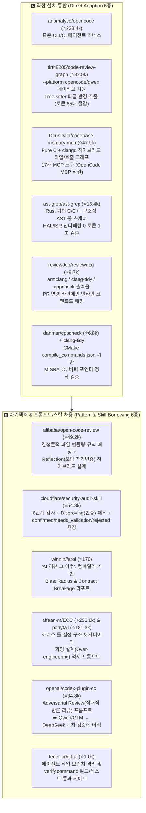

# 25대 오픈소스 코드 리뷰 & 그래프 분석 리포지토리 전수 벤치마크

> **분석 기준 및 환경 정합성**
> - **대상 조직:** 모바일 PHY 임베디드 SW 그룹 (ARM CPU Core, Upper IPC, 3GPP Procedure, Device, HAL Register, ISR/Event-driven)
> - **확정 기술 스택:** `GitHub` 형상관리 · `OpenCode` (`anomalyco/opencode`) 하네스 · 오픈 모델 전용 (`DeepSeek`, `GLM x.x`, `Qwen`) · `ARM Clang` (`armclang`) · `CMake` (`compile_commands.json`)
> - **데이터 기준:** GitHub REST API 실시간 쿼리 검증 완료 (`2026-10-31` 기준 Stars / Forks / License / README 아키텍처 전수 분석)

---

## 1. 한눈에 보는 의사결정 요약: PHY SW 그룹 추천 Top 12 (직접 도입 6종 + 핵심 패턴 차용 6종)

수십만 스타를 받은 리포지토리라도 웹 프론트엔드 전용이거나 SaaS 종속적인 도구는 임베디드 PHY 환경에 맞지 않는다. 인지도(실사용자 검증도)와 **ARM C/C++ + OpenCode + 오픈 모델(DeepSeek/GLM/Qwen) 호환성**을 교차 평가하여 아래 **직접 도입(Tier A) 6종**과 **설계/프롬프트 차용(Tier B) 6종**을 최종 선정했다.

---

## 2. 25개 리포지토리 전체 실시간 지표 (GitHub API 검증 완료)

| 순위 | 리포지토리 (`owner/repo`) | ⭐ Stars | 🍴 Forks | 언어 | 라이선스 | 분류 카테고리 | PHY SW 도입 판정 |
| :---: | :--- | ---: | ---: | :---: | :---: | :--- | :--- |
| **1** | [`affaan-m/everything-claude-code`](https://github.com/affaan-m/everything-claude-code) | **293,757** | 43,470 | JS | MIT | Agent Harness Rules & Hooks | **🅱️ 훅/룰 구조 차용** |
| **2** | [`anomalyco/opencode`](https://github.com/anomalyco/opencode) | **223,474** | 30,006 | TS | MIT | Core Coding & Review Harness | **🅰️ 핵심 하네스 (확정)** |
| **3** | [`DietrichGebert/ponytail`](https://github.com/DietrichGebert/ponytail) | **181,307** | 9,966 | JS | MIT | Anti-Bloat Senior Review Skill | **🅱️ 프롬프트 차용** |
| **4** | [`Graphify-Labs/graphify`](https://github.com/Graphify-Labs/graphify) | **139,831** | 13,341 | Python | MIT | Code + Doc Knowledge Graph | **🅲 아키텍처 참고** (Spec↔Code 연결) |
| **5** | [`pbakaus/impeccable`](https://github.com/pbakaus/impeccable) | **97,815** | 5,769 | Rust | MIT | Deterministic Rule + Skill Pack | **🅲 구조 참고** (UI 중심이나 룰 엔진 우수) |
| **6** | [`usestrix/strix`](https://github.com/usestrix/strix) | **73,039** | 8,211 | Python | Apache-2.0 | Dynamic Security Agent | **🅲 참고** (웹/앱 동적 침투 테스트 중심) |
| **7** | [`cloudflare/security-audit-skill`](https://github.com/cloudflare/security-audit-skill) | **54,848** | 3,569 | JS | Apache-2.0 | 6-Phase Verification Audit Skill | **🅱️ 반증(Disproving) 스킬 이식 (강력 추천)** |
| **8** | [`alibaba/open-code-review`](https://github.com/alibaba/open-code-review) | **49,163** | 3,600 | Go | Apache-2.0 | Enterprise Hybrid Review Agent | **🅱️ 핵심 파이프라인 설계 표준 (강력 추천)** |
| **9** | [`DeusData/codebase-memory-mcp`](https://github.com/DeusData/codebase-memory-mcp) | **47,893** | 3,937 | **C** | MIT | C/C++ `clangd` Graph MCP | **🅰️ 직접 도입 (OpenCode MCP 연동 1순위)** |
| **10** | [`ifixai-ai/iFixAi`](https://github.com/ifixai-ai/iFixAi) | **40,710** | 1,757 | Python | Apache-2.0 | 120s Independent Code Audit | **🅲 참고** |
| **11** | [`openai/codex-plugin-cc`](https://github.com/openai/codex-plugin-cc) | **34,755** | 2,407 | JS | Apache-2.0 | Cross-Model Adversarial Review | **🅱️ 적대적 크로스 리뷰 프롬프트 이식** |
| **12** | [`tirth8205/code-review-graph`](https://github.com/tirth8205/code-review-graph) | **32,518** | 2,959 | Python | MIT | Blast-Radius Graph for Review | **🅰️ 직접 도입 (`--platform opencode/qwen` 지원)** |
| **13** | [`NVIDIA/SkillSpector`](https://github.com/NVIDIA/SkillSpector) | **23,638** | 2,046 | Python | Apache-2.0 | Agent Skill Security Auditor | **🅲 사내 스킬 보안 검증용** |
| **14** | [`ast-grep/ast-grep`](https://github.com/ast-grep/ast-grep) | **16,401** | 487 | Rust | MIT | Structural AST Lint/Search CLI | **🅰️ 직접 도입 (PHY 5-Layer 결정론적 룰 엔진)** |
| **15** | [`qodo-ai/pr-agent`](https://github.com/qodo-ai/pr-agent) | **13,827** | 2,030 | Python | AGPL-3.0 | GitHub PR Review Bot (`/review`) | **🅱️ PR 코멘트 포맷 차용** (OpenCode로 대체 가능) |
| **16** | [`reviewdog/reviewdog`](https://github.com/reviewdog/reviewdog) | **9,711** | 511 | Go | MIT | Compiler/Linter → PR Diff Bridge | **🅰️ 직접 도입 (`armclang`/`clang-tidy` 연동)** |
| **17** | [`Gentleman-Programming/gentle-ai`](https://github.com/Gentleman-Programming/gentle-ai) | **8,156** | 877 | Go | Apache-2.0 | Multi-Agent Ecosystem Configurator | **🅱️ OpenCode 설정 템플릿 참고** |
| **18** | [`danmar/cppcheck`](https://github.com/danmar/cppcheck) | **6,790** | 1,607 | C++ | GPL-3.0 | Embedded C/C++ Static Analyzer | **🅰️ 직접 도입 (`compile_commands.json` 연동)** |
| **19** | [`perplexityai/bumblebee`](https://github.com/perplexityai/bumblebee) | **5,131** | 461 | Go | MIT | Git-native Investigation CLI | **🅲 참고** |
| **20** | [`devdotfast/whiteboard`](https://github.com/devdotfast/whiteboard) | **3,403** | 174 | TS/Rust | Dual | Local AST Semantic Diff UI | **🅲 로컬 대형 PR 시각적 탐색용** |
| **21** | [`feder-cr/git-ai`](https://github.com/feder-cr/git-ai) | **1,029** | 102 | Go | MIT | Agent Git Branch & Verify Gate | **🅱️ `verify.command` 게이트 패턴 차용** |
| **22** | [`regent-vcs/re_gent`](https://github.com/regent-vcs/re_gent) | **804** | 60 | Go | MIT | `git bisect` for Agent Trajectories | **🅲 에이전트 회귀 디버깅 참고** |
| **23** | [`ordewell/ordewell`](https://github.com/ordewell/ordewell) | **208** | 21 | TS | Fair | Local Structured PR Review UI | **🅲 참고** |
| **24** | [`winnin/farol`](https://github.com/winnin/farol) | **170** | 4 | TS | MIT | Compiler-Backed Blast Radius & Risk | **🅱️ 리스크 채점 & 계약 파괴 감지 로직 차용** |
| **25** | [`dsummersl/treepeat`](https://github.com/dsummersl/treepeat) | **88** | 5 | Python | Apache-2.0 | Tree-sitter Structural Clone Detector | **🅱️ RAT/모듈 간 복붙 코드(Clone) 탐지용** |

---

## 3. 핵심 리포지토리 8종 심층 해부 (왜 검증되었으며 무엇을 가져올 것인가?)

### ① `alibaba/open-code-review` (⭐ 49,163 | Go | Apache-2.0) — *가장 중요한 엔터프라이즈 레퍼런스*
- **검증 배경:** 알리바바 그룹 내부의 표준 AI 코드 리뷰 도구로 **2년 이상 실전 운영**되었으며, 업계 최초의 실전 AI 코드 리뷰 벤치마크인 **AACR-Bench** 논문(`arXiv:2603.11079`)과 함께 공개되었다.
- **왜 순수 에이전트(Pure Agent) 방식을 버렸는가? (README 핵심 통찰):**
  - Claude Code 등 순수 에이전트에 대형 PR을 통째로 맡기면 **(1) 파일 탐색에 과도한 턴과 토큰을 소모**하고, **(2) 컨텍스트가 길어지면서 팀의 세부 규칙(Rule)을 망각**하며, **(3) 확인되지 않은 추측성 코멘트(Hallucinated Nitpicks)를 남발**한다.
- **Alibaba의 해법: `결정론적 엔지니어링(Deterministic Engineering) × 에이전트(Agent) 하이브리드`:**
  1. **Precise File Selection (정밀 파일 필터링):** 자동 생성 코드, 빌드 산출물, 락 파일 등을 결정론적으로 사전 배제.
  2. **Smart File Bundling (연관 파일 스마트 번들링):** `.h` 헤더와 `.c` 구현체, 호출자와 피호출자처럼 함께 봐야 할 파일들을 응집도 높은 번들(Bundle)로 묶어 에이전트 컨텍스트로 전달.
  3. **Fine-grained Rule Matching (세밀한 규칙 동적 매칭):** 100개의 팀 규칙을 한꺼번에 프롬프트에 넣지 않고, **변경된 파일 경로·패턴에 해당하는 규칙만 골라서 주입**.
  4. **External Positioning & Reflection Modules (외부 라인 매핑 & 자기 성찰 모듈):** 에이전트가 초안 리뷰를 내놓으면 **독립된 Reflection(반증/필터링) 모듈**이 근거가 약한 지적을 기각하고 정확한 diff 라인 번호로 교정.
- **벤치마크 성과:** 순수 Claude Code 대비 **토큰 소모량 약 1/9 수준**이면서 **Precision(정밀도) 31.34%(1위), F1 28.43%(1위)** 달성.
- **PHY SW 그룹 적용점:** OpenCode에 전체 diff를 그냥 던지지 말고, 앞단에 **파일 번들러(`hal_*.h` + `hal_*.c` 묶기) + 경로별 5-Layer 규칙 동적 주입 + 마지막 Chief Verifier(Reflection) 패스**를 둔다.

---

### ② `DeusData/codebase-memory-mcp` (⭐ 47,893 | Pure C | MIT) — *C/C++ `clangd` 하이브리드 그래프 MCP*
- **검증 배경:** 의존성 없는 순수 C 단일 바이너리로 구현되어 초고속 인덱싱을 제공하며, **17개의 MCP 도구**를 노출해 `OpenCode`에 즉시 연결된다.
- **임베디드 C/C++ 특화 강점:**
  1. **Hybrid LSP (`clangd`) Type Resolution:** 일반 Tree-sitter 파서만으로는 C++ 함수 오버로딩, 매크로 확장, 함수 포인터/콜백 연결을 정확히 추적하기 어렵다. 이 도구는 CMake가 생성한 **`compile_commands.json`과 `clangd`를 결합해 97% 정밀도의 호출 그래프(Call-Graph)**를 구축한다.
  2. **Smart CI Impact Analysis (`trace_path`):** 변경된 함수로부터 `direction="inbound"` / `"outbound"` 경로를 추적하여, **예컨대 `hal_modem_reg_write()` 수정이 상위 어떤 `ISR` 핸들러에서 호출되는지 즉시 역추적**한다!
  3. **3단계 에이전트 프로필 (`Scout` / `Verify` / `Auditor`):**
     - `Verify` 프로필(Pre-commit/Pre-push용): `get_Graph_Status`, `search_graph`, `trace_path`, `detect_changes` 4개 핵심 도구만 노출하여 최소 토큰으로 변경 영향도 검증.

---

### ③ `tirth8205/code-review-graph` (⭐ 32,518 | Python | MIT) — *OpenCode & Qwen 네이티브 지원 파급 반경 분석기*
- **검증 배경:** 로컬 SQLite + Tree-sitter 기반으로 코드베이스의 구조적 지식 그래프(함수, 클래스, 콜 사이트, 테스트 매핑)를 구축하여 **코드 리뷰 시 읽어야 할 토큰을 평균 6.8배, 대형 모노레포에서 최대 65배 절감**한다.
- **우리 환경과의 완벽한 궁합:**
  - 설치 CLI가 **`--platform opencode`** 및 **`--platform qwen`**을 공식 네이티브 플래그로 지원한다!
  - `code-review-graph detect-changes` 실행 시 변경된 심볼과 그 **2-hop 이내의 Blast Radius(호출자/피호출자)**만 정확히 잘라내어 OpenCode 에이전트에게 전달한다.

---

### ④ `cloudflare/security-audit-skill` (⭐ 54,848 | JS | Apache-2.0) — *오탐(False Positive)을 죽이는 6단계 반증 프레임워크*
- **검증 배경:** Cloudflare 보안팀이 공개한 감사 스킬로, 오픈 모델(DeepSeek/Qwen/GLM) 사용 시 가장 큰 골칫거리인 **"그럴싸해 보이지만 실제로는 상위 함수에서 이미 방어된 오탐 지적"**을 제거하는 최고의 프롬프트 엔지니어링 구조를 갖추고 있다.
- **핵심 메커니즘 (PHY 리뷰 에이전트에 그대로 이식):**
  1. **Phase 1~3 (정찰 및 후보 탐색):** 엔트리 포인트(PHY의 경우 `ISR`, `IPC RX`, `Slot Tick`)와 신뢰 경계를 먼저 식별.
  2. **Phase 4 (Disproving Pass — 반증 패스):** 후보 버그를 찾았을 때 바로 리포트하지 않고, **"이 버그가 실제로는 발생하지 않는 이유(예: 상위 호출자가 이미 `DISABLE_IRQ()`를 걸었거나 범위를 체크함)를 찾아내라"**라고 에이전트에게 반증을 명령한다.
  3. **Phase 5~6 (3단 상태 원장 & 독립 검증기):** 살아남은 이슈만 `confirmed`(확정 차단), `needs_validation`(HW/시뮬레이터 확인 필요), `rejected`(기각) JSON 원장으로 분류한다.

---

### ⑤ `winnin/farol` (⭐ 170 | TS | MIT) — *"AI 코드 리뷰 그 이후"의 결정론적 Blast Radius & 리스크 채점*
- **핵심 철학:** *"AI 코드 리뷰는 바뀐 줄(Diff)에 코멘트를 달지만, 정작 시니어 리뷰어가 가장 두려워하는 것은 **'바뀌지 않은 파일 중 어디가 이 변경 때문에 깨지는가(Blast Radius & Contract Breakage)'**이다."*
- **차용할 3대 기능:**
  1. **Contract Breakage Detection:** 함수의 시그니처, 구조체 필드 타입/순서, 에러 반환 규약이 바뀌었을 때 기존 호출자(Callers)와의 계약 파괴 여부를 결정론적으로 표시.
  2. **Deterministic Blast Radius:** 수정된 심볼을 직접/간접 호출하는 상위 모듈 목록과 거리(Hop)를 시각화.
  3. **0~100 Risk Score + Review Checklist:** 실밸개발자 강의의 5축 Risk Score를 LLM의 주관적 추측에만 맡기지 않고, **컴파일러/그래프 지표(변경 심볼의 호출자 수, 공용 헤더 포함 여부, ISR 경로 포함 여부)로 기본 점수를 산출**한 뒤 LLM이 정성 평가를 더하도록 결합할 수 있다.

---

### ⑥ `ast-grep/ast-grep` (⭐ 16,401) + `reviewdog/reviewdog` (⭐ 9,711) — *레거시 임베디드 C/C++의 결정론적 수문장*
- **왜 임베디드 PHY 코드에서 `reviewdog`이 필수인가?**
  - 레거시 PHY 코드베이스에 `armclang -Wall`이나 `clang-tidy`, `cppcheck`를 돌리면 기존 코드에서 수천 개의 경고가 쏟아져 나와 아무도 보지 않게 된다(Warning Fatigue).
  - **`reviewdog`**은 컴파일러/정적 분석기의 전체 출력 중 **이번 PR에서 수정된 Git Diff 라인에 해당하는 경고만 정확히 필터링**하여 GitHub PR 인라인 코멘트로 달아준다.
- **왜 `ast-grep`이 필수인가?**
  - 정규표현식(`grep`)으로는 잡을 수 없고 LLM으로 잡기엔 비용이 아까운 **구조적 C 언어 안티패턴**(예: `ISR` 함수 내부의 `while` 루프에 타임아웃 카운터가 없는 패턴, `W1C` 레지스터에 `|=` 연산자를 쓴 패턴, `DMA` 시작 후 `DSB` 배리어가 빠진 패턴)을 YAML 규칙 몇 줄로 정의해 **0.5초 만에 토큰 비용 0원으로 100% 잡아낸다.**

---

### ⑦ `DietrichGebert/ponytail` (⭐ 181,307) & `openai/codex-plugin-cc` (⭐ 34,755) — *프롬프트 철학 차용*
- **`ponytail` ("세상에서 가장 게으른 시니어 엔지니어" 스킬):**
  - AI 에이전트들이 흔히 저지르는 **"불필요한 추상화, 과잉 방어 코드, 미래를 대비한다는 명목의 블로트웨어(Bloatware) 추가"**를 가차 없이 쳐내는 리뷰 페르소나다.
  - 코드 크기(ROM/RAM Footprint)와 사이클 예산이 극도로 제한된 **PHY 임베디드 SW에서 불필요한 래퍼 클래스나 동적 분기 추가를 막는 프롬프트 규칙**으로 차용한다.
- **`codex-plugin-cc` (`/codex:adversarial-review`):**
  - 단순 코드 리뷰(버그 찾기)와 별개로, **"이 설계의 전제 조건이 틀렸다고 가정하고 아키텍처적 취약점과 레이스 컨디션 시나리오를 공격적으로 반박하라"**는 **적대적 리뷰(Adversarial Review)** 모드를 제공한다.
  - 이를 OpenCode의 `DeepSeek-R1` 기반 고위험 PR(`risk:high` / `risk:critical`) 전용 커맨드(`/phy-adversarial-review`)로 이식한다.

---

## 4. 오픈 모델(DeepSeek / GLM / Qwen) 환경에서 오픈소스 조합 시 핵심 주의사항

우리 그룹은 외부 상용 폐쇄형 모델(Claude/GPT) 대신 **사내/프라이빗 배포가 가능한 오픈 웨이트 모델(`DeepSeek-V3/R1`, `GLM-4.5`, `Qwen3-Coder`)**을 `OpenCode`에 연결하여 사용한다. 이 환경에서 코드 리뷰 품질을 극대화하려면 다음 3가지 엔지니어링 보정이 필수적이다:

1. **컨텍스트 다이어트 (Graph-RAG 전처리 필수):**
   - 오픈 모델은 프롬프트에 수천 줄의 파일 전체를 넣으면 중간 부분의 세밀한 비트 연산이나 포인터 연산 오류를 놓치는 경향(Lost-in-the-Middle)이 커진다.
   - 반드시 **`code-review-graph` 또는 `codebase-memory-mcp`를 통해 변경된 함수 + 호출자/피호출자 + 관련 레지스터/구조체 헤더만 압축한 Smart Bundle**을 만들어 주입해야 한다 (`alibaba/open-code-review` 방식).
2. **결정론적 정적 분석 결과의 선행 주입 (Compiler-Augmented Prompting):**
   - LLM에게 C 언어의 복잡한 매크로 확장이나 구조체 바이트 오프셋을 암산하게 하지 말고, **`armclang` / `clang-tidy` / `ast-grep`이 먼저 뽑아낸 정확한 진단 메시지와 AST 매칭 결과를 프롬프트 컨텍스트로 함께 제공**하여 LLM이 도메인 문맥과 수정안 도출에 집중하게 한다.
3. **2단계 이종 모델 교차 검증 (Cross-Model Disproving):**
   - 1차 탐색(Candidate Hunting)은 속도와 코드 이해도가 빠른 **`Qwen3-Coder` 또는 `GLM-4.5`**가 수행하고, 2차 반증 및 최종 리스크 판정(Chief Verifier)은 추론(Reasoning) 능력이 뛰어난 **`DeepSeek-R1`**이 수행하도록 역할을 분리한다.

---

## 🔗 관련 문서 연결
- 다음 문서: [[02_PHY_5Layer_Review_Invariants_Catalog]] — PHY 5개 계층별 치명적 버그 패턴, `ast-grep` 규칙 및 리뷰 체크리스트
- 마스터 설계서: [[00_PHY_SW_Code_Review_Master_Blueprint]] — 전체 파이프라인 통합 아키텍처 및 단계별 구축 가이드
- 강의 분석 리포트: [[코드_리뷰가_병목이_되는_이유_메타_시니어_AI_코드_리뷰_실밸개발자]]
