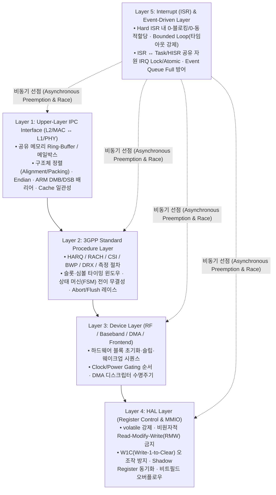

# PHY 임베디드 SW 5-Layer 코드 리뷰 불변조건(Invariants) 카탈로그

> **설계 목적**
> 범용 LLM에게 *"이 C 코드를 리뷰해 줘"*라고만 지시하면 변수명 스타일이나 불필요한 `NULL` 체크 같은 피상적인 코멘트만 남발하고, 정작 **실제 단말 모뎀 크래시(Crash)나 TTI 데드라인 미스(Deadline Miss), 하드웨어 레지스터 오동작**을 유발하는 치명적 결함은 놓친다.
> 본 문서는 우리 PHY SW 그룹의 **5대 아키텍처 계층별 절대 깨져서는 안 되는 불변조건(Invariants)**을 명문화하고, 각 항목을 **(1) 컴파일러/정적 분석(`armclang`/`clang-tidy`)**, **(2) 구조적 AST 스캐너(`ast-grep`)**, **(3) 추론 에이전트(`OpenCode` + `DeepSeek/GLM/Qwen`)** 중 어디서 잡아야 하는지 명확히 매핑한다.

---

## 1. PHY SW 5-Layer 아키텍처 및 결함 전파 경로



---

## 2. 계층별(Layer 1 ~ 5) 핵심 리뷰 불변조건 및 탐지 명세

### Layer 1: Upper-Layer IPC Interface (`ipc/`, `l1_l2_if/`)
상위 L2(MAC/RRC) 코어와 L1(PHY) ARM 코어(또는 DSP) 간 공유 메모리(Shared Memory) 및 하드웨어 메일박스를 통해 메시지를 주고받는 경계 계층이다.

| 규칙 ID | 불변조건 (Invariant) 명칭 | 치명적 버그 시나리오 (Why it kills PHY) | 결정론적 탐지 (`armclang` / `ast-grep`) | `OpenCode` 에이전트 심층 검증 포인트 |
| :---: | :--- | :--- | :--- | :--- |
| **`PHY-IPC-01`** | **IPC 구조체 바이트 정렬 및 패딩 명시** | L2 코어와 L1 코어의 컴파일러 옵션 차이로 구조체 패딩이 달라지면 모든 필드가 밀려 읽힘(Silent Corruption). | `armclang -Wpadded` (IPC 헤더 한정) + `STATIC_ASSERT(sizeof(...) == ...)` 유무 검사 | 신규 필드 추가 시 **4바이트/8바이트 정렬 경계**가 깨지지 않는지, 구버전 L2 펌웨어와의 하위 호환성이 유지되는지 검증 |
| **`PHY-IPC-02`** | **공유 메모리 Write 후 `DMB/DSB` 배리어 및 IPC 트리거 순서** | ARM 약한 메모리 순서(Weak Memory Ordering)로 인해 페이로드가 공유 RAM에 써지기 전에 메일박스 인터럽트 레지스터가 먼저 써져, 상대 코어가 쓰레기 값을 읽음. | `ast-grep`: `ipc_doorbell_set()` 호출 직전 블록 내 `__DMB()` / `__DSB()` 호출 누락 탐지 | 공유 버퍼 포인터/인덱스(`write_idx`) 업데이트와 페이로드 기록 사이에 메모리 배리어 및 캐시 Clean(`SCB_CleanDCache_by_Addr`)이 정확한 순서로 배치되었는지 확인 |
| **`PHY-IPC-03`** | **외부 IPC 파라미터 신뢰 경계 검증 (Untrusted Input Bounds)** | 상위 레이어가 잘못된 `cell_idx`, `harq_id`, `prb_num`을 내려보낼 때 검증 없이 배열 인덱스로 사용하면 즉시 메모리 오염 발생. | `clang-tidy`: `security.ArrayBound` + `ast-grep` 배열 인덱스 직접 참조 감시 | IPC 메시지 수신 핸들러 진입부에서 `MAX_HARQ_PROC`, `MAX_CC_NUM`, `MAX_RB_NUM` 범위 검사가 빠져 있는지 추적 |

```c
// ❌ [BAD: PHY-IPC-02 위반] 배리어 없이 공유 메모리 기록 직후 Doorbell 인터럽트 발생
shm_ring->slot_cmd[w_idx].rnti = rnti;
shm_ring->write_idx = (w_idx + 1) % RING_SIZE; // 컴파일러/CPU가 순서 재정렬 가능!
HAL_IPC_TRIG_REG = 0x1;                        // 상대 코어가 이전 쓰레기 rnti를 읽음!

// ✅ [GOOD] 페이로드 기록 -> DMB 배리어 -> 인덱스 갱신 -> DSB 배리어 -> Doorbell 트리거
shm_ring->slot_cmd[w_idx].rnti = rnti;
__DMB(); // 페이로드 메모리 쓰기 완료 보장
shm_ring->write_idx = (w_idx + 1) % RING_SIZE;
__DSB(); // 인덱스 갱신 완료 후 하드웨어 메일박스 트리거 보장
HAL_IPC_TRIG_REG = 0x1;
```

---

### Layer 2: 3GPP Standard Procedure Layer (`proc/`, `ul/`, `dl/`, `meas/`)
HARQ, RACH, CSI, BWP 스위칭, DRX, 스케줄링 등 3GPP 물리계층 표준 절차를 슬롯(Slot)/심볼(Symbol) 타이밍에 맞춰 구동하는 상태 머신 계층이다.

| 규칙 ID | 불변조건 (Invariant) 명칭 | 치명적 버그 시나리오 | 결정론적 탐지 | `OpenCode` 에이전트 심층 검증 포인트 |
| :---: | :--- | :--- | :--- | :--- |
| **`PHY-PROC-01`** | **FSM 상태 머신 Dead-End 및 비정상 이벤트 방어** | RACH 절차 도중 상위에서 BWP Switch나 Cell Release가 내려올 때 특정 상태(`RACH_WAIT_RAR`)에서 취소 처리가 누락되면 상태 머신이 영구 먹통(Stuck)됨. | `armclang -Wswitch-enum` (열거형 `switch`문에서 누락된 상태 경고) | 상태 전이 표(State Transition)에서 **Abort / Reset / Timeout / Reconfig 이벤트가 모든 활성 상태에서 처리**되고 버퍼/타이머가 해제되는지 추론 |
| **`PHY-PROC-02`** | **SFN / Slot 번호 모듈로(Modulo) 랩어라운드 연산** | `sfn + offset >= 1024` 또는 슬롯 번호 차이를 단순 뺄셈(`cur_slot - prev_slot`)으로 계산하면 SFN 1023 ➡️ 0 경계에서 음수/오버플로우 버그 발생(10.24초마다 장애). | `ast-grep`: `sfn` 또는 `slot` 변수 간 단순 `<` / `>` / `-` 비교 패턴 플래깅 | 모든 프레임/슬롯 타이밍 비교가 `PHY_SLOT_DIFF(a, b)` 같은 **모듈로 랩어라운드 안전 매크로**를 사용하는지 검사 |
| **`PHY-PROC-03`** | **특정 RAT(5G NR / LTE) 수정 시 공통/타 RAT 누락 점검** | 멀티모드 모뎀에서 NR 경로의 버그만 고치고 동일한 구조의 LTE/NB-IoT 핸들러나 복제된 함수를 방치함. | `treepeat` / `code-review-graph`로 유사 AST 구조 함수 검색 | 수정된 프로시저 함수와 대칭되는 타 채널(PDSCH vs PUSCH) 또는 타 RAT 함수에 동일 결함이 존재하는지 교차 질의 |

---

### Layer 3: Device Layer (`dev/`, `rf_drv/`, `dma_drv/`)
RF 트랜시버, 프론트엔드(FEM), 베이스밴드 가속기, DMA 컨트롤러 등 하드웨어 서브시스템의 시퀀스를 제어하는 계층이다.

| 규칙 ID | 불변조건 (Invariant) 명칭 | 치명적 버그 시나리오 | 결정론적 탐지 | `OpenCode` 에이전트 심층 검증 포인트 |
| :---: | :--- | :--- | :--- | :--- |
| **`PHY-DEV-01`** | **Clock / Power Domain 활성화 전 레지스터 접근 금지** | 하드웨어 블록의 Clock Gate나 Power Switch를 켜기 전에 해당 블록의 MMIO 레지스터를 읽거나 쓰면 **ARM Bus Fault (HardFault / Data Abort)**로 즉사함. | `codebase-memory-mcp`로 초기화/슬립 복귀 콜 그래프 추적 | 슬립 해제(Wake-up) 또는 에러 복구 경로에서 `dev_clk_enable()` + 안정화 대기 후 레지스터 접근이 이루어지는지 시퀀스 검증 |
| **`PHY-DEV-02`** | **DMA 전송 중 버퍼 수명주기 및 캐시 일관성 보장** | 지역 변수(Stack 메모리) 주소를 비동기 DMA 소스로 넘기거나, CPU가 쓴 버퍼를 `DCache Clean` 없이 DMA에 넘기면 깨진 파형이 전송됨. | `clang-tidy`: 스택 주소 이스케이프 검사 + `ast-grep` DMA API 호출 패턴 | DMA 디스크립터에 전달되는 버퍼가 비동기 완료 인터럽트 시점까지 유효한 정적/풀 메모리인지, TX 전 Clean / RX 후 Invalidate가 수행되는지 확인 |

---

### Layer 4: HAL Layer — Register Control (`hal/`, `reg/`)
메모리 맵 입출력(MMIO) 레지스터를 직접 읽고 써서 하드웨어를 제어하는 최하위 계층이다. **AI 코드 리뷰에서 결정론적 AST 룰의 효과가 가장 극적인 계층**이다.

| 규칙 ID | 불변조건 (Invariant) 명칭 | 치명적 버그 시나리오 | 결정론적 탐지 (`ast-grep` / `armclang`) | `OpenCode` 에이전트 심층 검증 포인트 |
| :---: | :--- | :--- | :--- | :--- |
| **`PHY-HAL-01`** | **Write-1-to-Clear (`W1C`) 레지스터에 `\|=` 연산 절대 금지** | 인터럽트 상태 클리어 레지스터(`IRQ_STATUS_W1C`)의 특정 비트만 지우려고 `REG \|= (1 << 3)`을 수행하면, **읽어온 순간 1이었던 다른 펜딩 인터럽트 비트들까지 전부 1이 써지면서 동시에 날아가 버림(Lost Interrupt)!** | `ast-grep` 룰로 `*_STATUS*`, `*_CLR*`, `*_W1C*`, `*_PEND*` 레지스터에 `\|=` 사용 시 **즉시 차단** | 하드웨어 레지스터 맵 문서/주석과 대조하여 `W1C` 속성의 레지스터에는 오직 단순 대입(`REG = (1U << bit)`)만 사용했는지 검증 |
| **`PHY-HAL-02`** | **비원자적 Read-Modify-Write (`RMW`) 경쟁 상태 방지** | 태스크 문맥에서 `CTRL_REG \|= EN_BIT`를 수행하는 도중(Read 직후, Write 직전) ISR이 끼어들어 같은 `CTRL_REG`의 다른 비트를 수정하면, 태스크 복귀 후 ISR의 변경 사항을 덮어써 버림. | `ast-grep`: 공유 제어 레지스터에 락 없는 `\|=`, `&= ~` 패턴 탐지 | 해당 레지스터가 하드웨어 `SET`/`CLR` 분리 레지스터를 지원하는지, 아니면 `HAL_REG_RMW_ATOMIC(reg, mask, val)` 또는 `IRQ_LOCK` 내부에서 수행되는지 확인 |
| **`PHY-HAL-03`** | **MMIO 포인터 `volatile` 강제 및 비트필드 오버플로우 방지** | `volatile`이 빠지면 `armclang -O2/-O3` 최적화 시 레지스터 폴링 루프가 무한 루프로 고정되거나 연속 쓰기가 제거됨. 또한 부호 있는 `1 << 31` 시프트는 Undefined Behavior 유발. | `armclang -Wshift-sign-overflow` + `ast-grep` MMIO 캐스팅 내 `volatile` 누락 탐지 | 모든 비트 마스크가 `1U << n` (Unsigned) 형식인지, 멀티비트 필드 삽입 시 `(val & MASK) << SHIFT`로 인접 비트 침범을 막았는지 확인 |
| **`PHY-HAL-04`** | **Write-Only 레지스터와 Shadow Register 동기화** | 하드웨어 설계상 읽기 시 항상 0이 반환되는 Write-Only 모뎀 레지스터를 읽어서 수정하면 기존 설정값이 모두 0으로 초기화됨. | `ast-grep`: `*_WO_*` 또는 Shadow 대상 레지스터 직접 Read 탐지 | 반드시 RAM 상의 `g_hal_shadow_reg`를 업데이트한 뒤 하드웨어 레지스터에 통째로 기록하는지 확인 |

```c
// ❌ [BAD: PHY-HAL-01 위반] W1C(Write-1-to-Clear) 인터럽트 상태 레지스터에 |= 사용
// 현재 비트 0과 비트 3이 모두 1(Pending)인 상태에서 비트 3만 클리어하려는 의도였으나,
// |= 연산이 현재 값(0x9)을 읽어 다시 쓰므로 비트 0 인터럽트까지 증발함!
MODEM_IRQ_STATUS_W1C |= (1U << 3);

// ✅ [GOOD] W1C 레지스터에는 클리어할 비트만 단독으로 대입(=)해야 함
MODEM_IRQ_STATUS_W1C = (1U << 3);
```

---

### Layer 5: Interrupt (ISR) & Event-Driven Activities (`isr/`, `sched/`, `evt/`)
모뎀 심볼/슬롯 타이머 인터럽트, DMA 완료 인터럽트 등 **실시간성(Real-Time Determinism)이 생명인 최우선 감사 계층**이다.

| 규칙 ID | 불변조건 (Invariant) 명칭 | 치명적 버그 시나리오 | 결정론적 탐지 (`ast-grep` / Call-Graph) | `OpenCode` 에이전트 심층 검증 포인트 |
| :---: | :--- | :--- | :--- | :--- |
| **`PHY-ISR-01`** | **ISR 경로 내 블로킹·동적할당·무거운 로그 호출 절대 금지** | Hard ISR(또는 ISR이 호출하는 하위 함수) 안에서 `mutex_lock`, `osDelay`, `malloc`, `free`, 포맷팅 `printf`를 호출하면 즉시 데드락 또는 TTI 데드라인 크래시 발생. | `codebase-memory-mcp`로 `ISR_*` 함수에서 출발하는 모든 하위 Call-Graph에 금지 심볼 존재 여부 추적 | 직접 호출뿐 아니라 **2~3단계 하위 유틸리티 함수 내부에 숨어 있는 블로킹/할당 호출**까지 콜 그래프로 추적해 차단 |
| **`PHY-ISR-02`** | **하드웨어 상태 폴링 루프의 유한 타임아웃(Bounded Wait) 강제** | ISR 또는 HAL에서 `while (!(REG & READY_BIT))`처럼 탈출 카운터 없이 폴링하면, RF/HW 글리치 발생 시 코어 전체가 영구 행(Hang)에 빠지고 워치독 리셋 발생. | `ast-grep`: `while ($COND)` 루프 조건에 레지스터 읽기가 있으면서 루프 내부에 `timeout--` 브레이크가 없는 모든 코드 즉시 검출 | 타임아웃 만료 시 안전한 에러 복구 경로(Error Log 기록 + 상태 복구 반환)가 구현되어 있는지 검증 |
| **`PHY-ISR-03`** | **ISR ↔ Task/HISR 공유 변수 접근 시 원자성 및 가시성 보장** | ISR이 갱신하는 64비트 카운터나 구조체를 일반 태스크가 락 없이 읽으면 32비트 ARM 코어에서 상위/하위 워드가 찢어져 읽히는 **Torn Read** 발생. | `clang-tidy` 동시성 체크 + 공유 전역 변수 참조 그래프 분석 | 32비트 초과 데이터나 복합 구조체 공유 시 `IRQ_SAVE/RESTORE` 또는 Lock-free Seqlock/Atomic이 적용되었는지 검증 |
| **`PHY-ISR-04`** | **Event Queue / HISR 큐 포화(Queue Full) 시 조용한 유실 방지** | 폭주 상황에서 ISR이 이벤트를 큐에 넣을 때 반환값(`QUEUE_FULL`)을 무시하면 상태 머신이 영원히 다음 이벤트를 기다리며 정지함. | `armclang -Wunused-result` (`__attribute__((warn_unused_result))` 적용) | 큐 포화 시 카운터 증가, 크리티컬 어서트 또는 폴백 복구 플래그 설정이 누락되지 않았는지 검증 |

```c
// ❌ [BAD: PHY-ISR-02 위반] 하드웨어 PLL Lock 대기 루프에 타임아웃이 없음 (HW 이상 시 무한 루프)
while ((RF_PLL_STAT_REG & PLL_LOCK_BIT) == 0U) {
    // No timeout escape!
}

// ✅ [GOOD] 반드시 최대 사이클/루프 상한(Bounded Timeout)과 실패 처리를 강제함
uint32_t timeout = PHY_HAL_PLL_LOCK_TIMEOUT_CNT;
while (((RF_PLL_STAT_REG & PLL_LOCK_BIT) == 0U) && (timeout > 0U)) {
    timeout--;
}
if (timeout == 0U) {
    phy_err_report(PHY_ERR_RF_PLL_TIMEOUT, RF_PLL_STAT_REG);
    return PHY_STATUS_HW_TIMEOUT;
}
```

---

## 3. 3중 방어 매트릭스 요약: 무엇을 어떤 도구로 잡는가?

| 방어 계층 | 실행 도구 | 소요 시간 | 토큰 비용 | 담당 불변조건 (Invariants) |
| :--- | :--- | :---: | :---: | :--- |
| **1차: 컴파일러 & 정적 분석** | `armclang` + `clang-tidy` + `cppcheck` + `reviewdog` | `3 ~ 10초` | **0 토큰** | 타입 불일치, `switch` 열거형 누락(`PHY-PROC-01`), 부호 시프트 오버플로우(`PHY-HAL-03`), 반환값 무시(`PHY-ISR-04`), 구조체 패딩 경고(`PHY-IPC-01`) |
| **2차: 구조적 AST 패턴 게이트** | `ast-grep` (`.ast-grep/rules/phy-hal-isr-rules.yml`) | **`< 1초`** | **0 토큰** | `W1C` 레지스터 `\|=` 오용(`PHY-HAL-01`), 타임아웃 없는 `while` 폴링(`PHY-ISR-02`), ISR 내부 금지 함수 직접 호출(`PHY-ISR-01`), IPC 트리거 전 `DMB/DSB` 누락(`PHY-IPC-02`) |
| **3차: 그래프 + 에이전트 추론** | `codebase-memory-mcp` / `code-review-graph` + `OpenCode` (`DeepSeek/GLM/Qwen`) | `20 ~ 60초` | **최소화 (1/10)** | 다단계 함수 호출 건너의 ISR 블로킹(`PHY-ISR-01`), 3GPP 상태 머신 취소/예외 경로 누락(`PHY-PROC-01`), Clock/Power 시퀀스 오류(`PHY-DEV-01`), RMW 경쟁 조건 문맥 판별(`PHY-HAL-02`) |

---

## 🔗 관련 문서 연결
- 마스터 설계서: [[00_PHY_SW_Code_Review_Master_Blueprint]]
- 오픈소스 벤치마크: [[01_OpenSource_Code_Review_Benchmark]]
- 즉시 실행 가능한 설정 파일 모음: `03_PHY_Review_Harness_PoC/` 폴더 내 `.ast-grep/`, `.opencode/`, `.githooks/`, `.github/workflows/`
