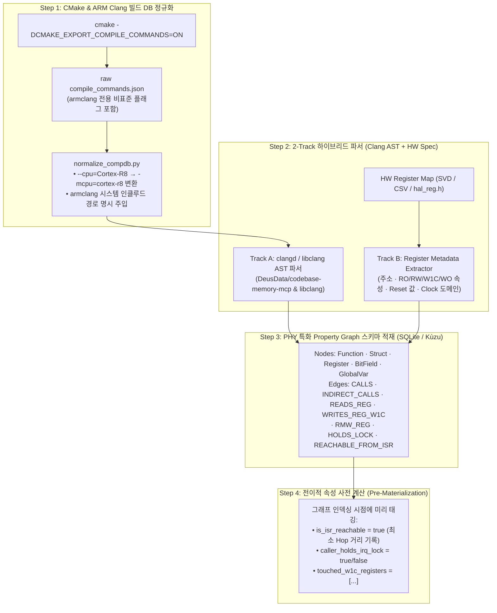
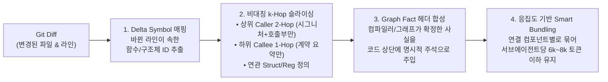

# PHY 임베디드 SW를 위한 Code Graph 구축 및 AI Context Engineering 심층 가이드 (개발 레벨)

> **문서 목적**
> 오픈 웨이트 LLM(`DeepSeek-V3/R1`, `GLM-4.5`, `Qwen3-Coder`)을 `OpenCode`에 연결해 대규모 PHY 임베디드 C/C++ 코드를 리뷰하거나 분석시킬 때, **성패의 90%는 모델의 크기가 아니라 "어떤 Code Graph를 구축하고, 어떻게 Context를 잘라(Slicing) 주입하는가"에 달려 있다.**
> 본 문서는 추상적인 개념 설명을 넘어, 실제 우리 그룹의 **`ARM Clang (armclang)` + `CMake`** 환경에서 **Code Graph를 구축하는 구체적인 파이프라인 코드**와 **토큰을 85~90% 절감하면서 정확도를 높이는 Context Engineering 알고리즘**을 개발 레벨에서 상세히 해부한다.

---

## Part 1. 왜 일반 RAG(벡터 검색)나 단순 파일 주입은 PHY 코드에서 실패하는가?

임베디드 PHY C 코드는 일반 웹 애플리케이션과 구조적으로 완전히 다르다:

1. **조건부 컴파일(`#ifdef`)과 하드웨어 매크로 중첩:**
   - `HAL_REG_WRITE(MODEM_BASE + (cc_idx * 0x400) + REG_OFFSET, val)`처럼 3~4단계 매크로로 감싸진 코드는 텍스트/정규식이나 단순 Tree-sitter 파서로는 어떤 물리 레지스터를 건드리는지 알 수 없다.
2. **함수 포인터 테이블(FSM Dispatch Table)을 통한 간접 호출:**
   - 3GPP 프로시저 상태 머신은 `g_rach_fsm_tbl[state][event](ctx)` 형태의 함수 포인터 배열로 구동된다. 단순 호출 그래프는 여기서 끊어진다.
3. **비동기 실행 문맥(ISR vs HISR vs Task)의 암묵적 공유:**
   - 함수 `phy_harq_buf_reset()` 자체의 코드만 보면 아무 문제가 없어 보이지만, 실제로는 **상위 2단계 위의 `PHY_Slot_Tick_ISR()` 인터럽트 핸들러에서 락 없이 호출**되고 있다면 치명적인 레이스 컨디션이 된다.
4. **오픈 모델의 'Lost-in-the-Middle' 현상:**
   - `Qwen`, `GLM`, `DeepSeek`에 3,000줄짜리 `.c` 파일 5개를 통째로 넣으면(약 60,000 토큰), 모델의 어텐션(Attention)이 분산되어 정작 바뀐 20줄 내부의 부호 비트 시프트(`1 << 31`)나 `W1C` 레지스터 버그를 놓친다.

---

## Part 2. [개발 레벨] ARM Clang + CMake 기반 PHY Code Graph 구축 아키텍처

기존 [[Semantic_CodeGraph_Indexer_Clang]]의 기본 개념을 **실제 PHY 5-Layer 코드 리뷰에 즉시 쓸 수 있는 프로덕션 수준**으로 확장한 4단계 구축 파이프라인이다.



### 2.1 [핵심 함정 해결] `armclang` 전용 `compile_commands.json` 정규화
`CMake`에서 `CMAKE_C_COMPILER=armclang`으로 생성한 `compile_commands.json`을 표준 `clangd`(`codebase-memory-mcp`)나 `clang-tidy`에 그대로 넣으면, `--via`, `--cpu=Cortex-R52`, `--fpu=FPv5-SP` 같은 ARM 컴파일러 고유 플래그 때문에 파싱 에러가 발생할 수 있다.
따라서 인덱싱 직전에 아래 **정규화 필터**를 거치거나 `.clangd` 설정 파일을 두어야 한다:

```yaml
# 프로젝트 루트 .clangd 설정 (armclang 플래그 호환성 보장)
CompileFlags:
  Remove:
    - --via*
    - --cpu=*
    - --fpu=*
    - --apcs=*
    - -Warmcc*
  Add:
    - -target
    - arm-none-eabi
    - -D__ARMCC_VERSION=6210000
```

### 2.2 PHY 도메인 특화 Graph Schema (Nodes & Edges 설계)
단순히 `Function -> CALLS -> Function`만 저장하면 PHY 코드 리뷰를 할 수 없다. 반드시 아래 **5종 노드와 7종 엣지 속성**을 추출해야 한다.

#### (1) Node 스키마 (SQLite / JSON-Graph / Kùzu 호환)
| Node Label | 핵심 Properties (개발 레벨 필드) | 역할 |
| :--- | :--- | :--- |
| **`Function`** | `id`, `name`, `file`, `start_line`, `end_line`, `signature`, **`exec_context`** (`"ISR"` \| `"HISR"` \| `"TASK"` \| `"UNKNOWN"`), **`isr_distance`** (`0, 1, 2, ...`), **`has_unbounded_loop`** (`bool`), **`calls_blocking_api`** (`bool`) | 함수가 인터럽트 문맥에서 몇 홉 만에 호출되는지 즉시 판별 |
| **`StructType`** | `id`, `name`, `sizeof_bytes`, `align_bytes`, `is_packed` (`bool`), `layer` (`"IPC"` \| `"HAL"` \| `"INTERNAL"`), `fields_json` | L1-L2 IPC 구조체 레이아웃 및 바이트 크기 변화 추적 |
| **`HWRegister`** | `id`, `name`, `base_addr`, `offset`, **`access_type`** (`"RW"` \| `"RO"` \| **`"W1C"`** \| **`"WO"`**), `clock_domain`, `shadow_var` | `W1C` 레지스터에 `\|=` 연산 시 즉시 적발하기 위한 메타데이터 |
| **`GlobalState`** | `id`, `name`, `type`, `bit_width` (`32` \| `64` \| `struct`), `is_volatile` (`bool`), `shared_across_isr_task` (`bool`) | ISR ↔ Task 간 공유 변수 레이스 및 64비트 Torn Read 추적 |
| **`FSMTable`** | `id`, `table_name`, `state_enum`, `event_enum`, `handler_funcs` (`List[func_id]`) | 함수 포인터 배열로 구현된 3GPP 상태 머신의 간접 호출 연결 |

#### (2) Edge 스키마
| Edge Type | Source ➡️ Target | Edge Properties |
| :--- | :--- | :--- |
| **`CALLS`** | `Function` ➡️ `Function` | `call_line`, **`under_irq_lock`** (`bool` — 호출 시점에 `IRQ_LOCK` 활성 여부!), `in_loop` (`bool`) |
| **`INDIRECT_CALLS`** | `Function` ➡️ `Function` | `via_table` (함수 포인터 구조체/배열을 통한 상태 머신 전이 호출) |
| **`ACCESSES_REG`** | `Function` ➡️ `HWRegister` | `line`, **`op`** (`"READ"` \| `"WRITE_ASSIGN"` \| **`"RMW_OR"`** \| **`"RMW_AND"`**), **`has_barrier_after`** (`"DMB"` \| `"DSB"` \| `"NONE"`) |
| **`MUTATES_GLOBAL`** | `Function` ➡️ `GlobalState` | `line`, `under_irq_lock` (`bool`), `is_atomic` (`bool`) |

---

## Part 3. [개발 레벨] AI에게 코드베이스를 이해시키는 Context Engineering 방법론

코드 그래프를 만들었다면, 이제 PR이 올라왔을 때 **`OpenCode` 에이전트(`DeepSeek / GLM / Qwen`)에게 최소한의 토큰으로 가장 밀도 높은 컨텍스트를 조립해 먹이는 방법(Context Management)**이 핵심이다.



### 기법 1: 비대칭 $k$-Hop 컨텍스트 슬라이싱 (Asymmetric Skeleton Slicing)
수백 줄짜리 상위 호출자(Caller)와 하위 피호출자(Callee)의 **전체 함수 본문(Body)을 다 넣으면 토큰이 폭발**한다. 대신 **거리(Hop)와 방향에 따라 코드를 골격화(Skeletonize)**하여 주입한다:

| 대상 노드 (변경된 함수 $F_0$ 기준) | 컨텍스트 주입 수준 (Pruning Rule) | 토큰 절감률 |
| :--- | :--- | :---: |
| **1. 수정 대상 함수 ($F_0$, `0-Hop`)** | **함수 전체 본문 (Full Body) + Git Diff (`+/-`) 마커** | 기준 (`100%`) |
| **2. 상위 호출자 ($F_{\text{caller}}$, `Inbound 1~2 Hop`)** | 함수 전체가 아니라 **`시그니처 + IRQ_LOCK 획득 줄 + F_0를 호출하는 전후 5줄`만 발췌 (Call-site Slice)** | **85% 절감** |
| **3. 하위 피호출자 ($F_{\text{callee}}$, `Outbound 1 Hop`)** | 본문 생략! **`함수 시그니처 + 주석 계약 + 그래프가 요약한 부작용(예: [Modifies: REG_CTRL, Blocks: False])`만 3줄로 주입** | **92% 절감** |
| **4. 참조 타입 및 레지스터 (`Struct` / `HWRegister`)** | 수천 줄짜리 `hal_reg_map.h` 전체가 아니라 **$F_0$가 실제 접근한 구조체와 레지스터 매크로 정의 줄만 발췌** | **98% 절감** |

### 기법 2: 컴파일러/그래프 확정 사실의 선행 주입 (Compiler-Fact Header Injection)
오픈 모델(`Qwen`, `GLM`, `DeepSeek`)이 코드를 읽고 스스로 추론하느라 토큰과 어텐션을 쓰지 않도록, **그래프 쿼리로 이미 100% 확정된 사실을 코드 블록 맨 위에 `[COMPILER_VERIFIED_FACTS]` 헤더로 박아 넣는다.**

```markdown
<!-- OpenCode 에이전트에게 실제로 주입되는 Context Slice 예시 -->
### [BUNDLE #1] Target Function: `hal_modem_irq_ack()` (File: `src/hal/hal_irq.c:142-168`)

> **[COMPILER_VERIFIED_FACTS — DO NOT GUESS, USE THESE AS GROUND TRUTH]**
> - **Execution Context:** `ISR_REACHABLE` (Hop=1 from `PHY_Slot_Timer_ISR` at `src/isr/phy_isr.c:88`)
> - **Caller Lock State:** `PHY_Slot_Timer_ISR` calls `hal_modem_irq_ack()` with `under_irq_lock = True` (Hard IRQ context)
> - **Touched Hardware Registers:**
>   1. `MODEM_IRQ_STAT_W1C` (`0x4001_0014`) — **Attribute: `W1C` (Write-1-to-Clear)**, Operation in diff: **`RMW_OR (|=)` [HAZARD!]**
>   2. `MODEM_DMA_TRIG` (`0x4001_0020`) — **Attribute: `WO` (Write-Only)**, Barrier before write: **`NONE` [HAZARD!]**
> - **Shared Globals Mutated:** `g_slot_tick_cnt` (`uint64_t`, 64-bit on 32-bit ARM, also read by `proc_ul_schedule_task` without lock!)
```

이렇게 주입하면 **모델 크기가 작은 오픈 모델이라도 환각(Hallucination)이 0%로 수렴하고, 시니어 아키텍트 수준의 100% 정확한 지적**을 내놓게 된다!

### 기법 3: 연결 컴포넌트 기반 스마트 번들링 (`Alibaba Open-Code-Review` 방식)
하나의 PR에서 파일 12개가 수정되었을 때 이를 한 번에 LLM에 넣지 않고, **Call-Graph 및 Header 의존성 그래프에서 서로 연결된 파일끼리 클러스터링(Connected Components)**하여 독립된 번들(Bundle)로 나눈다:
- **Bundle A (`hal_rf.c` + `hal_rf.h` + `phy_rx_isr.c`)** ➡️ `phy-isr-hal-auditor` 서브에이전트에 할당 (`~4,500 tokens`)
- **Bundle B (`ipc_msg.h` + `proc_rach.c`)** ➡️ `phy-ipc-3gpp-auditor` 서브에이전트에 할당 (`~3,800 tokens`)

각 서브에이전트는 자기 번들만 깨끗한 컨텍스트 윈도우에서 심사한 뒤, 결과 JSON만 `phy-chief-verifier`(`DeepSeek-R1`)에게 넘긴다.

---

## Part 4. 실전 구현 코드: `phy_context_slicer.py`

우리 그룹 리포지토리의 `03_PHY_Review_Harness_PoC/scripts/phy_context_slicer.py`에 탑재된 실전 컨텍스트 슬라이서 & 그래프 빌더의 핵심 동작 구조는 다음과 같다:

1. `compile_commands.json` 및 소스 트리를 스캔하여 **함수, 호출 관계(`CALLS`), 하드웨어 레지스터 접근(`W1C`/`RMW`), ISR 도달 가능성(`isr_distance`)**을 그래프 DB로 색인한다.
2. 현재 Git Diff를 파싱하여 변경된 함수 목록을 찾고, 각 함수에 대해 **`[COMPILER_VERIFIED_FACTS]` + `2-Hop Caller Slice` + `1-Hop Callee Summary` + `Register/Struct Slice`**로 구성된 토큰 최적화 마크다운 번들을 자동 생성한다.
3. 이 출력을 `opencode run`의 프롬프트 입력으로 바로 파이핑(`|`)한다.

---

## 🔗 관련 문서 연결
- 마스터 설계서: [[00_PHY_SW_Code_Review_Master_Blueprint]]
- 오픈소스 벤치마크: [[01_OpenSource_Code_Review_Benchmark]]
- 5-Layer 불변조건 카탈로그: [[02_PHY_5Layer_Review_Invariants_Catalog]]
- 실행 스크립트: `03_PHY_Review_Harness_PoC/scripts/phy_context_slicer.py`
