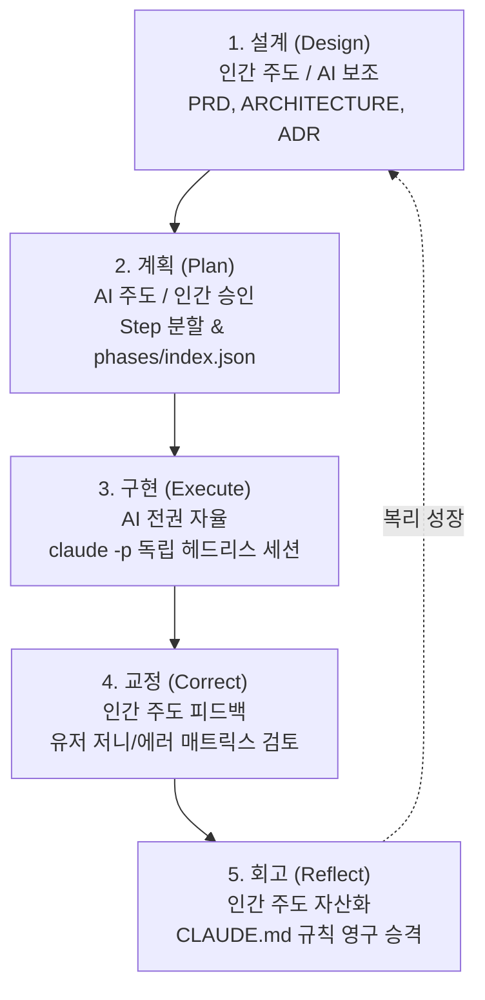

# Spec-Driven Development (스펙 주도 개발)

**Spec-Driven Development (SDD, 스펙 주도 개발)**은 인간 엔지니어가 명확한 자연어 스펙(Natural Language Specification)을 선행 설계하고, AI 코딩 에이전트가 이를 기반으로 **계획(Plan) ➡️ 구현(Execute) ➡️ 교정(Correct) ➡️ 회고(Reflect)**를 자율 수행하도록 지휘하는 AI-Native 개발 패러다임입니다.

---

## 1. TDD의 한계와 SDD의 필요성

전통적 **TDD(Test-Driven Development)**는 "어떻게 동작해야 하는가"가 이미 명확히 규정된 영역(버그 픽스, 단일 함수, 레거시 인터페이스 리팩토링)에서는 강력한 가드레일 역할을 합니다.

그러나 **신규 프로덕트 기획, 복잡한 통신 프로토콜 모듈 설계, 미지의 도메인 시스템 구축**처럼 **"무엇을 만들어야 하는가"부터 모호한 자리**에서는 테스트 케이스 자체를 먼저 작성할 수 없는 치명적 병목이 발생합니다.

| 비교 항목 | TDD (Test-Driven Development) | SDD (Spec-Driven Development) |
| :--- | :--- | :--- |
| **적용 시점** | 동작 사양이 이미 명확히 정의된 단계 | 요구사항과 목표가 모호한 신규 기획 단계 |
| **선행 산출물** | 단위 테스트 코드 (`*.test.ts`, `test_*.py`) | 자연어 스펙 문서 (`PRD.md`, `ARCHITECTURE.md`, `ADR.md`) |
| **엔지니어 역할** | 테스트 코드 작성자 (Author) | 아키텍처 의사결정자 및 검토자 (Reviewer/Architect) |
| **핵심 병목** | 테스트 및 구현 코드 작성 | **스펙 설계(Design)** 및 **에이전트 산출물 검토(Review)** |
| **AI 협업 방식** | AI에게 테스트 없이 코드부터 짜지 말 것을 강제 | AI에게 스펙 기반 Step 분할과 서브프로세스 자가 교정 위임 |

---

## 2. SDD를 위한 5대 사고방식 전환 (5 Mindset Shifts)

1. **Spec First, Code Second**: 코드를 건드리기 전에 자연어 스펙부터 작성한다. 모호한 프롬프트는 무한 수정 핑퐁을 낳고, 명확한 스펙은 단번에 프로덕션 코드로 직행한다.
2. **Reviewer, Not Author**: 인간은 더 이상 타이핑하는 코더(Author)가 아니다. 쉬운 코딩은 AI에 넘기고, 인간은 아키텍처·엣지케이스·도메인 맥락을 판단하는 리뷰어(Judge)가 된다.
3. **지식의 외부화 (Externalize Mental Context)**: 개발자 머릿속 암묵지(패턴, 컨벤션, 의도)를 `CLAUDE.md`, `ADR.md`로 외부화한다. 문서화되지 않은 지식은 AI가 알 수 없다.
4. **설계가 유일한 병목 (Attention on Design)**: 100명의 엔지니어 몫을 AI가 코딩하므로 코딩은 더 이상 병목이 아니다. 인간의 주의력 80%는 스펙 설계에 투입되어야 한다.
5. **학습 루프 구축 (Closed Learning Loop)**: AI의 실패는 환경 개선의 기회다. 실패 원인을 시스템 가드레일로 영구 승격시켜 **"50번째 세션은 첫 번째 세션보다 압도적으로 생산적인 환경"**을 구축한다.

---

## 3. SDD 5단계 라이프사이클 루프

---

## 4. 좋은 스펙의 5대 필수 요소

1. **Inputs & Outputs (입출력)**: 입력 데이터와 관측 가능한 기대 출력의 형태.
2. **Success Criteria (성공 기준)**: 측정 가능한 AC (예: 응답시간 < 2초, `npm test` 통과).
3. **Constraints (제약 사항)**: 라이브러리 제한, 외부 API 격리 라우트 강제 등 지켜야 할 경계.
4. **Scope & Out-of-Scope (범위)**: 이번 작업에서 절대 하지 않을 항목을 명시하여 AI의 오버엔지니어링 억제.
5. **Edge Cases (예외 처리)**: API 제한, 네트워크 단절 시의 에러 처리 매트릭스.

---

## 5. 프로젝트 확장 시: 계층형 스펙 (Hierarchical Specs)

프로젝트 규모가 커질 경우, 단일 거대 스펙 문서는 AI의 컨텍스트 윈도우 압축 과정에서 유실됩니다. 따라서 **Master Spec** 아래에 독립 세션 크기의 **Component Specs**를 계층 분할하여 관리합니다:
- **Master Spec**: 전체 시스템 비전, 코어 아키텍처 규칙, 전사 보안 제약.
- **Component Spec (Phase 단위)**: 단일 기능 모듈, API 레이어, 독립 서비스.

---

## 6. 연결된 지식
- [[concepts/harness-engineering|하네스 엔지니어링 (Harness Engineering)]] — 스펙을 자율 실행하는 환경과 가드레일 설계
- [[entities/harness-framework|Harness Framework (jha0313/harness_framework)]] — SDD를 구현한 오픈소스 파이썬 오케스트레이터
- [[concepts/vibe-coding|바이브 코딩 (Vibe Coding)]] — 감(Intuition) 중심 코딩에서 스펙 중심 시스템 엔지니어링으로의 성숙
- [[concepts/clang-codegraph|Clang 코드그래프]] — 레거시 C/C++ 및 임베디드 SW를 위한 시맨틱 스펙 추출 기반
